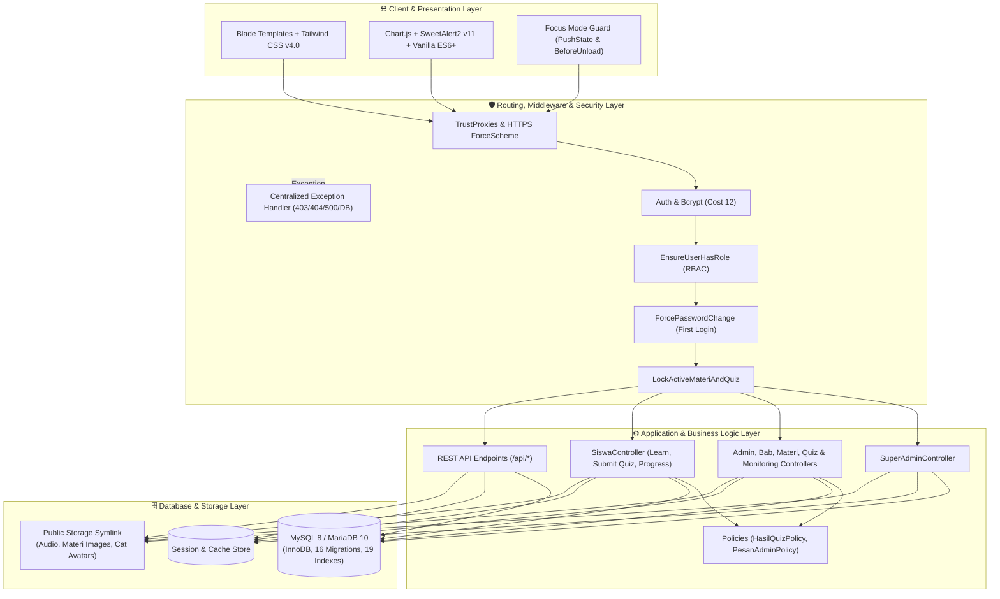
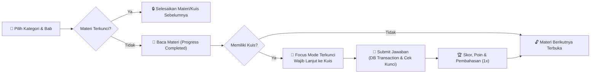

<div align="center">

# 🐾 ENGLIFY — English Learning Gamified Platform

**Platform Pembelajaran Bahasa Inggris Interaktif Berbasis Web dengan Sistem Gamifikasi, Sequential Lock & Evaluasi Terintegrasi**

[](https://www.php.net/)
[](https://laravel.com/)
[](https://tailwindcss.com/)
[](https://www.mysql.com/)
[](https://vitejs.dev/)
[](https://opensource.org/licenses/MIT)

<br />

🌐 **[Live Production](https://englify.my.id)** &nbsp;•&nbsp;
📐 **[Arsitektur](#-arsitektur-sistem)** &nbsp;•&nbsp;
🚀 **[Instalasi](#-panduan-instalasi)** &nbsp;•&nbsp;
⚙️ **[Konfigurasi Env](#-konfigurasi-environment-env)** &nbsp;•&nbsp;
📡 **[API Docs](docs/API_DOCUMENTATION.md)** &nbsp;•&nbsp;
📮 **[Postman](api_collection.json)**

</div>

---

## 📋 Daftar Isi

1. [Tentang Proyek](#-tentang-proyek)
2. [Arsitektur Sistem](#-arsitektur-sistem)
3. [Fitur Utama Per Peran](#-fitur-utama-per-peran)
4. [Struktur Direktori](#-struktur-direktori)
5. [Panduan Instalasi](#-panduan-instalasi)
6. [Konfigurasi Environment (`.env`)](#-konfigurasi-environment-env)
7. [Akun Demo (*Default Seeder*)](#-akun-demo-default-seeder)
8. [Dokumentasi API & Pemodelan](#-dokumentasi-api--pemodelan)
9. [Pengujian (*Testing*)](#-pengujian-testing)
10. [Tim Pengembang & Lisensi](#-tim-pengembang--lisensi)

---

## 📖 Tentang Proyek

**Englify** adalah *Learning Management System (LMS)* bertema gamifikasi edukatif yang dirancang khusus untuk kompetensi Bahasa Inggris (**Speaking**, **Writing**, **Listening**, dan **Reading**) di **SMK Budi Bakti Ciwidey** sebagai proyek **Uji Kompetensi Keahlian (UKK) 2026**.

Berbeda dengan platform belajar biasa, Englify menerapkan pendekatan **"Read & Test in One Flow"** (*Sequential Learning Flow*). Siswa diwajibkan menuntaskan materi secara berurutan per bab dan langsung menyelesaikan kuis evaluasi dengan isolasi fokus penuh (*Focus Mode Anti-Exit Lock*) sebelum materi berikutnya terbuka.

---

## 📐 Arsitektur Sistem

Englify dibangun menggunakan pola arsitektur **MVC (Model-View-Controller)** berbasis **Laravel 12** yang dipadukan dengan lapisan keamanan *Middleware Pipeline*, otorisasi *Policy*, serta penanganan eksepsi terpusat di [`bootstrap/app.php`](bootstrap/app.php).

### Diagram Arsitektur Infrastruktur



### Alur Pembelajaran Sekuensial (*Sequential Learning Flow*)



### Ringkasan Tech Stack

| Lapisan | Teknologi & Spesifikasi |
| :--- | :--- |
| **Backend Core** | PHP `^8.2`, Laravel Framework `^12.0`, Eloquent ORM, Laravel Policies |
| **Frontend Styling** | Tailwind CSS `^4.0`, `@tailwindcss/vite`, Vite `^6.0`, Blade Components |
| **Interaktivitas & Visual** | Chart.js, SweetAlert2 v11, *Word-Style Dual-Mode Rich Text Editor* |
| **Database** | MySQL 8.x / MariaDB 10.x (Engine InnoDB, `utf8mb4_unicode_ci`, 16 Migrasi, 19 Indeks) |
| **Keamanan & Infrastruktur** | Bcrypt Hashing (12 Rounds), `TrustProxies('*')`, `URL::forceScheme('https')` |
| **Testing & Kualitas Kode** | PHPUnit `^11.5.3`, Laravel Pint `^1.13` |

---

## ✨ Fitur Utama Per Peran

<details open>
<summary><b>👨‍🎓 1. Siswa (Learner Experience)</b></summary>

* **Alur Belajar Berjenjang:** Hierarki rapi (`Kategori Divisi` → `Bab` → `Materi` → `Quiz`) dengan status gembok dinamis.
* **Focus Mode Anti-Exit Lock:** Mengunci navigasi navbar dan rute umum saat siswa sedang membaca materi yang memiliki kuis atau sedang mengerjakan ujian.
* **Kuis Interaktif + Audio Listening:** Mendukung *countdown timer*, pengacakan pilihan jawaban, serta pemutar audio bawaan untuk soal *Listening*.
* **Proteksi Kunci Jawaban:** Pembahasan soal dan kunci jawaban hanya dapat dilihat **satu kali** tepat setelah kuis dikumpulkan; kunjungan riwayat selanjutnya hanya menampilkan skor.
* **Gamifikasi & Persona:** Perolehan total poin akumulatif, grafik progres, lencana pencapaian, pesan pengingat (*reminder*), serta **6 pilihan avatar maskot kucing Englify**.

</details>

<details>
<summary><b>👩‍🏫 2. Admin Divisi (Pengajar & Kurikulum)</b></summary>

* **Word-Style Dual-Mode Editor:** Penyusun materi teks kaya dengan *Mode Standar* dan *Mode Layar Penuh*, penomoran otomatis, penanda anak judul tebal, unggah foto langsung (*inline upload*), dan kotak catatan (*callout*).
* **Manajemen Kurikulum & Bank Kuis:** Kelola Kategori, Bab, Materi, butir soal pilihan ganda, dan berkas audio `.mp3`/`.wav`.
* **Monitoring & Evaluasi Real-time:** Pantau persentase progres membaca seluruh siswa, rekap hasil kuis tersimpan, rata-rata nilai kelas, total poin, dan rincian jawaban per butir soal.
* **Kirim Reminder:** Mengirimkan pengingat belajar langsung ke kotak masuk siswa.

</details>

<details>
<summary><b>🛡️ 3. Super Admin (Administrator Sistem)</b></summary>

* **Manajemen Pengguna & RBAC:** Tambah, ubah, dan kelola status aktif/nonaktif seluruh akun (Super Admin, Admin Divisi, Siswa) beserta paksaan ganti password login pertama (`must_change_password`).
* **System Overview & Health Check:** Pemantauan status koneksi basis data (`Normal` / `Gangguan`), versi server/PHP, kapasitas disk, dan grafik pertumbuhan akun.
* **Moderasi Ulasan:** Mengelola ulasan dan testimoni siswa untuk ditampilkan di halaman *landing page*.

</details>

---

## 📂 Struktur Direktori

```text
englify-app/
├── app/
│   ├── Http/
│   │   ├── Controllers/
│   │   │   ├── admin/              # AdminController, BabController, KategoriController, MateriController, QuizController, MonitoringController
│   │   │   ├── siswa/              # SiswaController (Dashboard, Baca Materi, Kuis, Progres, Reminder, Profil)
│   │   │   ├── superadmin/         # SuperAdminController (Manajemen User, Sistem & Profil)
│   │   │   ├── AuthController.php  # Autentikasi, Regenerasi Sesi & Ganti Password Wajib
│   │   │   └── ReviewController.php
│   │   └── Middleware/
│   │       ├── EnsureUserHasRole.php         # Proteksi RBAC berbasis peran
│   │       ├── ForcePasswordChange.php       # Wajib ganti password siswa login pertama
│   │       └── LockActiveMateriAndQuiz.php   # Pengunci navigasi selama materi/kuis aktif
│   ├── Models/                     # User, Role, Kategori, Bab, Materi, Quiz, HasilQuiz, JawabanUser, ProgressMateri, PesanAdmin, Review
│   ├── Policies/                   # HasilQuizPolicy, PesanAdminPolicy
│   ├── Providers/                  # AppServiceProvider (Policies, HTTPS Scheme, View Composers)
│   └── Support/                    # SystemNotifications helper
├── bootstrap/
│   └── app.php                     # Konfigurasi Routing, Middleware Aliases & Exception Handler SOP
├── config/                         # Konfigurasi database, session, auth, cache, dll.
├── database/
│   ├── migrations/                 # 16 berkas migrasi terstruktur & indeks performa
│   └── seeders/                    # DatabaseSeeder & SuperAdminSeeder
├── docs/
│   ├── Pemodelan UKK/              # Activity Diagram, ERD, Flowchart, Use Case, User Flow, Wireframe
│   ├── API_DOCUMENTATION.md        # Dokumentasi spesifikasi seluruh endpoint REST API
│   ├── api_collection.json         # Koleksi Postman v2.1.0 (salinan)
│   └── PRD_ENGLIFY.md              # Product Requirement Document lengkap
├── public/                         # Entry point web & hasil build aset Vite (public/build/)
├── resources/
│   ├── css/ & js/                  # Aset sumber Tailwind CSS v4 & JS
│   └── views/                      # Blade Templates (landing, auth, superadmin, admin, siswa, errors)
├── routes/
│   ├── web.php                     # Rute web lengkap per peran
│   └── api.php                     # Rute REST API (/api/*) dengan proteksi RBAC
├── tests/                          # Automated Feature & Unit Tests (PHPUnit)
├── .env.example                    # Template variabel lingkungan standar
├── api_collection.json             # Berkas Postman Collection siap import
├── composer.json                   # Dependensi PHP & Composer Scripts
├── package.json                    # Dependensi Frontend & Vite Scripts
└── README.md                       # Berkas dokumentasi utama repositori
```

---

## 🚀 Panduan Instalasi

### 1. Prasyarat Sistem
Pastikan perangkat atau server Anda telah memenuhi kebutuhan minimum berikut:
* **PHP:** `>= 8.2` (ekstensi aktif: `pdo_mysql`, `mbstring`, `openssl`, `tokenizer`, `xml`, `ctype`, `json`, `fileinfo`, `gd`)
* **Composer:** `>= 2.x`
* **Node.js & NPM:** Node.js `>= 18.x`
* **Database:** MySQL `>= 8.0` atau MariaDB `>= 10.4`

### 2. Instalasi di Lingkungan Lokal (*Development*)

```bash
# 1. Clone repositori
git clone https://github.com/trespage/englify-lunarway.git
cd englify-lunarway

# 2. Install seluruh dependensi backend (PHP) & frontend (Node)
composer install
npm install

# 3. Salin template environment dan buat Application Key
cp .env.example .env
php artisan key:generate

# 4. (Setelah mengatur DB di .env) Jalankan migrasi tabel dan seeder awal
php artisan migrate --seed

# 5. Buat tautan simbolik storage untuk unggahan gambar & audio
php artisan storage:link

# 6. Kompilasi aset Tailwind CSS & Vite
npm run build
```

Jalankan server pengembangan lokal:
```bash
# Opsi A: Jalankan server Laravel standar
php artisan serve

# Opsi B: Jalankan server, queue, log pail, dan Vite HMR sekaligus (dari composer.json)
composer run dev
```
Aplikasi dapat diakses melalui `http://127.0.0.1:8000`.

### 3. Catatan Deployment ke Hosting (*Production*)

```bash
# Optimalkan autoloader & cache konfigurasi pada server hosting
composer install --optimize-autoloader --no-dev
php artisan config:cache
php artisan route:cache
php artisan view:cache
```

> [!IMPORTANT]
> Sebelum mengunggah ke *shared hosting* yang tidak memiliki Node.js, pastikan Anda sudah menjalankan `npm run build` di komputer lokal terlebih dahulu sehingga folder `public/build/` ikut terunggah ke server.

---

## ⚙️ Konfigurasi Environment (`.env`)

Sesuaikan berkas `.env` berdasarkan template [`.env.example`](.env.example). Berikut panduan pengisian variabel penting untuk **Lokal** dan **Production**:

### A. Konfigurasi Aplikasi & Keamanan

| Variabel | Contoh Lokal | Contoh Production (*Hosting*) | Keterangan |
| :--- | :--- | :--- | :--- |
| `APP_NAME` | `Englify` | `Englify` | Nama aplikasi yang ditampilkan di judul & email. |
| `APP_ENV` | `local` | `production` | Mode environment (`production` otomatis mengaktifkan `HTTPS` di `AppServiceProvider`). |
| `APP_KEY` | `base64:...` | `base64:...` | Wajib di-generate dengan `php artisan key:generate`. |
| `APP_DEBUG` | `true` | **`false`** | **Wajib `false` di production** agar pesan galat database kustom aktif dan tidak membocorkan *stack trace*. |
| `APP_URL` | `http://127.0.0.1:8000` | `https://englify.my.id` | URL utama aplikasi untuk aset dan redirect. |
| `APP_TIMEZONE` | `Asia/Jakarta` | `Asia/Jakarta` | Sinkronisasi waktu WIB (GMT+7) untuk log & timestamp kuis. |
| `BCRYPT_ROUNDS` | `12` | `12` | Tingkat kompleksitas hashing password Bcrypt. |

### B. Konfigurasi Database & Sesi

| Variabel | Contoh Lokal | Contoh Production (*Hosting*) | Keterangan |
| :--- | :--- | :--- | :--- |
| `DB_CONNECTION` | `mysql` | `mysql` | Gunakan `mysql` atau `mariadb` (default `.env.example` adalah `sqlite`). |
| `DB_HOST` | `127.0.0.1` | `localhost` *(atau host DB hosting)* | Pada cPanel Linux, `localhost` memakai UNIX socket yang lebih efisien. |
| `DB_PORT` | `3306` | `3306` | Port koneksi MySQL/MariaDB. |
| `DB_DATABASE` | `englify_db` | `nama_db_hosting` | Nama basis data target. |
| `DB_USERNAME` | `root` | `user_db_hosting` | Username akses database. |
| `DB_PASSWORD` | *(kosong)* | `password_kuat_db` | Kata sandi akses database. |
| `SESSION_DRIVER` | `database` | `database` / `file` | Jika shared hosting memiliki limit koneksi MySQL ketat saat ujian serentak, gunakan `file` untuk menghemat koneksi DB. |
| `SESSION_LIFETIME` | `120` | `120` | Masa aktif sesi dalam menit. |
| `SESSION_SECURE_COOKIE` | `false` | `true` | Aktifkan `true` jika hosting sudah menggunakan HTTPS/SSL penuh. |
| `CACHE_STORE` | `database` | `database` / `file` | Driver penyimpanan cache aplikasi. |
| `FILESYSTEM_DISK` | `local` | `local` | Penyimpanan berkas di `storage/app`. |

<details>
<summary><b>📄 Contoh Template Lengkap `.env` untuk Production Hosting</b></summary>

```ini
APP_NAME=Englify
APP_ENV=production
APP_KEY=base64:ISI_DENGAN_HASIL_KEY_GENERATE
APP_DEBUG=false
APP_URL=https://englify.my.id
APP_TIMEZONE=Asia/Jakarta

APP_LOCALE=id
APP_FALLBACK_LOCALE=en

BCRYPT_ROUNDS=12

LOG_CHANNEL=stack
LOG_STACK=single
LOG_LEVEL=error

DB_CONNECTION=mysql
DB_HOST=localhost
DB_PORT=3306
DB_DATABASE=englify_prod_db
DB_USERNAME=englify_prod_user
DB_PASSWORD=MASUKKAN_PASSWORD_KUAT

SESSION_DRIVER=file
SESSION_LIFETIME=120
SESSION_ENCRYPT=false
SESSION_PATH=/
SESSION_DOMAIN=null
SESSION_SECURE_COOKIE=true

BROADCAST_CONNECTION=log
FILESYSTEM_DISK=local
QUEUE_CONNECTION=database
CACHE_STORE=database

VITE_APP_NAME="${APP_NAME}"
```

</details>

---

## 🔑 Akun Demo (*Default Seeder*)

Setelah menjalankan perintah `php artisan db:seed` ([`DatabaseSeeder.php`](database/seeders/DatabaseSeeder.php)), Anda dapat langsung masuk menggunakan akun uji coba berikut:

| Peran (*Role*) | Email | Username | Password | Hak Akses |
| :--- | :--- | :--- | :--- | :--- |
| **Super Admin** | `superadmin@englify.com` | `superadmin` | `password123` | Kontrol penuh pengguna & sistem |
| **Admin Divisi** | `adminenglish@englify.com` | `adminenglish` | `password123` | Kelola materi, bab, kuis & monitoring |
| **Siswa** | `siswa@englify.com` | `siswa` | `password123` | Belajar materi, kuis & lihat progres |

> [!WARNING]
> Pastikan untuk mengganti kata sandi seluruh akun default sebelum aplikasi digunakan di lingkungan *production* nyata.

---

## 📡 Dokumentasi API & Pemodelan

Seluruh dokumentasi teknis dan pemodelan sistem tersedia lengkap di dalam repositori:

* **Spesifikasi REST API:** [`docs/API_DOCUMENTATION.md`](docs/API_DOCUMENTATION.md) — Dokumentasi terperinci endpoint `/api/kategori`, `/api/bab`, `/api/materi`, `/api/quiz`, `/api/reviews`, `/api/monitoring`, `/api/users`, dan `/api/siswa/progress` lengkap beserta skema DTO dan aturan RBAC.
* **Postman Collection v2.1.0:** [`api_collection.json`](api_collection.json) (juga tersedia di [`docs/api_collection.json`](docs/api_collection.json)) — Siap di-import ke aplikasi **Postman** untuk pengujian API instan.
* **Product Requirement Document:** [`docs/PRD_ENGLIFY.md`](docs/PRD_ENGLIFY.md) — Spesifikasi produk, daftar kebutuhan fungsional/non-fungsional, dan SOP teknis.
* **Pemodelan Sistem UKK:** Folder [`docs/Pemodelan UKK/`](docs/Pemodelan%20UKK/) — Berisi *ERD*, *Use Case*, *Activity Diagram*, *Flowchart*, *User Flow*, dan *Wireframe*.

---

## 🧪 Pengujian (*Testing*)

Jalankan seluruh skenario pengujian otomatis (**PHPUnit**) dengan perintah:

```bash
php artisan test
```

Untuk memeriksa format penulisan kode agar tetap rapi sesuai standar Laravel (*PSR-12*):

```bash
./vendor/bin/pint --test
```

---

## 👥 Tim Pengembang & Lisensi

Dikembangkan dengan dedikasi oleh **Tim LunarWay** — Program Keahlian Rekayasa Perangkat Lunak (RPL / PPLG), **SMK Budi Bakti Ciwidey** untuk **UKK 2026**:

| Nama | Peran | Fokus Tanggung Jawab |
| :--- | :--- | :--- |
| **Anggia Tresa Putri** | *Backend & Database Developer* | Arsitektur database (16 migrasi & 19 indeks), Eloquent ORM, Security Middleware, Policies, REST API & PHPUnit Testing |
| **Nur Aprilia** | *Frontend Developer & UI/UX Designer* | Blade Master Layouts, Tailwind CSS v4, Chart.js, SweetAlert2 v11, Focus Mode UI, Word-Style Rich Editor & Avatar Maskot |

---

<div align="center">

Proyek ini dirilis di bawah lisensi **[MIT License](https://opensource.org/licenses/MIT)**.  
*Built with ❤️ by Tim LunarWay — SMK Budi Bakti Ciwidey (2026)*

</div>
