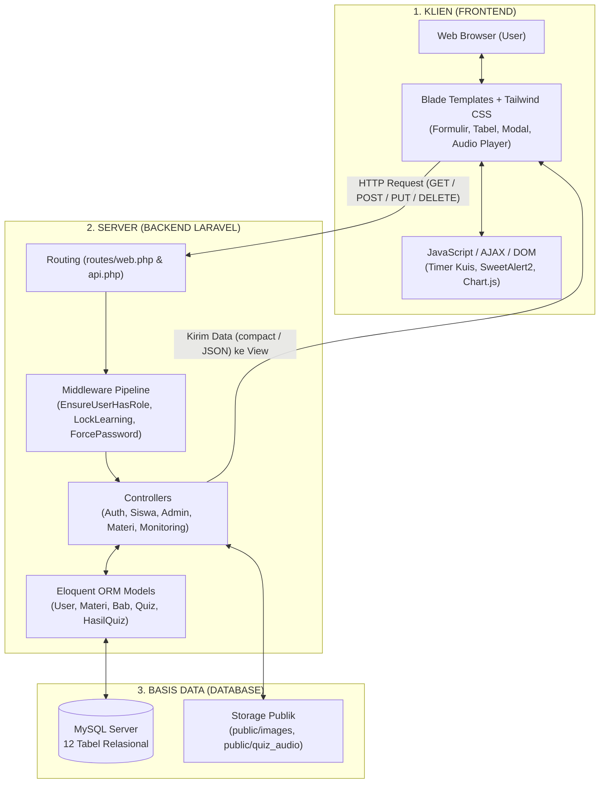
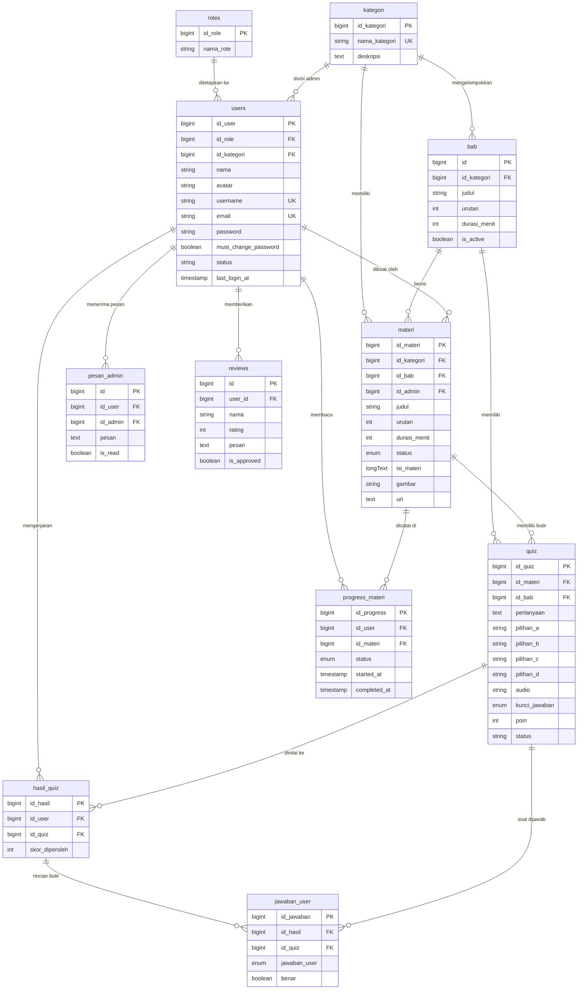
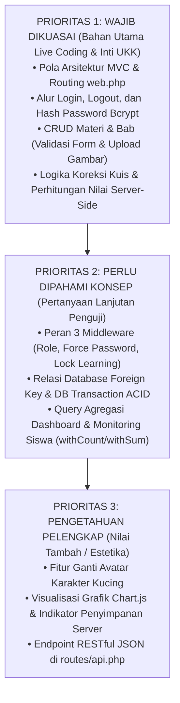

# DOKUMEN PANDUAN TEKNIS & PERSIAPAN SIDANG UKK RPL/PPLG
## SISTEM INFORMASI PEMBELAJARAN BAHASA INGGRIS BERBASIS WEB (ENGLIFY)

---

> **Identitas Dokumen & Proyek:**
> * **Nama Aplikasi**: ENGLIFY (*English Learning & Interactive Facility for Youth*)
> * **Kategori Sistem**: Learning Management System (LMS) & Interactive Quiz Platform
> * **Teknologi Utama**: Laravel 11/12 (PHP 8.2+), MySQL 8.0, Tailwind CSS, JavaScript (ES6+), Chart.js, SweetAlert2
> * **Arsitektur**: Model-View-Controller (MVC) & Multi-Role Role-Based Access Control (RBAC)
> * **Target Ujian**: Uji Kompetensi Keahlian (UKK) SMK Jurusan Rekayasa Perangkat Lunak (RPL) / Pengembangan Perangkat Lunak dan Gim (PPLG)

---

## DAFTAR ISI

1. [BAB I — ARSITEKTUR SISTEM (FRONTEND, BACKEND, DAN DATABASE)](#bab-i--arsitektur-sistem)
   * 1.1 Komponen Frontend (Tampilan & Interaksi Pengguna)
   * 1.2 Komponen Backend (Logika Bisnis & Pengolahan Data)
   * 1.3 Komponen Database (Skema Relasional & Integritas Data)
2. [BAB II — ANALISIS SETIAP FILE KUNCI PROYEK](#bab-ii--analisis-setiap-file-kunci-proyek)
3. [BAB III — ALUR KERJA 11 FITUR UTAMA (END-TO-END WORKFLOW)](#bab-iii--alur-kerja-11-fitur-utama)
4. [BAB IV — SIMULASI LIVE CODING UKK (8 SKENARIO MODIFIKASI)](#bab-iv--simulasi-live-coding-ukk)
5. [BAB V — BANK SOAL & JAWABAN SIDANG PENGUJI (35 PERTANYAAN)](#bab-v--bank-soal--jawaban-sidang-penguji)
6. [BAB VI — MATRIKS PRIORITAS BELAJAR & STRATEGI SIDANG](#bab-vi--matriks-prioritas-belajar)

---

# BAB I — ARSITEKTUR SISTEM

Aplikasi **ENGLIFY** dibangun di atas kerangka kerja **Laravel** menggunakan pola desain perangkat lunak **MVC (Model-View-Controller)** yang memisahkan antara antarmuka (View), pengatur lalu lintas data (Controller), dan representasi data bisnis (Model).



---

## 1.1 Komponen Frontend (Tampilan & Interaktivitas)

Frontend ENGLIFY bertanggung jawab menyajikan antarmuka yang intuitif, ramah bagi siswa sekolah menengah, dan responsif di berbagai ukuran layar.

### A. Struktur Template Blade (`resources/views/`)
Laravel menggunakan *Blade Templating Engine*. Ciri khas Blade adalah kemampuannya melakukan *layout inheritance* (pewarisan tampilan induk) menggunakan direktif `@extends`, `@section`, dan `@yield`, serta kondisional logika seperti `@if`, `@auth`, dan perulangan `@foreach`.

1. **Master Layouts (`resources/views/layouts/`)**:
   * [`layouts/admin.blade.php`](file:///d:/LunarWay-UKK-2026/englify-app/resources/views/layouts/admin.blade.php): Kerangka dasar panel Admin Divisi (Sidebar navigasi kurikulum, header profil, inject Tailwind CDN, SweetAlert2, dan Chart.js).
   * [`layouts/superadmin.blade.php`](file:///d:/LunarWay-UKK-2026/englify-app/resources/views/layouts/superadmin.blade.php): Kerangka kerja Super Admin untuk pengelolaan akun global, konfigurasi sistem, dan pemantauan server.
   * [`layouts/siswa.blade.php`](file:///d:/LunarWay-UKK-2026/englify-app/resources/views/layouts/siswa.blade.php): Antarmuka siswa dengan palet warna ceria, status bar progres belajar, avatar kucing interaktif, dan navigasi belajar.
   * [`layouts/partials/`](file:///d:/LunarWay-UKK-2026/englify-app/resources/views/layouts/partials/): Komponen modular yang dapat disisipkan berulang kali (*reusable*), seperti breadcrumbs navigasi, modal indikator loading saat upload file, dan toggle intip sandi.

2. **Daftar Halaman Berdasarkan Pengguna**:
   * **Publik**: [`landing.blade.php`](file:///d:/LunarWay-UKK-2026/englify-app/resources/views/landing.blade.php) (Hero section, ringkasan 4 kategori materi, form review ulasan pengguna).
   * **Otentikasi**: [`auth/login.blade.php`](file:///d:/LunarWay-UKK-2026/englify-app/resources/views/auth/login.blade.php) (Satu gerbang masuk untuk 3 peran) dan [`auth/change-password.blade.php`](file:///d:/LunarWay-UKK-2026/englify-app/resources/views/auth/change-password.blade.php) (Wajib ganti kata sandi perdana).
   * **Area Admin**:
     * [`admin/dashboard.blade.php`](file:///d:/LunarWay-UKK-2026/englify-app/resources/views/admin/dashboard.blade.php): Kartu ringkasan metrik, performa divisi, siswa berprestasi, dan siswa butuh perhatian.
     * [`admin/kategori.blade.php`](file:///d:/LunarWay-UKK-2026/englify-app/resources/views/admin/kategori.blade.php): Manajemen pilar keahlian (*Speaking, Writing, Reading, Listening*).
     * [`admin/bab.blade.php`](file:///d:/LunarWay-UKK-2026/englify-app/resources/views/admin/bab.blade.php): Manajemen Bab dengan urutan nomor otomatis bersusun.
     * [`admin/materi.blade.php`](file:///d:/LunarWay-UKK-2026/englify-app/resources/views/admin/materi.blade.php): Formulir artikel materi pembelajaran, upload gambar cover, dan penyisipan tautan rujukan eksternal.
     * [`admin/quiz.blade.php`](file:///d:/LunarWay-UKK-2026/englify-app/resources/views/admin/quiz.blade.php): Bank soal pilihan ganda, kunci jawaban, dan upload file audio listening.
     * [`admin/hasil-quiz.blade.php`](file:///d:/LunarWay-UKK-2026/englify-app/resources/views/admin/hasil-quiz.blade.php) & [`admin/detail-hasil-quiz.blade.php`](file:///d:/LunarWay-UKK-2026/englify-app/resources/views/admin/detail-hasil-quiz.blade.php): Log skor kuis dan audit butir jawaban siswa.
     * [`admin/monitoring.blade.php`](file:///d:/LunarWay-UKK-2026/englify-app/resources/views/admin/monitoring.blade.php) & [`admin/monitoring-detail.blade.php`](file:///d:/LunarWay-UKK-2026/englify-app/resources/views/admin/monitoring-detail.blade.php): Rekapitulasi progres siswa (% materi dibaca, jumlah kuis selesai, poin).
     * [`admin/kirim-reminder.blade.php`](file:///d:/LunarWay-UKK-2026/englify-app/resources/views/admin/kirim-reminder.blade.php): Pengiriman notifikasi/pengingat belajar langsung ke siswa.
   * **Area Siswa**:
     * [`siswa/dashboard.blade.php`](file:///d:/LunarWay-UKK-2026/englify-app/resources/views/siswa/dashboard.blade.php): Dasbor siswa (kartu "Lanjutkan Belajar", grafik progres kategori, kotak pesan reminder).
     * [`siswa/materi.blade.php`](file:///d:/LunarWay-UKK-2026/englify-app/resources/views/siswa/materi.blade.php) & [`siswa/baca-materi.blade.php`](file:///d:/LunarWay-UKK-2026/englify-app/resources/views/siswa/baca-materi.blade.php): Tampilan kurikulum berjenjang dan antarmuka membaca materi pelajaran (dilengkapi audio player listening dan penguncian materi berurutan).
     * [`siswa/peta-quiz.blade.php`](file:///d:/LunarWay-UKK-2026/englify-app/resources/views/siswa/peta-quiz.blade.php): Peta jalur kuis (Gamifikasi simpul node) per Bab.
     * [`siswa/quiz/show.blade.php`](file:///d:/LunarWay-UKK-2026/englify-app/resources/views/siswa/quiz/show.blade.php): Ruang pengerjaan kuis interaktif dengan timer countdown mundur, player audio listening bersama (*audio passage*), dan opsi jawaban acak.
     * [`siswa/quiz/hasil.blade.php`](file:///d:/LunarWay-UKK-2026/englify-app/resources/views/siswa/quiz/hasil.blade.php): Pengumuman perolehan skor, ucapan selamat, dan pembahasan (hanya terbuka 1x setelah selesai).
     * [`siswa/progress.blade.php`](file:///d:/LunarWay-UKK-2026/englify-app/resources/views/siswa/progress.blade.php): Statistik belajar mingguan dan lencana pencapaian (*badge badges*).
     * [`siswa/reminder.blade.php`](file:///d:/LunarWay-UKK-2026/englify-app/resources/views/siswa/reminder.blade.php): Kotak masuk pesan dari pengajar / admin.
   * **Area Super Admin**:
     * [`superadmin/dashboard.blade.php`](file:///d:/LunarWay-UKK-2026/englify-app/resources/views/superadmin/dashboard.blade.php): Manajemen akun cepat, grafik pertumbuhan user (Chart.js), dan metrik sistem.
     * [`superadmin/siswa.blade.php`](file:///d:/LunarWay-UKK-2026/englify-app/resources/views/superadmin/siswa.blade.php) & [`superadmin/admin-divisi.blade.php`](file:///d:/LunarWay-UKK-2026/englify-app/resources/views/superadmin/admin-divisi.blade.php): CRUD akun siswa dan admin divisi (termasuk reset password dan aktivasi status).
     * [`superadmin/data-sistem.blade.php`](file:///d:/LunarWay-UKK-2026/englify-app/resources/views/superadmin/data-sistem.blade.php) & [`superadmin/settings.blade.php`](file:///d:/LunarWay-UKK-2026/englify-app/resources/views/superadmin/settings.blade.php): Informasi spesifikasi teknis server PHP, status database, dan pemakaian ruang disk.

### B. Styling & Interaksi Dinamis
* **CSS Framework**: Memanfaatkan **Tailwind CSS CDN** dengan utilitas utility-first, dikombinasikan dengan Google Fonts (*Plus Jakarta Sans* dan aksen tulisan tangan *Caveat*).
* **DOM & Asynchronous Interaction**:
  * **AJAX Cascading Dropdown**: Saat Admin memilih Kategori di modal Materi, JavaScript melakukan `fetch('/admin/api/babs-by-kategori/' + kategoriId)` untuk mengambil daftar Bab terkait secara dinamis tanpa refresh halaman.
  * **Interactive Quiz Engine**: Pada [`siswa/quiz/show.blade.php`](file:///d:/LunarWay-UKK-2026/englify-app/resources/views/siswa/quiz/show.blade.php), JavaScript murni mengelola perpindahan nomor soal (paginasi soal single-page), pewarnaan nomor yang sudah dijawab/ragu-ragu, sinkronisasi timer countdown, dan peringatan waktu habis otomatis (*auto-submit*).
  * **Notifikasi SweetAlert2**: Digunakan untuk konfirmasi aksi berbahaya (*Are you sure you want to delete this?*) dan memunculkan notifikasi sukses berbasis flash session Laravel (`session('success')`).

---

## 1.2 Komponen Backend (Logika Bisnis & Pengolahan Data)

Backend berperan memvalidasi integritas data, menegakkan aturan bisnis, menghitung skor, serta membatasi akses berdasarkan peran.

### A. Alur Permintaan HTTP (Request Lifecycle)
Setiap request yang dikirimkan oleh browser melewati alur berikut:
1. `public/index.php`: Titik masuk pertama aplikasi.
2. `bootstrap/app.php`: Menginisialisasi dependensi framework dan mendaftarkan middleware.
3. `routes/web.php` atau `routes/api.php`: Memetakan URI dan HTTP verb (`GET`, `POST`, `PUT`, `DELETE`).
4. **Middleware Pipeline**: Memeriksa otentikasi login, validasi status aktif akun, dan otorisasi peran.
5. **Controller**: Menerima request, memanggil validator, berinteraksi dengan Eloquent Model, dan menyiapkan response.
6. **Model (Eloquent ORM)**: Mengeksekusi query SQL yang aman dari SQL Injection via PDO prepared statements.
7. **View / Response**: Mengirimkan halaman HTML terkompilasi atau payload JSON.

### B. Middleware Khusus Proyek ENGLIFY
* [`EnsureUserHasRole.php`](file:///d:/LunarWay-UKK-2026/englify-app/app/Http/Middleware/EnsureUserHasRole.php):
  * Memeriksa apakah pengguna memiliki peran yang diizinkan (`role:superadmin`, `role:admin`, atau `role:siswa`).
  * Memeriksa status akun: jika akun berstatus `nonaktif`, user langsung di-logout otomatis dan sesi dibersihkan.
  * Melemparkan HTTP 403 Forbidden jika role tidak sesuai.
* [`ForcePasswordChange.php`](file:///d:/LunarWay-UKK-2026/englify-app/app/Http/Middleware/ForcePasswordChange.php):
  * Khusus peran Siswa (`id_role = 3`), jika kolom `must_change_password == true`, semua akses halaman belajar dikunci dan dialihkan ke rute `change.password`.
* [`LockActiveMateriAndQuiz.php`](file:///d:/LunarWay-UKK-2026/englify-app/app/Http/Middleware/LockActiveMateriAndQuiz.php):
  * Fitur anti-curang; saat siswa membuka materi atau sedang mengerjakan kuis, sesi `active_quiz_lock` atau `active_materi_lock` aktif di server. Seluruh rute navigasi navbar umum diblokir sampai kuis selesai dikerjakan.

---

## 1.3 Komponen Database (Skema Relasional MySQL)

Database ENGLIFY dirancang dengan 12 tabel relasional ternormalisasi yang menerapkan integritas referensial *Foreign Key Constraint*.



### Kamus Data Tabel Utama:
1. **`roles`**: Menyimpan tingkat wewenang (`id_role`: 1 = Super Admin, 2 = Admin Divisi, 3 = Siswa).
2. **`kategori`**: 4 pilar kurikulum bahasa Inggris (`Speaking`, `Writing`, `Reading`, `Listening`).
3. **`users`**: Data kredensial pengguna, profil avatar, dan status keaktifan.
4. **`bab`**: Pengelompokan bab terstruktur per kategori dengan aturan nomor urut unik per kategori (`UNIQUE(id_kategori, urutan)`).
5. **`materi`**: Artikel modul belajar yang terikat pada Bab, Kategori, dan Admin pembuat.
6. **`quiz`**: Bank butir pertanyaan pilihan ganda (opsi A, B, C, D), kunci jawaban terenkripsi di server, bobot poin, dan berkas audio listening.
7. **`hasil_quiz`**: Rekapitulasi perolehan skor akhir siswa saat menyelesaikan ujian kuis per materi.
8. **`jawaban_user`**: Log riwayat butir per butir dari opsi yang dipilih siswa untuk keperluan analisis audit jawaban dan pembahasan.
9. **`progress_materi`**: Pencatat status tuntas membaca modul dengan aturan unik komposit `UNIQUE(id_user, id_materi)` untuk mencegah duplikasi data progres.
10. **`pesan_admin`**: Pesan peringatan dan motivasi yang dikirim guru/admin ke akun siswa.

---

# BAB II — ANALISIS SETIAP FILE KUNCI PROYEK

Berikut analisis teknis mendalam terhadap 8 file paling vital di dalam source code asli ENGLIFY:

---

### 1. `routes/web.php`
* **Lokasi File**: [`routes/web.php`](file:///d:/LunarWay-UKK-2026/englify-app/routes/web.php)
* **Kategori**: Routing & HTTP Pipeline
* **Fungsi**: Mendefinisikan seluruh endpoint web browser, mengelompokkan hak akses via middleware, dan memberikan nama rute (*named routes*).
* **Potongan Kode Kunci**:
  ```php
  Route::middleware(['auth', 'force.password.change', 'role:siswa', 'lock.learning'])
      ->prefix('siswa')
      ->name('siswa.')
      ->group(function () {
          Route::get('/dashboard', [SiswaController::class, 'index'])->name('dashboard');
          Route::get('/materi/{id}', [SiswaController::class, 'baca'])->name('materi.baca');
          Route::get('/quiz/{id}', [SiswaController::class, 'kerjakanQuiz'])->name('quiz.kerjakan');
          Route::post('/quiz/{id}/submit', [SiswaController::class, 'submitQuiz'])->name('quiz.submit');
      });
  ```
* **Penjelasan Teknis**: Menerapkan konsep *Route Grouping* dengan prefix URL `/siswa/` dan proteksi berlapis: otentikasi login (`auth`), wajib ganti sandi awal (`force.password.change`), verifikasi peran (`role:siswa`), dan penguncian navigasi kuis (`lock.learning`).
* **Keterhubungan**: Menghubungkan view Blade dengan method Controller terkait di namespace `App\Http\Controllers\`.
* **Skenario Eksekusi**: Ketika siswa mengklik menu kuis di antarmuka, browser mengirim request HTTP GET ke `/siswa/quiz/1`. Route mencocokkan pola tersebut dan meneruskannya ke method `kerjakanQuiz(1)` pada `SiswaController`.

---

### 2. `app/Http/Controllers/AuthController.php`
* **Lokasi File**: [`app/Http/Controllers/AuthController.php`](file:///d:/LunarWay-UKK-2026/englify-app/app/Http/Controllers/AuthController.php)
* **Kategori**: Backend (Controller Otentikasi)
* **Fungsi**: Mengelola proses login multi-kredensial (email atau username), pengecekan status akun aktif, regenerasi ID sesi, dan logout aman.
* **Potongan Kode Kunci**:
  ```php
  $user = User::where('email', $loginInput)
      ->orWhere('username', $loginInput)
      ->orWhereRaw('LOWER(email) = ?', [strtolower($loginInput)])
      ->orWhereRaw('LOWER(username) = ?', [strtolower($loginInput)])
      ->first();

  if (!$user || !Hash::check($password, $user->password)) {
      return back()->withErrors(['email' => 'Email atau password yang Anda masukkan salah.']);
  }

  if (strtolower(trim((string)($user->status ?? 'aktif'))) === 'nonaktif') {
      return back()->withErrors(['email' => 'Akun Anda sedang dinonaktifkan oleh Super Admin.']);
  }

  Auth::login($user, $request->boolean('remember'));
  $request->session()->regenerate();
  ```
* **Penjelasan Method**:
  * `showLogin()`: Membuka view form login.
  * `login(Request $request)`: Memvalidasi format input, mencari user secara presisi tanpa terpengaruh huruf besar/kecil (*case-insensitive*), memverifikasi hash Bcrypt password via `Hash::check()`, memastikan status akun bukan `nonaktif`, memperbarui stempel `last_login_at`, dan mengarahkan pengguna sesuai nilai `id_role`.
  * `logout(Request $request)`: Mengakhiri sesi pengguna, membatalkan token session lama (`invalidate`), dan meregenerasi token CSRF baru.
* **Keterhubungan**: Berinteraksi dengan model `User`, dipanggil oleh rute di `web.php`, dan me-render view `auth/login.blade.php`.
* **Skenario Eksekusi**: Siswa memasukkan username `siswa` dan sandi `password123`. Method `login()` memeriksa kecocokan hash sandi di database, memvalidasi bahwa siswa berstatus aktif, lalu me-redirect siswa ke rute `siswa.dashboard`.

---

### 3. `app/Http/Controllers/siswa/SiswaController.php`
* **Lokasi File**: [`app/Http/Controllers/siswa/SiswaController.php`](file:///d:/LunarWay-UKK-2026/englify-app/app/Http/Controllers/siswa/SiswaController.php)
* **Kategori**: Backend (Controller Pembelajaran & Kuis)
* **Fungsi**: Menangani logika pembacaan modul materi, penguncian materi berurutan, pengacakan opsi kuis dinamis, evaluasi nilai otomatis, dan pencatatan riwayat progres.
* **Potongan Kode Kunci**:
  ```php
  // Pengacakan opsi dinamis per siswa di method kerjakanQuiz():
  $filteredOptions = array_values(array_filter($rawOptions, fn($opt) => !empty($opt['text'])));
  shuffle($filteredOptions);

  // Evaluasi dan penyimpanan aman di method submitQuiz():
  $benar = ($selectedKey !== null && $selectedKey === strtoupper(trim((string)$pertanyaan->kunci_jawaban)));
  if ($benar) { $benarCount++; }
  $skor = $totalSoal > 0 ? round(($benarCount / $totalSoal) * 100) : 0;

  \Illuminate\Support\Facades\DB::transaction(function () use ($user, $quiz, $skor, $jawabanList) {
      $hasil = HasilQuiz::create([
          'id_user' => $user->id_user,
          'id_quiz' => $quiz->id_quiz,
          'skor_diperoleh' => $skor,
      ]);
      foreach ($jawabanList as $jwb) {
          JawabanUser::create([...]);
      }
  });
  ```
* **Penjelasan Method**:
  * `index()`: Menghitung agregasi statistik dashboard siswa (materi selesai, total poin, materi rekomendasi selanjutnya).
  * `baca($id)`: Membuka materi belajar, mencatat record pembacaan pada tabel `progress_materi` menjadi `Completed`, dan memasang session lock.
  * `kerjakanQuiz($id)`: Mengambil butir soal kuis, mengacak opsi jawaban A-B-C-D via fungsi `shuffle()`, serta membagi info audio passage listening.
  * `submitQuiz($request, $id)`: Mencocokkan jawaban siswa dengan `kunci_jawaban` database di sisi server, menghitung persentase skor, menyimpan ke tabel `hasil_quiz` dan `jawaban_user` dalam satu `DB::transaction`, lalu menghapus session lock.
  * `hasilQuiz($id)`: Menampilkan rincian skor dan mengamankan pembahasan jawaban agar hanya dapat ditinjau tepat 1 kali setelah submit.
* **Keterhubungan**: Menggunakan model `Materi`, `Quiz`, `HasilQuiz`, `JawabanUser`, `ProgressMateri`, `Bab`, dan me-render view di folder `resources/views/siswa/`.
* **Skenario Eksekusi**: Siswa menyelesaikan 10 butir soal kuis. Saat tombol submit ditekan, controller memverifikasi ke database bahwa 8 soal dijawab benar. Rumus `(8/10) * 100 = 80` dieksekusi, data tersimpan aman ke database, dan siswa diarahkan ke halaman hasil perayaan.

---

### 4. `app/Http/Controllers/admin/MateriController.php`
* **Lokasi File**: [`app/Http/Controllers/admin/MateriController.php`](file:///d:/LunarWay-UKK-2026/englify-app/app/Http/Controllers/admin/MateriController.php)
* **Kategori**: Backend (Controller Manajemen Materi)
* **Fungsi**: Mengelola operasi CRUD modul materi, pengelompokan materi ke dalam bab, upload berkas media, dan sanitasi tautan referensi.
* **Potongan Kode Kunci**:
  ```php
  public function store(Request $request)
  {
      $data = $this->validateData($request);
      $bab = Bab::findOrFail($data['id_bab']);
      $data['id_admin']    = auth()->id();
      $data['bab']         = $bab->judul;
      $data['id_kategori'] = $bab->id_kategori;
      $data['urutan']      = $data['urutan'] ?? (Materi::where('id_bab', $data['id_bab'])->max('urutan') ?? 0) + 1;
      $data['status']      = $data['status'] ?? 'Draft';

      if ($request->hasFile('gambar')) {
          $data['gambar'] = $this->simpanFile($request->file('gambar'), 'images/materi', 'img');
      }

      Materi::create($data);
      return redirect()->route('admin.materi')->with('success', 'Materi berhasil ditambahkan ke Bab!');
  }
  ```
* **Penjelasan Method**:
  * `index(Request $request)`: Menampilkan materi yang terkelompok berdasarkan Bab kurikulum dengan fitur pencarian dan filter kategori.
  * `store(Request $request)`: Validasi data wajib, upload gambar sampul modul ke direktori publik, dan simpan record baru.
  * `update(Request $request, $id)`: Memperbarui konten materi dan menghapus berkas gambar lama dari penyimpanan fisik jika diganti.
  * `destroy($id)`: Menghapus materi beserta seluruh kuis terkait, file audio, dan progres belajar siswa secara bersih melalui transaksi database.
  * `uploadImage(Request $request)`: Endpoint API AJAX untuk upload gambar inline di editor materi (Word-style).
* **Keterhubungan**: Berelasi dengan model `Materi`, `Bab`, `Kategori`, serta view `resources/views/admin/materi.blade.php`.
* **Skenario Eksekusi**: Admin mengunggah modul "Simple Past Tense" dengan gambar cover. Controller memvalidasi input, memindahkan gambar ke folder `public/images/materi/`, menyimpan path gambar dan konten ke MySQL, lalu mengembalikan admin ke tabel materi dengan pesan sukses.

---

### 5. `app/Http/Controllers/admin/MonitoringController.php`
* **Lokasi File**: [`app/Http/Controllers/admin/MonitoringController.php`](file:///d:/LunarWay-UKK-2026/englify-app/app/Http/Controllers/admin/MonitoringController.php)
* **Kategori**: Backend (Controller Evaluasi & Rekapitulasi)
* **Fungsi**: Melakukan agregasi data kemajuan belajar seluruh siswa secara real-time.
* **Potongan Kode Kunci**:
  ```php
  $query = User::where('id_role', 3)
      ->withCount(['hasilQuiz as total_quiz_dikerjakan'])
      ->withSum('hasilQuiz as total_skor', 'skor_diperoleh')
      ->withCount(['progressMateri as materi_dibaca' => function ($query) {
          $query->where('status', 'Completed');
      }]);
  ```
* **Penjelasan Method**:
  * `index(Request $request)`: Menggunakan query agregasi Eloquent `withCount` dan `withSum` untuk menghitung persentase tuntas membaca dan total skor tanpa memicu masalah N+1 query.
  * `detail($id)`: Menampilkan profil belajar spesifik satu siswa: log aktivitas jam pengerjaan kuis/membaca materi, serta diagram radar kemampuan di tiap kategori skill.
* **Keterhubungan**: Membaca model `User`, `HasilQuiz`, `ProgressMateri`, `Kategori`, dan menyajikan data ke view `admin/monitoring.blade.php`.
* **Skenario Eksekusi**: Admin membuka menu monitoring siswa. Controller menjalankan query penghitungan, memetakan hasilnya ke dalam persentase progres 0-100%, lalu menampilkannya dalam tabel berurutan nama siswa.

---

### 6. `app/Models/Materi.php`
* **Lokasi File**: [`app/Models/Materi.php`](file:///d:/LunarWay-UKK-2026/englify-app/app/Models/Materi.php)
* **Kategori**: Backend (Eloquent Model)
* **Fungsi**: Model representasi tabel `materi`, mendefinisikan relasi ke Bab/Kategori/Kuis, query scope, dan logika penguncian modul berurutan (*sequential lock*).
* **Potongan Kode Kunci**:
  ```php
  public function isLockedBy($userId, ?Materi $materiSebelumnya = null): array
  {
      $prev = $materiSebelumnya ?? $this->getMateriSebelumnyaDalamBab();
      if (!$prev) {
          return ['is_locked' => false, 'materi_sebelumnya' => null];
      }
      $quizIds = $prev->quiz()->pluck('id_quiz')->all();
      if (!empty($quizIds)) {
          $sudahQuiz = \App\Models\HasilQuiz::where('id_user', $userId)
              ->whereIn('id_quiz', $quizIds)->exists();
          return ['is_locked' => !$sudahQuiz, 'materi_sebelumnya' => $prev];
      }
      $sudahBaca = \App\Models\ProgressMateri::where('id_user', $userId)
          ->where('id_materi', $prev->id_materi)
          ->where('status', 'Completed')->exists();
      return ['is_locked' => !$sudahBaca, 'materi_sebelumnya' => $prev];
  }
  ```
* **Penjelasan Method**:
  * `kategori()`: Relasi `belongsTo` ke model `Kategori`.
  * `babModel()`: Relasi `belongsTo` ke model `Bab`.
  * `quiz()`: Relasi `hasMany` ke model `Quiz`.
  * `scopeVisibleForSiswa($query)`: Query scope untuk menyaring hanya materi berstatus `Published` atau `Aktif`.
  * `isLockedBy($userId)`: Logika bisnis untuk mengecek apakah materi sebelumnya sudah diselesaikan oleh siswa terkait. Jika materi sebelumnya belum tuntas, materi saat ini berstatus terkunci (`is_locked = true`).
* **Keterhubungan**: Menjadi jembatan data antara tabel `materi` dengan `MateriController` dan `SiswaController`.

---

### 7. `app/Http/Middleware/EnsureUserHasRole.php`
* **Lokasi File**: [`app/Http/Middleware/EnsureUserHasRole.php`](file:///d:/LunarWay-UKK-2026/englify-app/app/Http/Middleware/EnsureUserHasRole.php)
* **Kategori**: Backend (Security Middleware)
* **Fungsi**: Memvalidasi hak akses peran (*Role-Based Access Control*) dan memutus sesi pengguna yang akunnya telah dinonaktifkan.
* **Potongan Kode Kunci**:
  ```php
  $user = Auth::user();
  if ($user && !empty($user->status) && strtolower(trim((string)$user->status)) === 'nonaktif') {
      Auth::logout();
      $request->session()->invalidate();
      $request->session()->regenerateToken();
      return redirect()->route('login')->withErrors([
          'email' => 'Sesi Anda berakhir karena akun Anda telah dinonaktifkan oleh Super Admin.',
      ]);
  }

  $userRoleId = (int) $user->id_role;
  if (!empty($allowedRoleIds) && !in_array($userRoleId, $allowedRoleIds, true)) {
      abort(403, 'Akses ditolak. Halaman ini hanya dapat diakses oleh peran yang berwenang.');
  }
  ```
* **Penjelasan Teknis**: Mencegah serangan *privilege escalation*. Jika akun siswa mencoba membuka URL `/admin/dashboard`, middleware memeriksa `id_role` siswa (3) terhadap daftar peran yang diizinkan (2). Karena tidak cocok, sistem segera menghentikan request dan merespons dengan HTTP 403 Forbidden.
* **Keterhubungan**: Didaftarkan sebagai alias `role` di routing Laravel (`web.php` dan `api.php`).

---

### 8. `database/migrations/2026_09_28_002540_create_materi_table.php`
* **Lokasi File**: [`database/migrations/2026_09_28_002540_create_materi_table.php`](file:///d:/LunarWay-UKK-2026/englify-app/database/migrations/2026_09_28_002540_create_materi_table.php)
* **Kategori**: Database (Migration Schema)
* **Fungsi**: Cetak biru (*blueprint*) pembuatan tabel `materi` di MySQL beserta aturan Foreign Key relasionalnya.
* **Potongan Kode Kunci**:
  ```php
  Schema::create('materi', function (Blueprint $table) {
      $table->id('id_materi');
      $table->foreignId('id_kategori')->constrained('kategori', 'id_kategori')->onDelete('cascade');
      $table->foreignId('id_bab')->nullable()->constrained('bab', 'id')->onDelete('set null');
      $table->foreignId('id_admin')->constrained('users', 'id_user')->onDelete('cascade');
      $table->string('judul');
      $table->string('bab', 100)->nullable();
      $table->integer('urutan');
      $table->integer('durasi_menit')->default(15);
      $table->enum('status', ['Draft', 'Published'])->default('Draft');
      $table->longText('isi_materi');
      $table->string('gambar')->nullable();
      $table->text('url')->nullable();
      $table->timestamps();
  });
  ```
* **Penjelasan Teknis**: Mendefinisikan tipe data kolom dan constraint foreign key: `id_kategori` berelasi ke tabel `kategori` dengan aturan `onDelete('cascade')`, `id_bab` berelasi ke tabel `bab`, dan `id_admin` berelasi ke tabel `users`.
* **Keterhubungan**: Dieksekusi melalui perintah CLI `php artisan migrate`, mendasari struktur kerja model `Materi`.

---

# BAB III — ALUR KERJA 11 FITUR UTAMA (END-TO-END WORKFLOW)

Tabel berikut merangkum penelusuran alur lengkap 11 fitur utama aplikasi ENGLIFY dari interaksi browser hingga ke basis data:

| No | Fitur Utama | Tindakan Pengguna di Frontend | File Frontend (View) | Route & Method HTTP | Controller & Method | Model & Tabel Database | Hasil Kembali ke Tampilan |
| :--- | :--- | :--- | :--- | :--- | :--- | :--- | :--- |
| **1** | **Login & Logout** | Memasukkan email/username & sandi, lalu klik "Masuk" | `auth/login.blade.php` | `POST /login` (`login.proses`) | `AuthController::login()` | Model `User`, Tabel `users` | Redirect ke dashboard sesuai peran (`superadmin`, `admin`, `siswa`) |
| **2** | **Dashboard Super Admin** | Mengakses menu Dashboard utama Super Admin | `superadmin/dashboard.blade.php` | `GET /superadmin/dashboard` | `SuperAdminController::index()` | Model `User`, `Kategori`, Tabel `users`, `kategori` | Menampilkan metrik total user, divisi, dan grafik Chart.js |
| **3** | **Dashboard Admin Divisi** | Membuka beranda panel Admin Divisi | `admin/dashboard.blade.php` | `GET /admin/dashboard` | `AdminController::index()` | Model `Materi`, `Quiz`, `HasilQuiz`, Tabel `materi`, `quiz`, `hasil_quiz` | Menampilkan skor rata-rata divisi, top 5 siswa, siswa butuh perhatian |
| **4** | **Dashboard Siswa** | Siswa membuka beranda belajar | `siswa/dashboard.blade.php` | `GET /siswa/dashboard` | `SiswaController::index()` | Model `ProgressMateri`, `HasilQuiz`, Tabel `progress_materi`, `hasil_quiz` | Kartu "Lanjutkan Belajar", persentase progres per skill, reminder admin |
| **5** | **Kelola Kategori Materi** | Admin mengisi nama & deskripsi kategori baru | `admin/kategori.blade.php` | `POST /admin/kategori` | `KategoriController::store()` | Model `Kategori`, Tabel `kategori` | Flash session success, SweetAlert2 muncul, tabel kategori terupdate |
| **6** | **Kelola Modul Pembelajaran** | Admin mengisi modul, upload gambar cover, klik simpan | `admin/materi.blade.php` | `POST /admin/materi` | `MateriController::store()` | Model `Materi`, `Bab`, Tabel `materi`, folder `public/images/materi/` | Modul tersimpan, muncul di daftar materi terkelompok per bab |
| **7** | **Referensi Pembelajaran** | Admin memasukkan URL eksternal pada form materi | `admin/materi.blade.php` | `POST /admin/materi` | `MateriController::validateData()` | Model `Materi` (`$urls_list`), Tabel `materi` (kolom JSON `url`) | Ditampilkan sebagai tautan rujukan di halaman baca materi siswa |
| **8** | **Progress Membaca Siswa** | Siswa mengklik judul modul materi untuk membaca | `siswa/baca-materi.blade.php` | `GET /siswa/materi/{id}` | `SiswaController::baca($id)` | Model `ProgressMateri`, Tabel `progress_materi` (`status = Completed`) | Status tuntas membaca tercatat, session lock kuis diaktifkan |
| **9** | **Pengerjaan Kuis Interaktif** | Siswa memilih jawaban A/B/C/D, klik "Kumpulkan" | `siswa/quiz/show.blade.php` | `POST /siswa/quiz/{id}/submit` | `SiswaController::submitQuiz()` | Model `Quiz`, `HasilQuiz`, `JawabanUser`, Tabel `quiz`, `hasil_quiz`, `jawaban_user` | Koreksi server-side, kalkulasi skor, simpan via DB Transaction, lepas lock |
| **10** | **Hasil Kuis & Review** | Siswa melihat perolehan skor nilai ujian kuis | `siswa/quiz/hasil.blade.php` | `GET /siswa/quiz/{id}/hasil` | `SiswaController::hasilQuiz($id)` | Model `HasilQuiz`, `JawabanUser`, Tabel `hasil_quiz`, `jawaban_user` | Menampilkan nilai skor, ucapan selamat, pembahasan soal (hanya 1x) |
| **11** | **Monitoring Siswa** | Admin membuka menu rekapitulasi progres belajar | `admin/monitoring.blade.php` | `GET /admin/monitoring-siswa` | `MonitoringController::index()` | Model `User`, `ProgressMateri`, `HasilQuiz`, Tabel `users`, `progress_materi` | Tabel rekapitulasi siswa: persentase materi dibaca, jumlah kuis, total skor |

---

# BAB IV — SIMULASI LIVE CODING UKK (8 SKENARIO)

Berikut panduan langkah demi langkah untuk menyelesaikan tugas modifikasi langsung (*live coding*) yang kerap diinstruksikan oleh penguji UKK:

---

### Skenario 1: Mengubah Validasi Form
* **Tantangan Penguji**: *"Ubah aturan form materi agar judul minimal 5 karakter, dan durasi maksimal dibatasi 120 menit."*
1. **File yang Dibuka**: [`app/Http/Controllers/admin/MateriController.php`](file:///d:/LunarWay-UKK-2026/englify-app/app/Http/Controllers/admin/MateriController.php)
2. **Bagian yang Diubah** (Method `validateData()` baris ~328):
   ```php
   // Kode Asli:
   'judul'        => 'required|string|max:255',
   'durasi_menit' => 'nullable|integer|min:1|max:300',

   // Kode Perubahan:
   'judul'        => 'required|string|min:5|max:255',
   'durasi_menit' => 'nullable|integer|min:1|max:120',
   ```
   Tambahkan pesan error kustom di bawahnya:
   ```php
   'judul.min'        => 'Judul materi minimal harus terdiri dari 5 karakter.',
   'durasi_menit.max' => 'Durasi materi maksimal tidak boleh melebihi 120 menit.',
   ```
3. **Alasan Teknis**: Menegakkan validasi server-side agar data yang masuk ke database memenuhi standar mutu konten.
4. **Pengujian**: Buka menu Materi Admin, coba simpan materi dengan judul "Test" (4 huruf). Pastikan sistem menolak dan pesan error validasi muncul di modal.

---

### Skenario 2: Menambahkan Kolom Baru pada Form & Database
* **Tantangan Penguji**: *"Tambahkan pilihan `tingkat_kesulitan` (Easy, Medium, Hard) pada data Bab."*
1. **Langkah 1 (Database Migration)**:
   Jalankan perintah di terminal: `php artisan make:migration add_tingkat_kesulitan_to_bab_table`
   Buka file migration yang baru terbentuk di `database/migrations/`:
   ```php
   public function up(): void {
       Schema::table('bab', function (Blueprint $table) {
           $table->enum('tingkat_kesulitan', ['Easy', 'Medium', 'Hard'])->default('Easy')->after('judul');
       });
   }
   public function down(): void {
       Schema::table('bab', function (Blueprint $table) {
           $table->dropColumn('tingkat_kesulitan');
       });
   }
   ```
   Jalankan: `php artisan migrate`.
2. **Langkah 2 (Model)**:
   Buka [`app/Models/Bab.php`](file:///d:/LunarWay-UKK-2026/englify-app/app/Models/Bab.php), tambahkan `'tingkat_kesulitan'` ke dalam properti `$fillable`.
3. **Langkah 3 (Controller)**:
   Buka [`app/Http/Controllers/admin/BabController.php`](file:///d:/LunarWay-UKK-2026/englify-app/app/Http/Controllers/admin/BabController.php), tambahkan aturan validasi di method `store()` dan `update()`:
   ```php
   'tingkat_kesulitan' => 'required|in:Easy,Medium,Hard',
   ```
4. **Langkah 4 (View)**:
   Buka [`resources/views/admin/bab.blade.php`](file:///d:/LunarWay-UKK-2026/englify-app/resources/views/admin/bab.blade.php), tambahkan elemen `<select name="tingkat_kesulitan">` pada modal formulir Bab.
5. **Pengujian**: Tambah bab baru dengan memilih tingkat "Hard". Pastikan data tersimpan di MySQL dan tampil di tabel admin.

---

### Skenario 3: Mengubah Query Database (Sorting & Filtering)
* **Tantangan Penguji**: *"Ubah daftar kuis di tabel admin agar diurutkan berdasarkan bobot poin tertinggi ke terendah."*
1. **File yang Dibuka**: [`app/Http/Controllers/admin/AdminController.php`](file:///d:/LunarWay-UKK-2026/englify-app/app/Http/Controllers/admin/AdminController.php)
2. **Bagian yang Diubah** (Method `quiz()` baris ~398):
   ```php
   // Kode Asli:
   $quizzes = Quiz::with(['materi.kategori', 'bab.kategori'])->latest('id_quiz')->paginate(10);

   // Kode Perubahan:
   $quizzes = Quiz::with(['materi.kategori', 'bab.kategori'])->orderBy('poin', 'desc')->paginate(10);
   ```
3. **Alasan Teknis**: Mengubah klausa SQL dari `ORDER BY id_quiz DESC` menjadi `ORDER BY poin DESC`.
4. **Pengujian**: Buka menu Kelola Quiz di panel admin, pastikan soal dengan poin terbesar berada di urutan teratas tabel.

---

### Skenario 4: Menambahkan Method Baru pada Controller
* **Tantangan Penguji**: *"Buat fungsi untuk mereset seluruh hasil kuis seorang siswa tertentu."*
1. **Langkah 1 (Routing)**:
   Buka [`routes/web.php`](file:///d:/LunarWay-UKK-2026/englify-app/routes/web.php), tambahkan rute di dalam grup middleware admin:
   ```php
   Route::post('/monitoring-siswa/{id}/reset-quiz', [MonitoringController::class, 'resetQuiz'])->name('monitoring-siswa.reset-quiz');
   ```
2. **Langkah 2 (Controller)**:
   Buka [`app/Http/Controllers/admin/MonitoringController.php`](file:///d:/LunarWay-UKK-2026/englify-app/app/Http/Controllers/admin/MonitoringController.php), tambahkan method baru:
   ```php
   public function resetQuiz($id)
   {
       $hasilList = \App\Models\HasilQuiz::where('id_user', $id)->get();
       foreach ($hasilList as $hasil) {
           \App\Models\JawabanUser::where('id_hasil', $hasil->id_hasil)->delete();
           $hasil->delete();
       }
       return back()->with('success', 'Seluruh hasil kuis siswa berhasil direset!');
   }
   ```
3. **Langkah 3 (View)**:
   Buka [`resources/views/admin/monitoring-detail.blade.php`](file:///d:/LunarWay-UKK-2026/englify-app/resources/views/admin/monitoring-detail.blade.php), tambahkan tombol form POST yang memanggil `route('admin.monitoring-siswa.reset-quiz', $student->id_user)`.
4. **Pengujian**: Buka detail siswa, klik tombol reset, pastikan seluruh riwayat nilai kuis siswa kembali menjadi kosong.

---

### Skenario 5: Mengubah Tampilan Blade (Pewarnaan Kondisional)
* **Tantangan Penguji**: *"Di tabel hasil kuis admin, jika skor siswa di bawah KKM (< 75) berikan teks merah tebal, jika >= 75 berikan teks hijau tebal."*
1. **File yang Dibuka**: [`resources/views/admin/hasil-quiz.blade.php`](file:///d:/LunarWay-UKK-2026/englify-app/resources/views/admin/hasil-quiz.blade.php)
2. **Bagian yang Diubah**: Elemen kolom tabel yang menampilkan skor:
   ```blade
   <!-- Kode Asli: -->
   <span class="font-semibold">{{ $hasil->skor_diperoleh }}</span>

   <!-- Kode Perubahan: -->
   @if($hasil->skor_diperoleh < 75)
       <span class="inline-flex items-center px-2.5 py-0.5 rounded-full text-xs font-bold bg-rose-100 text-rose-700">
           Belum Lulus ({{ $hasil->skor_diperoleh }})
       </span>
   @else
       <span class="inline-flex items-center px-2.5 py-0.5 rounded-full text-xs font-bold bg-emerald-100 text-emerald-700">
           Lulus ({{ $hasil->skor_diperoleh }})
       </span>
   @endif
   ```
3. **Alasan Teknis**: Menerapkan logika kondisional Blade `@if` untuk menghasilkan kelas utilitas Tailwind CSS yang dinamis sesuai nilai variabel.
4. **Pengujian**: Buka menu Hasil Quiz di panel admin, pastikan badge berwarna merah dan hijau muncul proporsional.

---

### Skenario 6: Memperbaiki Error Handling (Pencegahan Crash Null Object)
* **Tantangan Penguji**: *"Bagaimana mengatasi error `Attempt to read property on null` jika data kategori materi terhapus?"*
1. **File yang Dibuka**: File Controller terkait atau view Blade.
2. **Penjelasan**: Error terjadi saat kode memanggil relasi `$materi->kategori->nama_kategori`, tetapi data baris kategori bernilai `null`.
3. **Solusi Implementasi**:
   Gunakan **Nullsafe Operator (`?->`)** bawaan PHP 8 dan **Null Coalescing (`??`)**:
   ```php
   // Ubah dari:
   $namaKategori = $materi->kategori->nama_kategori;

   // Menjadi:
   $namaKategori = $materi->kategori?->nama_kategori ?? 'Kategori Umum';
   ```
4. **Pengujian**: Website tetap berjalan normal tanpa mengalami fatal error 500 meskipun record induk terhapus.

---

### Skenario 7: Mengubah Proses Perhitungan Skor Kuis
* **Tantangan Penguji**: *"Ubah kalkulasi kuis dari nilai 0-100 menjadi akumulasi jumlah poin soal yang benar."*
1. **File yang Dibuka**: [`app/Http/Controllers/siswa/SiswaController.php`](file:///d:/LunarWay-UKK-2026/englify-app/app/Http/Controllers/siswa/SiswaController.php)
2. **Bagian yang Diubah** (Method `submitQuiz()` baris ~688):
   ```php
   // Kode Asli:
   $skor = $totalSoal > 0 ? round(($benarCount / $totalSoal) * 100) : 0;

   // Kode Perubahan:
   $totalPoin = 0;
   foreach ($soal as $pertanyaan) {
       $jawaban = $request->input('jawaban_' . $pertanyaan->id_quiz);
       if ($jawaban && strtoupper(trim($jawaban)) === strtoupper(trim($pertanyaan->kunci_jawaban))) {
           $totalPoin += (int) $pertanyaan->poin;
       }
   }
   $skor = $totalPoin;
   ```
3. **Alasan Teknis**: Mengganti persentase rasio dengan akumulasi nilai skalar kolom `poin` dari setiap record pertanyaan yang dijawab tepat.
4. **Pengujian**: Siswa mengerjakan kuis 2 soal bernilai masing-masing 25 poin. Jika menjawab benar 2 soal, skor yang muncul adalah 50 poin.

---

### Skenario 8: Mengubah Proses Penyimpanan Data (Auto-Default Value)
* **Tantangan Penguji**: *"Saat admin membuat materi baru dan statusnya dikosongkan, pastikan otomatis menjadi 'Published' bukan 'Draft'."*
1. **File yang Dibuka**: [`app/Http/Controllers/admin/MateriController.php`](file:///d:/LunarWay-UKK-2026/englify-app/app/Http/Controllers/admin/MateriController.php)
2. **Bagian yang Diubah** (Method `store()` baris ~259):
   ```php
   // Ubah dari:
   $data['status'] = $data['status'] ?? 'Draft';

   // Menjadi:
   $data['status'] = $data['status'] ?? 'Published';
   ```
3. **Pengujian**: Tambah materi baru tanpa memilih status, klik Simpan, periksa di tabel database apakah kolom `status` bernilai `Published`.

---

# BAB V — BANK SOAL & JAWABAN SIDANG PENGUJI (35 PERTANYAAN)

Berikut panduan menjawab 35 pertanyaan sidang UKK yang disusun terstruktur dengan bahasa yang lugas dan bukti source code nyata dari aplikasi ENGLIFY:

---

#### 1. Apa perbedaan mendasar Frontend dan Backend dalam sistem ENGLIFY?
* **Jawaban Sederhana**: Frontend adalah bagian antarmuka yang dilihat pengguna (tombol, warna, formulir), sedangkan Backend adalah bagian dapur di balik layar yang mengolah data, memeriksa password, dan menyimpan nilai ke database.
* **Penjelasan Teknis**: Frontend mencakup file Blade templates (`resources/views/`), CSS (Tailwind), dan JavaScript untuk manipulasi DOM. Backend mencakup framework Laravel, routing HTTP (`web.php`), Controller sebagai pengendali alur logika, Model sebagai representasi ORM Eloquent, dan database MySQL.
* **Bukti di ENGLIFY**: Halaman ujian kuis di-render oleh view Blade [`resources/views/siswa/quiz/show.blade.php`](file:///d:/LunarWay-UKK-2026/englify-app/resources/views/siswa/quiz/show.blade.php), sedangkan pencocokan kunci jawaban dan perhitungan nilai dilakukan di Backend oleh method `submitQuiz()` pada [`app/Http/Controllers/siswa/SiswaController.php`](file:///d:/LunarWay-UKK-2026/englify-app/app/Http/Controllers/siswa/SiswaController.php).

---

#### 2. Bagian mana saja yang kamu kerjakan dalam pengembangan sistem ini?
* **Jawaban Sederhana**: Saya mengerjakan sistem ini secara full-stack: merancang skema database di MySQL, membangun logika backend di Laravel (otentikasi, CRUD modul, engine kuis, middleware pengaman), serta merancang antarmuka pengguna di Blade dengan Tailwind CSS.
* **Penjelasan Teknis**: Bertanggung jawab penuh terhadap perancangan DDL migrasi database, penerapan arsitektur MVC, penulisan aturan validasi form, integrasi database transaction, pembuatan endpoint API RESTful, hingga pengujian fungsionalitas antarmuka kuis interaktif.
* **File Terkait**: Seluruh controller di `app/Http/Controllers/`, model di `app/Models/`, dan views di `resources/views/`.

---

#### 3. Apa fungsi Controller dalam framework Laravel?
* **Jawaban Sederhana**: Controller bertindak seperti pelayan restoran yang menerima pesanan dari pengguna, menyampaikannya ke dapur (Model/Database), lalu membawakan hasilnya kembali ke meja tamu (View).
* **Penjelasan Teknis**: Controller adalah pengendali lalu lintas logika aplikasi. Controller menerima `Illuminate\Http\Request`, memvalidasi data masukan, mengeksekusi operasi bisnis, berinteraksi dengan Eloquent ORM, dan mengembalikan response berupa view HTML atau data JSON.
* **Bukti di ENGLIFY**: [`MateriController.php`](file:///d:/LunarWay-UKK-2026/englify-app/app/Http/Controllers/admin/MateriController.php) menerima form materi baru, memindahkan upload gambar ke disk fisik, menyimpannya via model `Materi`, dan me-redirect browser dengan pesan flash.

---

#### 4. Apa fungsi Model dalam Laravel?
* **Jawaban Sederhana**: Model adalah perwakilan tabel database dalam bentuk objek PHP. Melalui Model, kita bisa mengambil, menambah, atau menghapus data tanpa perlu menulis sintaks SQL manual.
* **Penjelasan Teknis**: Model di Laravel mengimplementasikan pola desain *Active Record ORM* (Eloquent). Setiap instance model mewakili satu baris data tabel. Model menjadi wadah definisi relasi antar-tabel (`belongsTo`, `hasMany`), casting tipe data, query scope, dan accessor/mutator.
* **Bukti di ENGLIFY**: Model [`app/Models/User.php`](file:///d:/LunarWay-UKK-2026/englify-app/app/Models/User.php) merepresentasikan tabel `users` dan mendefinisikan relasi peran `public function role() { return $this->belongsTo(Role::class, 'id_role'); }`.

---

#### 5. Bagaimana siklus hidup operasi CRUD di ENGLIFY?
* **Jawaban Sederhana**: CRUD adalah Create (tambah data via form POST), Read (tampilkan data di tabel via GET), Update (perbarui data via PUT), dan Delete (hapus data via DELETE).
* **Penjelasan Teknis**:
  * *Create*: `Route::post` -> Controller `store()` -> Validasi -> `Model::create($request->all())`.
  * *Read*: `Route::get` -> Controller `index()` -> `Model::all()` -> View Blade `compact()`.
  * *Update*: `Route::put` -> Controller `update()` -> `Model::findOrFail($id)->update()`.
  * *Delete*: `Route::delete` -> Controller `destroy()` -> `Model::findOrFail($id)->delete()`.
* **File Terkait**: [`app/Http/Controllers/admin/KategoriController.php`](file:///d:/LunarWay-UKK-2026/englify-app/app/Http/Controllers/admin/KategoriController.php).

---

#### 6. Bagaimana Laravel menghubungkan Frontend dengan Database?
* **Jawaban Sederhana**: Form HTML mengirim data ke alamat Route. Route memanggil Controller. Controller meminta data ke Model. Model mengeksekusi query ke MySQL. Hasilnya dikirim balik oleh Controller ke View Blade melalui fungsi `compact()`, lalu Blade menampilkan data menggunakan sintaks kurung kurawal ganda `{{ $data }}`.
* **Penjelasan Teknis**: Mengikuti siklus HTTP Request-Response. Route memetakan URI ke Controller. Controller menggunakan Eloquent ORM via koneksi PDO database. Data dilewatkan ke template engine Blade yang mengompilasinya menjadi dokumen HTML murni sebelum dialirkan ke web browser klien.
* **File Terkait**: [`routes/web.php`](file:///d:/LunarWay-UKK-2026/englify-app/routes/web.php), [`app/Http/Controllers/admin/BabController.php`](file:///d:/LunarWay-UKK-2026/englify-app/app/Http/Controllers/admin/BabController.php), dan [`resources/views/admin/bab.blade.php`](file:///d:/LunarWay-UKK-2026/englify-app/resources/views/admin/bab.blade.php).

---

#### 7. Apa keunggulan Migration dibanding impor manual file .sql di phpMyAdmin?
* **Jawaban Sederhana**: Migration adalah version control untuk database. Struktur tabel ditulis dalam bentuk kode PHP sehingga jika berpindah komputer, database bisa dibuat secara instan hanya dengan mengetik perintah `php artisan migrate`.
* **Penjelasan Teknis**: Mengotomatisasi DDL (*Data Definition Language*), independen dari jenis database engine (bisa MySQL, PostgreSQL, SQLite), dapat dilacak perubahannya di Git, serta memiliki fungsi `rollback` untuk membatalkan perubahan struktur jika terjadi kegagalan skema.
* **File Terkait**: 16 file migrasi di folder [`database/migrations/`](file:///d:/LunarWay-UKK-2026/englify-app/database/migrations/).

---

#### 8. Apa itu Routing dalam framework Laravel?
* **Jawaban Sederhana**: Routing adalah penunjuk arah di website yang menentukan: "Jika pengguna membuka alamat URL ini dengan metode GET atau POST, fungsi kode mana yang harus merespons?".
* **Penjelasan Teknis**: Mekanisme pencocokan antara URI pattern dan HTTP Request Method dengan handler controller aksi yang sesuai, sekaligus menjadi tempat penerapan pembungkus middleware.
* **File Terkait**: [`routes/web.php`](file:///d:/LunarWay-UKK-2026/englify-app/routes/web.php) dan [`routes/api.php`](file:///d:/LunarWay-UKK-2026/englify-app/routes/api.php).

---

#### 9. Bagaimana sistem Login multi-role bekerja di ENGLIFY?
* **Jawaban Sederhana**: Pengguna memasukkan email/username dan sandi di form yang sama. Sistem mencocokkan ke tabel `users`. Jika sandi cocok dan akun aktif, sistem mengecek nilai `id_role`. Jika 1 dialihkan ke Super Admin, jika 2 ke Admin Divisi, dan jika 3 ke Siswa.
* **Penjelasan Teknis**: Di [`AuthController::login()`](file:///d:/LunarWay-UKK-2026/englify-app/app/Http/Controllers/AuthController.php#L52), pencarian user dilakukan dengan query case-insensitive (`LOWER(email)` / `LOWER(username)`). Sandi diverifikasi via `Hash::check()`, status diperiksa tidak sama dengan `nonaktif`, lalu alur redirect ditentukan via ekspresi PHP 8 `match((int)$user->id_role)`.

---

#### 10. Bagaimana kata sandi pengguna diamankan di database ENGLIFY?
* **Jawaban Sederhana**: Kata sandi tidak pernah disimpan dalam bentuk teks biasa, melainkan diacak menggunakan algoritma matematika satu arah (hashing) bernama **Bcrypt**. Developer maupun admin database tidak dapat melihat sandi aslinya.
* **Penjelasan Teknis**: Laravel menggunakan fungsi bawaan `Hash::make()` yang menerapkan algoritma hashing Bcrypt dengan salt acak 10 putaran (*work factor*). Sifat hash adalah irreversible (satu arah), dan pencocokan saat login dilakukan dengan menghitung ulang hash sandi inputan melalui `Hash::check()`.
* **File Terkait**: [`app/Http/Controllers/superadmin/SuperAdminController.php`](file:///d:/LunarWay-UKK-2026/englify-app/app/Http/Controllers/superadmin/SuperAdminController.php#L406).

---

#### 11. Bagaimana sistem menghitung nilai kuis siswa?
* **Jawaban Sederhana**: Saat siswa mengumpulkan jawaban, server mengambil kunci jawaban asli dari database. Setiap jawaban siswa dicocokkan. Jumlah jawaban yang benar dibagi dengan total seluruh soal kuis, kemudian dikali 100.
* **Penjelasan Teknis**: Evaluasi dilakukan murni di sisi server (*server-side scoring*). Rumus matematika: `round(($benarCount / $totalSoal) * 100)`. Skor akhir disimpan ke tabel `hasil_quiz` dengan tipe data integer.
* **Bukti di ENGLIFY**: Baris 686-704 pada [`app/Http/Controllers/siswa/SiswaController.php`](file:///d:/LunarWay-UKK-2026/englify-app/app/Http/Controllers/siswa/SiswaController.php).

---

#### 12. Bagaimana cara sistem menghitung persentase progres belajar siswa?
* **Jawaban Sederhana**: Sistem menghitung berapa jumlah materi yang sudah dibaca tuntas (Completed) oleh siswa tersebut, dibagi dengan total seluruh materi yang ada di database, lalu dikalikan 100%.
* **Penjelasan Teknis**: Rumus persentase: `round(($materiDibaca / $totalMateri) * 100)`. Dihitung dengan membaca relasi tabel `progress_materi` yang memiliki status `Completed` untuk user bersangkutan.
* **File Terkait**: [`app/Http/Controllers/admin/MonitoringController.php`](file:///d:/LunarWay-UKK-2026/englify-app/app/Http/Controllers/admin/MonitoringController.php#L41) dan [`app/Http/Controllers/siswa/SiswaController.php`](file:///d:/LunarWay-UKK-2026/englify-app/app/Http/Controllers/siswa/SiswaController.php#L112).

---

#### 13. Apa itu Middleware dan contoh penerapannya di ENGLIFY?
* **Jawaban Sederhana**: Middleware adalah satpam gerbang aplikasi yang memeriksa hak pengguna sebelum diizinkan masuk ke halaman tertentu.
* **Penjelasan Teknis**: Filter perantara (*HTTP Request Filter*) yang berada di antara request masuk dan controller. Middleware dapat memeriksa kondisi, memodifikasi header request, atau membatalkan akses dan melempar exception 403 Forbidden.
* **Bukti di ENGLIFY**: Middleware [`EnsureUserHasRole.php`](file:///d:/LunarWay-UKK-2026/englify-app/app/Http/Middleware/EnsureUserHasRole.php) menjaga agar siswa tidak bisa mengakses halaman admin divisi atau super admin.

---

#### 14. Apa fungsi token `@csrf` pada setiap formulir Blade?
* **Jawaban Sederhana**: Token `@csrf` adalah stempel keamanan resmi anti-pemalsuan agar peretas dari situs lain tidak bisa mengirim data palsu ke website kita atas nama pengguna yang sedang login.
* **Penjelasan Teknis**: Melindungi sistem dari eksploitasi **Cross-Site Request Forgery (CSRF)**. Laravel membuat token unik acak terenkripsi per sesi login. Setiap request metode `POST`, `PUT`, atau `DELETE` wajib memuat token ini; jika tidak cocok, Laravel menolak request dengan status HTTP 419 Page Expired.
* **File Terkait**: Seluruh formulir di folder [`resources/views/`](file:///d:/LunarWay-UKK-2026/englify-app/resources/views/).

---

#### 15. Apa perbedaan Primary Key dan Foreign Key pada database ENGLIFY?
* **Jawaban Sederhana**: Primary Key adalah identitas unik (KTP) sebuah baris data agar tidak tertukar. Foreign Key adalah nomor identitas penghubung yang merujuk pada Primary Key di tabel lain.
* **Penjelasan Teknis**: Primary Key menjamin integritas entitas (*Entity Integrity*). Foreign Key menjamin integritas referensial (*Referential Integrity*) antara dua tabel yang saling berhubungan dalam skema RDBMS.
* **Bukti di ENGLIFY**: Pada tabel `materi`, `id_materi` adalah Primary Key, sedangkan `id_bab` adalah Foreign Key yang merujuk pada kolom `id` di tabel `bab`.

---

#### 16. Apa fungsi aturan `onDelete('cascade')` pada Foreign Key?
* **Jawaban Sederhana**: Jika data induk dihapus, maka seluruh data anak yang menempel pada data induk tersebut akan ikut terhapus otomatis agar tidak ada data sampah yang kehilangan induk.
* **Penjelasan Teknis**: Aturan referensial DDL di MySQL. Ketika baris pada tabel parent dihapus, sistem RDBMS otomatis menghapus baris terkait di child table tanpa meninggalkan *orphan records*.
* **Bukti di ENGLIFY**: Jika sebuah Bab dihapus di [`BabController::destroy()`](file:///d:/LunarWay-UKK-2026/englify-app/app/Http/Controllers/admin/BabController.php#L157), seluruh data materi dan kuis di bawah bab tersebut terhapus secara otomatis.

---

#### 17. Mengapa penyimpanan nilai kuis dibungkus dalam `DB::transaction()`?
* **Jawaban Sederhana**: Untuk memastikan prinsip "semua tersimpan sukses, atau batalkan semua sama sekali". Jika penyimpanan tabel `hasil_quiz` sukses tetapi penyimpanan detail di `jawaban_user` gagal, database akan dibatalkan (*rollback*) agar data tidak korup.
* **Penjelasan Teknis**: Memenuhi prinsip **ACID** (*Atomicity, Consistency, Isolation, Durability*). Menjamin bahwa serangkaian query penulisan dieksekusi sebagai satu kesatuan atomik yang utuh.
* **Bukti di ENGLIFY**: Baris 709 pada [`app/Http/Controllers/siswa/SiswaController.php`](file:///d:/LunarWay-UKK-2026/englify-app/app/Http/Controllers/siswa/SiswaController.php#L709).

---

#### 18. Bagaimana sistem mencegah kecurangan kuis antar siswa?
* **Jawaban Sederhana**: Menggunakan 3 proteksi: urutan pilihan ganda A, B, C, D diacak secara otomatis per siswa sehingga tidak bisa meniru huruf jawaban teman, kunci jawaban tidak pernah dikirim ke browser saat ujian, dan halaman web dikunci agar siswa tidak bisa membuka menu lain.
* **Penjelasan Teknis**:
  1. Fungsi `shuffle()` mengacak opsi jawaban saat rendering di `SiswaController::kerjakanQuiz()`.
  2. Kunci jawaban disembunyikan dari JSON payload via `makeHidden(['kunci_jawaban'])`.
  3. Middleware [`LockActiveMateriAndQuiz`](file:///d:/LunarWay-UKK-2026/englify-app/app/Http/Middleware/LockActiveMateriAndQuiz.php) memblokir navigasi siswa hingga ujian disubmit.

---

#### 19. Apa tujuan adanya fitur `ForcePasswordChange` pada akun siswa?
* **Jawaban Sederhana**: Karena akun siswa dibuatkan secara massal oleh Super Admin dengan sandi standar awal (`password123`), siswa dipaksa mengganti kata sandinya sendiri saat pertama kali login demi privasi akun.
* **Penjelasan Teknis**: Kolom boolean `must_change_password` bernilai `true` saat akun dibuat. Middleware [`ForcePasswordChange`](file:///d:/LunarWay-UKK-2026/englify-app/app/Http/Middleware/ForcePasswordChange.php) mencegat semua rute dan mengarahkan siswa ke rute ganti sandi sampai siswa memperbarui sandinya menjadi rahasia.

---

#### 20. Bagaimana cara kerja fitur Listening Audio pada kuis ENGLIFY?
* **Jawaban Sederhana**: Admin mengunggah berkas MP3 ke sistem. Berkas disimpan di folder publik. Saat siswa mengerjakan kuis, antarmuka menyediakan pemutar suara audio player HTML5 yang terintegrasi di atas soal.
* **Penjelasan Teknis**: Admin mengupload file via `storeQuiz()` di [`AdminController.php`](file:///d:/LunarWay-UKK-2026/englify-app/app/Http/Controllers/admin/AdminController.php#L457). File disimpan ke direktori `public/quiz_audio/`. Path file disimpan di kolom `audio` pada tabel `quiz`. Di antarmuka siswa, audio disajikan menggunakan elemen HTML5 `<audio controls>` dengan fitur grouping *Shared Passage* jika beberapa soal merujuk ke file audio yang sama.

---

#### 21. Apa perbedaan method HTTP `GET` dan `POST`?
* **Jawaban Sederhana**: `GET` digunakan untuk meminta/membaca data dari server (datanya terlihat di URL browser). Sedangkan `POST` digunakan untuk mengirimkan data baru ke server (datanya tersembunyi di dalam badan request dan aman untuk kata sandi atau upload file).
* **Penjelasan Teknis**: `GET` bersifat *idempotent* dan parameter dikirim melalui URL Query String dengan limit panjang karakter tertentu. `POST` bersifat *non-idempotent*, mengirim payload melalui HTTP Request Body, mendukung *multipart/form-data* (upload berkas), dan wajib dilindungi verifikasi CSRF.

---

#### 22. Apa fungsi method `validate()` pada Controller?
* **Jawaban Sederhana**: Berfungsi sebagai penyaring syarat kelayakan data. Misalnya judul wajib diisi, email harus berformat valid, dan sandi minimal 6 huruf. Jika tidak memenuhi syarat, proses dibatalkan dan pengguna diberi tahu kesalahannya.
* **Penjelasan Teknis**: Memvalidasi data masukan terhadap aturan (*validation rules*). Jika validasi gagal, Laravel otomatis melemparkan `ValidationException` dan mengembalikan pengguna ke form asal membawa variabel pesan error `$errors` serta input lama `old()`.
* **Bukti di ENGLIFY**: Method `validateData()` pada [`app/Http/Controllers/admin/MateriController.php`](file:///d:/LunarWay-UKK-2026/englify-app/app/Http/Controllers/admin/MateriController.php#L327).

---

#### 23. Apa itu masalah N+1 Query dan bagaimana cara mengatasinya dengan Eager Loading?
* **Jawaban Sederhana**: Masalah N+1 terjadi saat sistem mengeksekusi query database berulang-ulang di dalam perulangan loop sehingga website menjadi lambat. Eager Loading mengatasinya dengan mengambil seluruh data relasi sekaligus di awal menggunakan fungsi `with()`.
* **Penjelasan Teknis**: Tanpa Eager Loading (*Lazy Loading*), pemanggilan relasi di dalam loop mengeksekusi 1 query untuk data induk ditambah N query untuk setiap data anak. Dengan Eager Loading (`with('kategori')`), Eloquent hanya mengeksekusi 2 query SQL optimal menggunakan klausa `WHERE id IN (...)`.
* **Bukti di ENGLIFY**: `HasilQuiz::with(['user', 'quiz.materi.kategori'])` pada [`app/Http/Controllers/admin/AdminController.php`](file:///d:/LunarWay-UKK-2026/englify-app/app/Http/Controllers/admin/AdminController.php#L566).

---

#### 24. Apa fungsi file konfigurasi `.env`?
* **Jawaban Sederhana**: `.env` adalah buku catatan rahasia konfigurasi lingkungan aplikasi, seperti nama database MySQL, username, password, dan port server yang bisa berbeda-beda di setiap komputer.
* **Penjelasan Teknis**: Menyimpan *environment variables* yang sensitif di luar kode sumber aplikasi. File `.env` tidak boleh diunggah ke repository publik Git demi menjaga kerahasiaan kredensial database dan enkripsi aplikasi (`APP_KEY`).
* **File Terkait**: [`.env`](file:///d:/LunarWay-UKK-2026/englify-app/.env).

---

#### 25. Apa itu Seeder di Laravel dan mengapa kamu membuatnya?
* **Jawaban Sederhana**: Seeder adalah script otomatis untuk mengisi database dengan data awal atau data uji coba (seperti akun Super Admin, Admin Speaking, materi contoh, dan role) agar saat aplikasi baru dipasang, kita tidak perlu mengetik data awal satu per satu secara manual.
* **Penjelasan Teknis**: Class PHP pembantu untuk populasi data awal (*data seeding*). Menggunakan perintah `updateOrCreate` agar bersifat *idempotent* (bisa dijalankan berkali-kali tanpa memicu error data ganda).
* **Bukti di ENGLIFY**: Dijalankan via perintah CLI `php artisan db:seed` pada file [`database/seeders/DatabaseSeeder.php`](file:///d:/LunarWay-UKK-2026/englify-app/database/seeders/DatabaseSeeder.php).

---

#### 26. Bagaimana cara ENGLIFY mencegah celah keamanan IDOR pada hasil kuis?
* **Jawaban Sederhana**: Siswa tidak bisa mengintip nilai kuis siswa lain hanya dengan mengganti nomor ID di URL browser, karena sistem selalu memverifikasi apakah pemilik data hasil kuis tersebut benar-benar akun siswa yang sedang login.
* **Penjelasan Teknis**: Mencegah celah **Insecure Direct Object Reference (IDOR)**. Di [`SiswaController::hasilQuiz()`](file:///d:/LunarWay-UKK-2026/englify-app/app/Http/Controllers/siswa/SiswaController.php#L761), query selalu dibatasi dengan `where('id_user', $user->id_user)` dan diotorisasi menggunakan Laravel Policy `$this->authorize('view', $hasil)`.

---

#### 27. Apa itu RESTful API yang tersedia di file `routes/api.php` ENGLIFY?
* **Jawaban Sederhana**: Pintu pertukaran data khusus yang menghasilkan data mentah dalam format JSON, sehingga modul materi atau data progres kuis ENGLIFY dapat dihubungkan ke aplikasi lain seperti aplikasi Android mobile.
* **Penjelasan Teknis**: Endpoint antarmuka pemrograman aplikasi berbasis standar arsitektur REST (Representational State Transfer) yang mengembalikan format response terstandarisasi `{ "status": "success", "message": "...", "data": [...] }`.
* **File Terkait**: [`routes/api.php`](file:///d:/LunarWay-UKK-2026/englify-app/routes/api.php).

---

#### 28. Mengapa pada tabel `progress_materi` dipasang aturan `UNIQUE(['id_user', 'id_materi'])`?
* **Jawaban Sederhana**: Agar jika siswa membuka dan membaca materi yang sama berkali-kali, data progres di database tetap tercatat satu kali saja sehingga persentase belajar siswa tidak membengkak lebih dari 100%.
* **Penjelasan Teknis**: Menerapkan *Composite Unique Key constraint* pada tingkat basis data untuk mencegah duplikasi baris (*duplicate rows*) dan anomali kalkulasi agregat.
* **File Terkait**: [`database/migrations/2026_09_28_002603_create_progress_materi_table.php`](file:///d:/LunarWay-UKK-2026/englify-app/database/migrations/2026_09_28_002603_create_progress_materi_table.php#L19).

---

#### 29. Bagaimana alur pengiriman pesan reminder dari Admin ke Siswa?
* **Jawaban Sederhana**: Admin memilih siswa tertentu atau memilih "Seluruh Siswa", lalu mengetik pesan motivasi belajar. Pesan tersimpan di database. Saat siswa login, muncul notifikasi di dasbor dan siswa bisa menandai pesan tersebut sudah dibaca.
* **Penjelasan Teknis**: Admin mengirim form via `kirimReminder()` di [`AdminController.php`](file:///d:/LunarWay-UKK-2026/englify-app/app/Http/Controllers/admin/AdminController.php#L825). Record dibuat di tabel `pesan_admin` dengan nilai `is_read = false`. Siswa dapat membaca dan menandai pesan telah dibaca via AJAX/Form (`markAsRead()`) yang mengupdate kolom `is_read` menjadi `true`.

---

#### 30. Bagaimana sistem mengelola penghapusan berkas fisik saat data dihapus?
* **Jawaban Sederhana**: Saat modul materi atau soal audio dihapus oleh admin, sistem tidak hanya menghapus baris teks di database, tetapi juga menghapus file gambar dan berkas MP3 aslinya dari folder penyimpanan komputer server agar memori tidak penuh.
* **Penjelasan Teknis**: Menggunakan fungsi native PHP `file_exists()` dan `@unlink(public_path(...))` di dalam blok transaksi controller untuk memastikan sinkronisasi antara database dan media disk fisik.
* **Bukti di ENGLIFY**: Baris 296-309 pada [`app/Http/Controllers/admin/MateriController.php`](file:///d:/LunarWay-UKK-2026/englify-app/app/Http/Controllers/admin/MateriController.php#L296-L309).

---

#### 31. Apa fungsi dari pagination data pada tabel admin dan siswa?
* **Jawaban Sederhana**: Membagi daftar data yang panjang menjadi beberapa halaman (misal 10 atau 15 baris per halaman) agar tampilan website rapi dan loading aplikasi tetap ringan.
* **Penjelasan Teknis**: Membatasi jumlah record yang diambil dari database menggunakan klausa SQL `LIMIT` dan `OFFSET`. Di Laravel, fitur ini dipanggil menggunakan method `->paginate(15)` pada query Eloquent.
* **Bukti di ENGLIFY**: `Materi::paginate(30)` di [`MateriController.php`](file:///d:/LunarWay-UKK-2026/englify-app/app/Http/Controllers/admin/MateriController.php#L88) dan `User::paginate(10)` di [`SuperAdminController.php`](file:///d:/LunarWay-UKK-2026/englify-app/app/Http/Controllers/superadmin/SuperAdminController.php#L371).

---

#### 32. Mengapa urutan Bab kurikulum dibuat otomatis bersusun di `BabController`?
* **Jawaban Sederhana**: Agar admin tidak perlu bingung mengingat nomor urutan terakhir saat menambah bab baru, dan sistem secara otomatis mencegah adanya dua bab yang memiliki nomor urut yang sama dalam satu kategori.
* **Penjelasan Teknis**: Di [`BabController::store()`](file:///d:/LunarWay-UKK-2026/englify-app/app/Http/Controllers/admin/BabController.php#L62), sistem memeriksa `max('urutan')` pada kategori bersangkutan lalu menambahkannya dengan 1 (`lastUrutan + 1`), sekaligus divalidasi dengan aturan `Rule::unique('bab', 'urutan')->where('id_kategori', $idKategori)`.

---

#### 33. Apa fungsi direktif Blade `@guest` dan `@auth`?
* **Jawaban Sederhana**: `@auth` digunakan untuk menampilkan menu khusus bagi pengguna yang sudah login (seperti tombol Profil dan Logout), sedangkan `@guest` untuk menampilkan menu bagi pengunjung yang belum login (seperti tombol Masuk).
* **Penjelasan Teknis**: Direktif kondisional otentikasi Blade. `@auth` memeriksa kondisi `Auth::check() == true`, sedangkan `@guest` memeriksa kondisi `Auth::check() == false`.
* **File Terkait**: [`resources/views/landing.blade.php`](file:///d:/LunarWay-UKK-2026/englify-app/resources/views/landing.blade.php).

---

#### 34. Apa itu database indexing dan mengapa dipasang pada tabel ENGLIFY?
* **Jawaban Sederhana**: Indexing seperti daftar indeks alfabet di halaman belakang buku tebal. Indexing membantu MySQL menemukan data siswa atau materi secara instan tanpa harus membaca jutaan baris tabel dari awal sampai akhir.
* **Penjelasan Teknis**: Struktur data B-Tree pada kolom database untuk mempercepat operasi query `SELECT`, `WHERE`, dan `JOIN`. Di migrasi [`2026_10_30_000001_add_performance_indexes_to_tables.php`](file:///d:/LunarWay-UKK-2026/englify-app/database/migrations/2026_10_30_000001_add_performance_indexes_to_tables.php), index dipasang pada kolom `status`, `id_bab`, dan komposit `[id_user, status]`.

---

#### 35. Bagaimana kamu membuktikan bahwa aplikasi ENGLIFY siap diuji secara profesional?
* **Jawaban Sederhana**: Seluruh fitur utama sudah berfungsi penuh secara dinamis dari database MySQL nyata (tanpa data tiruan hardcoded). Aplikasi memiliki proteksi validasi form, keamanan otorisasi 3 role, proteksi kecurangan kuis, dan tampilan modern yang siap dioperasikan langsung.
* **Penjelasan Teknis**: Mengimplementasikan standar industri: sanitasi input server-side, proteksi token CSRF, hashing kata sandi Bcrypt, ACID database transaction, pencegahan kebocoran kunci jawaban, penanganan error halaman kustom (403, 404, 500), serta pengujian smoke test pada seluruh endpoint rute utama.

---

# BAB VI — MATRIKS PRIORITAS BELAJAR & STRATEGI SIDANG



### A. Matriks Prioritas Belajar

| Tingkat | Komponen Kode | Alasan Kepentingan | Target Kemampuan Siswa |
| :--- | :--- | :--- | :--- |
| **PRIORITAS 1 (Wajib Dikuasai Penuh)** | 1. `routes/web.php`<br>2. `AuthController.php`<br>3. `MateriController.php`<br>4. `SiswaController.php` (Submit Quiz) | Merupakan 80% materi inti pengujian UKK RPL/PPLG. Sangat berpotensi dijadikan bahan modifikasi live coding langsung oleh penguji. | Mampu menjelaskan alur data dari form ke controller hingga database, serta mampu mengubah validasi form atau query sederhana secara mandiri tanpa error. |
| **PRIORITAS 2 (Pahami Konsepnya)** | 1. `EnsureUserHasRole.php`<br>2. `LockActiveMateriAndQuiz.php`<br>3. `MonitoringController.php`<br>4. Migrasi Foreign Key & `DB::transaction` | Sering ditanyakan penguji untuk mengukur sejauh mana pemahaman siswa mengenai keamanan aplikasi dan arsitektur database relasional. | Mampu menjawab konsep dan alasan teknis mengapa middleware dan foreign key cascade dipasang, tanpa harus menghafal baris kodenya. |
| **PRIORITAS 3 (Cukup Tahu Fungsinya)** | 1. Avatar picker kucing<br>2. Integrasi Chart.js<br>3. Data diagnostik server<br>4. RESTful API di `api.php` | Fitur pelengkap estetika (*finishing*) yang memberikan nilai tambah (*point plus*) di mata penguji. | Cukup mengetahui fungsi umumnya saat mendemokan aplikasi di depan penguji. |

---

### B. Tips Strategi Mental Menghadapi Penguji UKK:
1. **Buka Kode Langsung dengan Tenang**: Saat penguji menanyakan sebuah fitur, jangan hanya berbicara teori; buka filenya di text editor dan tunjukkan method kodenya (misal: *"Fitur ini diproses oleh method submitQuiz di SiswaController baris 686, Pak/Bu"*).
2. **Gunakan Analogi Sehari-hari**: Jelaskan konsep rumit dengan analogi sederhana (Controller sebagai pelayan restoran, Model sebagai buku resep dapur, Migration sebagai version control database, dan `.env` sebagai buku catatan rahasia konfigurasi).
3. **Membaca Pesan Error saat Live Coding**: Jika kode yang kamu ubah saat live coding mengalami error, jangan panik. Laravel memiliki pesan error yang sangat jelas (misal: *Class not found*, *Validation error*, *Syntax error*). Tunjukkan kepada penguji bahwa kamu mampu membaca pesan error dan memperbaikinya secara tenang dan sistematis.

---
*Dokumen ini disusun khusus sebagai buku panduan komprehensif Uji Kompetensi Keahlian (UKK) RPL/PPLG untuk Proyek ENGLIFY.*
