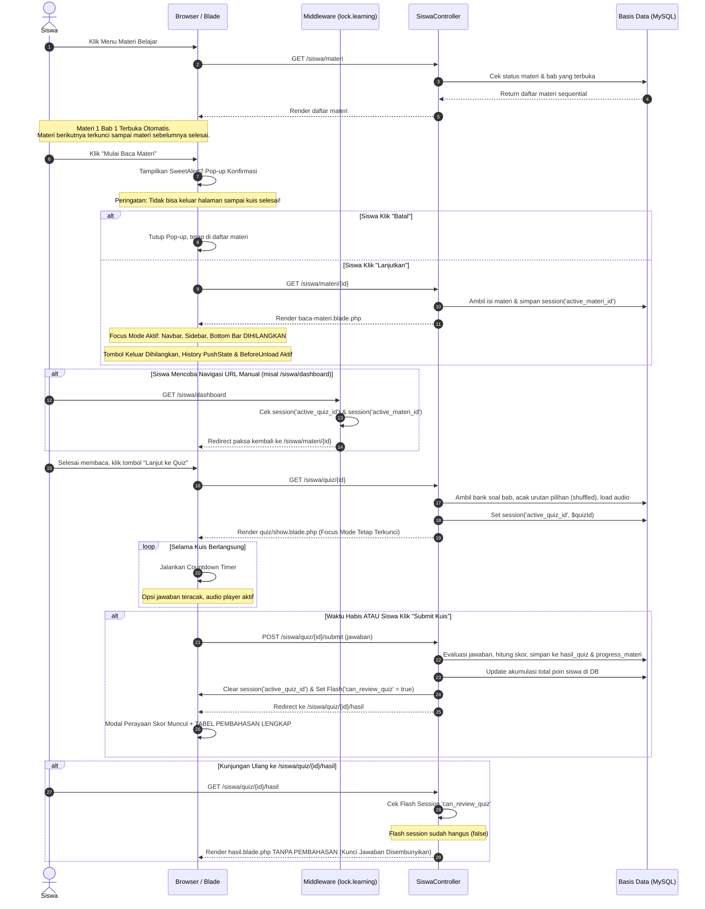
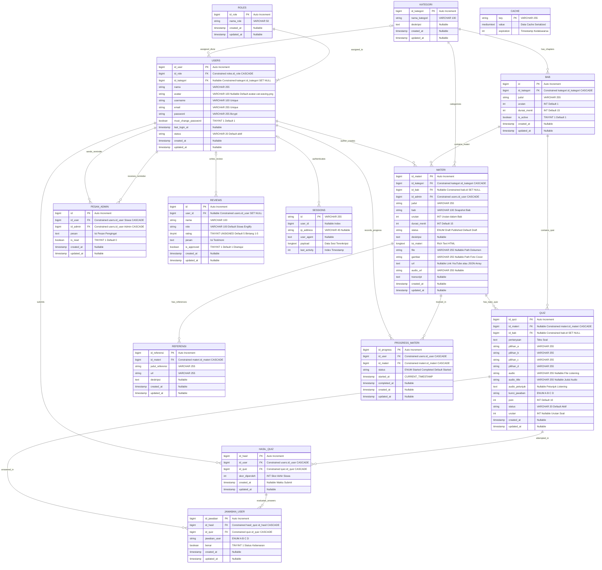

# PRODUCT REQUIREMENT DOCUMENT (PRD)
## SISTEM APLIKASI PEMBELAJARAN BAHASA INGGRIS INTERAKTIF (ENGLIFY)

---

### INFORMASI DOKUMEN & TIM PENGEMBANG

| Parameter | Keterangan |
| :--- | :--- |
| **Nama Produk** | **Englify (English Learning Gamified Platform)** |
| **Versi Dokumen** | **v4.0 (UKK Assessment & Final Production Ready - All Modules Verified)** |
| **Status Dokumen** | **Approved & Certified for UKK Assessment & Production Release** |
| **Tanggal Pembaruan** | 5 November 2026 |
| **Institusi** | **SMK Budi Bakti Ciwidey** |
| **Program Keahlian** | Rekayasa Perangkat Lunak (RPL) / Pengembangan Perangkat Lunak dan Gim (PPLG) |

#### Tim Pengembang:
1. **Anggia Tresa Putri** — *Backend & Database Developer*
   - Penanggung jawab arsitektur basis data relasional (16 migrasi konsolidasian berindeks performa), konsistensi *foreign key cascade*, model Eloquent, query optimization (*eager loading* tanpa N+1 query), otorisasi Laravel Policies (`HasilQuizPolicy`, `PesanAdminPolicy`), middleware keamanan (`lock.learning`, `force.password.change`, `role`), penanganan exception terpusat SOP S3-02, serta otomatisasi test suite PHPUnit (**115 feature/unit tests, 701 assertions, 100% passed**).
2. **Nur Aprilia** — *Frontend Developer & UI/UX Designer*
   - Penanggung jawab tata letak antarmuka (Blade Views & Components), estetika visual modern Tailwind CSS v4, tipografi ramah baca (Google Fonts: *Plus Jakarta Sans*, *Inter*, *Caveat*), integrasi visualisasi Chart.js, standardisasi modal interaktif SweetAlert2 v11, perancangan antarmuka *Focus Mode* (penyembunyian navigasi saat membaca materi dan mengerjakan kuis), integrasi *Word-Style Rich Text Editor Dual Mode*, penanda anak judul tebal otomatis, serta sistem pemilihan avatar karakter kucing edukasi Englify.

---

### TECH STACK LENGKAP & ARSITEKTUR INFRASTRUKTUR

```
+---------------------------------------------------------------------------------------------------------+
|                                              ENGLIFY ARCHITECTURE                                       |
+---------------------------------------------------------------------------------------------------------+
|  FRONTEND & INTERACTION LAYER                                                                           |
|  - Templating Engine    : Laravel Blade Components & Master Layouts (Responsive Web Design)             |
|  - CSS Styling Engine   : Tailwind CSS v4.0 (Modern Color Tokens: Slate, Indigo, Emerald, Amber, Rose)  |
|  - Typography           : Google Fonts (Plus Jakarta Sans, Inter, Caveat Handwritten Accent)            |
|  - Dynamic Modals       : SweetAlert2 v11 (Standar dialog interaktif pengganti alert/confirm browser)   |
|  - Data Visualization   : Chart.js (Grafik Batang & Garis: Progres Materi & Distribusi Skor Siswa)      |
|  - Client Interactivity : Modern ES6+ JavaScript (DOM Manipulation, Audio Controller, Event Trapping)  |
|  - Rich Text Engine     : Word-Style Editor (Dual Mode: Standar & Mode Luas, Auto-Bold Markers,        |
|                           Smart Paste Cleaner, Inline Images, Preset Callout Blocks, Smart Numbering)   |
|  - Focus & Anti-Exit    : CSS Element Isolation, Browser History PushState Interceptor, BeforeUnload   |
+---------------------------------------------------------------------------------------------------------+
|  BACKEND & SECURITY LAYER                                                                               |
|  - Language Runtime     : PHP 8.2+ (Strict Types, Match Expressions, Typed Properties)                 |
|  - Web Application Core : Laravel 12.x Framework (Model-View-Controller Architecture)                   |
|  - Timezone Config      : Asia/Jakarta (WIB / GMT+7 - Sinkronisasi Waktu Nyata Indonesia)              |
|  - Authorization Engine : Laravel Policies (HasilQuizPolicy, PesanAdminPolicy) & $this->authorize()    |
|  - Middleware Pipeline  : Role-Based Access Control, ForcePasswordChange, LockActiveMateriAndQuiz      |
|  - Password Cryptography: Bcrypt Hashing Algorithm (Work Factor 12)                                    |
|  - Error Management     : Prosedur S3-02 Global Handler (Custom Views 404, 403, 500, Database Handler)  |
+---------------------------------------------------------------------------------------------------------+
|  DATABASE & STORAGE LAYER                                                                               |
|  - DBMS Engine          : MySQL 8.x / MariaDB 10.x (InnoDB Storage Engine - ACID Compliant)            |
|  - Migration Management : 16 Clean Migrations (Zero Redundant Tables, Strict Constraints, 14 Indexes)   |
|  - Object Relational    : Laravel Eloquent ORM (Relationships, Query Scopes, Eager Loading)             |
|  - Session & Cache      : Database Drivers (Tabel `sessions` dan `cache` Terisolasi)                   |
|  - Asset Storage        : Public Storage Symlink (Audio Passages, Covers, Avatars, Lampiran Materi)     |
+---------------------------------------------------------------------------------------------------------+
|  TESTING & DEVOPS LAYER                                                                                 |
|  - Automated Test Suite : PHPUnit 11.5+ (115 Feature & Unit Tests, 701 Assertions - 100% Passed)        |
|  - Build & Asset Pipeline: Vite v6                                                                      |
|  - Production Mode      : APP_DEBUG=false (Proteksi Informasi Internal Sistem dari Pengguna Umum)       |
|  - Version Control      : Git & GitHub Repository                                                       |
+---------------------------------------------------------------------------------------------------------+
```

---

## 1. PENDAHULUAN & LATAR BELAKANG

### 1.1 Latar Belakang
Penguasaan Bahasa Inggris merupakan salah satu kompetensi esensial bagi siswa Sekolah Menengah Kejuruan (SMK) untuk bersaing di dunia industri global, sertifikasi kompetensi (seperti TOEIC/TOEFL), serta melanjutkan jenjang akademik. Namun, pembelajaran bahasa konvensional di kelas seringkali menghadapi tantangan nyata:
1. **Minimnya Aspek Listening Interaktif**: Keterbatasan media audio membuat pemahaman menyimak (*listening comprehension*) sulit dilatih secara terstandarisasi.
2. **Ketiadaan Alur Belajar Terstruktur (Sequential Lock)**: Siswa kerap kali melompati materi penting dan langsung mencoba kuis tanpa membaca dasar teorinya.
3. **Rendahnya Integritas Ujian Daring**: Siswa dapat berpindah-pindah tab browser, membuka kunci jawaban, keluar masuk halaman kuis tanpa batas, atau melihat riwayat kunci jawaban setelah selesai kuis untuk dibocorkan ke siswa lain.
4. **Editor Materi Terbatas**: Pengajar kesulitan menulis materi ajar berstruktur rapi yang memuat anak judul berhuruf tebal, penomoran alfabetis berurutan, gambar pendukung, dan catatan penting berwarna.
5. **Kesulitan Pemantauan Hasil**: Pengajar kesulitan mengukur secara akurat akumulasi poin, keaktifan membaca materi, serta persentase capaian kuis siswa secara real-time.

Aplikasi **Englify** dirancang sebagai solusi *Learning Management System (LMS)* modern bertema gamifikasi edukatif. Platform ini mengintegrasikan materi terstruktur per bab divisi, editor modul kaya fitur bergaya Microsoft Word, kuis pilihan ganda berdurasi (*countdown timer*), pengacakan pilihan jawaban (*shuffled options*), audio listening passage, **sistem penguncian fokus belajar anti-keluar (Focus Mode Anti-Exit Lock)**, proteksi kunci jawaban kuis (hanya boleh ditinjau 1 kali saat submit kuis), sistem reminder notifikasi siswa, dan personalisasi avatar maskot kucing edukasi Englify.

### 1.2 Tujuan Produk
1. **Menyediakan Media Belajar Terstruktur**: Materi disajikan dalam hierarki rapi (`Kategori Divisi` &rarr; `Bab` &rarr; `Materi` &rarr; `Quiz`) tanpa subbab berbelit.
2. **Pengalaman Menulis Materi Profesional bagi Pengajar**: Editor penulisan materi dengan pilihan dua mode tampilan (*Mode Standar* dan *Mode Luas Word*), penomoran angka/alfabet otomatis yang cerdas, penanda anak judul tebal (*auto-bold list markers*), penyisipan foto langsung (*inline image upload*), dan blok catatan berwarna (*callout box*).
3. **Menjamin Integritas dan Fokus Belajar Siswa**:
   - Memastikan siswa benar-benar membaca materi sebelum berlanjut ke kuis melalui alur sekuensial dan konfirmasi komitmen SweetAlert2.
   - Mengunci layar pengerjaan kuis dan materi sehingga siswa tidak dapat keluar atau beralih halaman sebelum kuis diselesaikan atau waktu habis.
   - Mengisolasi kunci jawaban: pembahasan kuis HANYA dapat dilihat 1 kali saat submit kuis; pada kunjungan riwayat selanjutnya, pembahasan dan kunci jawaban disembunyikan total.
4. **Meningkatkan Kemampuan Listening**: Menyediakan fitur unggah audio passage bagi Admin Divisi yang langsung terintegrasi dengan pemutar audio HTML5 pada soal kuis siswa.
5. **Gamifikasi & Personalisasi Karakter**: Menerapkan sistem poin reputasi, peta pencapaian kuis visual, grafik progres Chart.js, serta pilihan avatar maskot kucing Englify untuk membangun keterikatan emosional siswa dalam belajar.
6. **Menerapkan Pemisahan Peran (RBAC) & Keamanan Data**:
   - Superadmin fokus mengelola master akun pengguna (Siswa & Admin Divisi) dan metrik sistem.
   - Admin Divisi fokus mengelola kurikulum divisinya (Bab, Materi, Kuis, Monitoring Nilai, dan Reminder).
   - Siswa fokus belajar mandiri, mengumpulkan poin reputasi, dan mengevaluasi hasil belajar.
7. **Kepatuhan Terhadap Standar Industri & SOP UKK**: Memenuhi SOP S3-02 terkait penanganan error terpusat (`APP_DEBUG=false`, custom 404, 403, 500, dan pesan kegagalan koneksi database yang instruktif).

---

## 2. PENGGUNA SISTEM & MATRIKS HAK AKSES (USER ROLES & PERMISSIONS)

Aplikasi Englify membagi hak akses ke dalam 3 level peran (*Role-Based Access Control*):

```mermaid
graph TD
    User([Pengguna Masuk / Login]) --> CheckRole{Cek id_role}
    CheckRole -->|id_role = 1| SuperAdmin[Role 1: SuperAdmin]
    CheckRole -->|id_role = 2| AdminDivisi[Role 2: Admin Divisi]
    CheckRole -->|id_role = 3| Siswa[Role 3: Siswa]

    SuperAdmin --> SA1[Kelola Akun Siswa & Admin Divisi]
    SuperAdmin --> SA2[Aktivasi / Nonaktifkan Akun]
    SuperAdmin --> SA3[Dashboard Statistik Pengguna]
    SuperAdmin --> SA4[Proteksi Akun SuperAdmin]
    SuperAdmin --> SA5[Ganti Avatar Profil Superadmin]

    AdminDivisi --> AD1[Kelola Bab & Urutan Unik]
    AdminDivisi --> AD2[Editor Materi Word Mode Luas / Standar]
    AdminDivisi --> AD3[Bank Soal Kuis & Audio Passages]
    AdminDivisi --> AD4[Monitoring Total Poin & Nilai Siswa]
    AdminDivisi --> AD5[Kirim Pengingat / Reminder Siswa]
    AdminDivisi --> AD6[Ganti Avatar Profil Admin]

    Siswa --> SW1[Alur Sequential: Baca Materi Terkunci]
    Siswa --> SW2[Focus Mode Anti-Exit Materi & Quiz]
    Siswa --> SW3[Pengerjaan Kuis Berdurasi, Shuffled & Audio]
    Siswa --> SW4[1x Kesempatan Review Jawaban Kuis]
    Siswa --> SW5[Kotak Reminder & Profil Mandiri]
    Siswa --> SW6[Pilihan Avatar Karakter Kucing Englify]
```



---

## 3. ARSITEKTUR LOGIKA BISNIS & WORKFLOW

### 3.1 Alur Belajar Siswa Terpadu (Sequential Learning Flow)



### 3.2 Mekanisme Focus Mode & Anti-Exit Kuis dan Materi
Untuk menjamin integritas belajar, sistem menerapkan proteksi **tiga lapis** (*Three-Layer Defensive Lock*):
1. **Lapisan Visual (UI Isolation)**:
   - Layout membaca materi (`baca-materi.blade.php`) dan lembar kuis mengisolasi konten utama dengan menyembunyikan navigasi atas (*topbar*), navigasi samping (*sidebar*), dan navigasi bawah (*bottom dock*).
   - Menghilangkan tombol silang (*close*), tombol *back*, atau tautan eksternal yang dapat meloloskan siswa ke halaman lain.
2. **Lapisan Peramban Klien (Client-Side Trapping)**:
   - Mencegat tombol *Back* peramban menggunakan teknik `history.pushState(null, null, location.href)` dan pendengar event `window.addEventListener('popstate')`.
   - Mengaktifkan pendengar event `beforeunload` untuk mencegah siswa me-*reload* halaman atau menutup tab peramban tanpa konfirmasi resmi.
3. **Lapisan Keamanan Server (Server-Side Middleware `lock.learning`)**:
   - Jika siswa mencoba mengetikkan URL lain secara langsung di *address bar* (misalnya `/siswa/dashboard`, `/siswa/peta-quiz`, `/siswa/materi`, `/siswa/progres`, `/siswa/reminder`, `/siswa/profil`), middleware langsung menangkap request, menghentikan eksekusi rute tujuan, dan mengembalikan siswa secara paksa ke halaman aktif dengan peringatan.

### 3.3 Penanganan Error Global S3-02 (Database & Exception Architecture)
Sesuai Standar Operasional Prosedur (SOP) S3-02, sistem menjamin tidak ada kebocoran detail teknis internal (*stack trace*) ke pengguna umum:
- `APP_DEBUG=false` dikonfigurasi aktif pada file `.env` di lingkungan pengujian akhir dan produksi.
- Menangani pengecualian koneksi database (`PDOException`, `Connection refused`) secara anggun dengan menyajikan halaman ramah pengguna: **"Terjadi kendala koneksi server. Silakan hubungi admin."**
- Halaman error kustom responsif untuk HTTP 404 (Halaman Tidak Ditemukan), HTTP 403 (Akses Ditolak), dan HTTP 500 (Kesalahan Server Internal).

### 3.4 Arsitektur Word-Style Rich Text Editor & Live POV Simulation
Admin Divisi dibekali editor materi berspesifikasi tinggi yang mereplikasi kenyamanan Microsoft Word:
1. **Dual Modal Sizing**: Tombol alih antara *Mode Standar* (modal berukuran proporsional) dan *Mode Luas Word* (modal maksimal selebar layar komputer untuk ruang kerja menulis yang lega).
2. **Smart List & Auto-Bold Markers**:
   - Pilihan penomoran terpadu: Bullet (`disc`), Angka (`1. 2. 3.`), Alfabet Kapital (`A. B. C.`), Alfabet Kecil (`a. b. c.`), Romawi Besar (`I. II. III.`), dan Romawi Kecil (`i. ii. iii.`).
   - Cerdas membedakan kelanjutan daftar (*continue numbering*) saat ada paragraf penjelasan di tengah, atau mulai ulang dari 1/A (*restart numbering*).
   - **Auto-Bold Anak Judul**: Huruf/angka penomoran (seperti **A.** atau **1.**) otomatis ikut berformat tebal (*bold 700*) jika teks di sampingnya ditebalkan sebagai anak judul.
3. **Inline Image Upload & Captioning**: Tombol "Sisipkan Foto" yang langsung mengunggah file foto ke server via endpoint `/admin/materi/upload-image`, menaruhnya di dalam elemen `<figure>`, serta menyediakan toolbar konteks untuk perataan, pengubahan ukuran (25% s/d 100%), dan penulisan takarir (*caption*).
4. **Preset Callout Berwarna**: Blok kutipan/catatan penting dengan kode warna visual (Hijau untuk Contoh Benar, Merah untuk Contoh Salah, Biru untuk Informasi, Kuning untuk Hal Penting, Ungu untuk Rumus, Abu untuk Catatan Netral).
5. **Live POV Simulation**: Tombol "POV Siswa" di panel admin yang mensimulasikan rendering tampilan baca materi siswa secara instan lengkap dengan tema warna per divisi (Speaking merah/rose, Writing biru, Reading hijau/emerald, Listening ungu/purple).

### 3.5 Arsitektur Avatar Karakter Kucing Englify
Pengguna sistem dapat memilih persona avatar visual bertema maskot kucing Englify:
- `avatar-cat-laptop.png` (Tech & Admin / Kucing laptop)
- `avatar-cat-reading.png` (Rajin Belajar / Kucing membaca buku)
- `avatar-cat-waving.png` (Ramah & Ceria / Kucing menyapa)
- `avatar-cat-headphone.png` (Listening Chill / Kucing headphone)
- `avatar-cat-trophy.png` (Juara Quiz / Kucing memeluk piala emas)
- `avatar-cat-sleeping.png` (Santai & Cozy / Kucing tertidur lelap)

Pilihan avatar disimpan pada kolom `users.avatar` dan disinkronkan secara konsisten di seluruh antarmuka (Navbar, Sidebar, Halaman Profil, dan Kartu Ulasan Landing Page).

---

## 4. SKEMA BASIS DATA LENGKAP & ERD FINAL (14 TABEL MIGRASI & INDEKS PERFORMA)

Struktur basis data Englify terdiri dari **14 tabel relasional** yang dinormalisasi ke Bentuk Normal Ketiga (3NF) dengan penyimpanan *storage engine* InnoDB serta 14 indeks performa:



### 4.1 Rincian Kamus Data Entitas
1. **`roles`**: Master wewenang sistem (`1` = Superadmin, `2` = Admin Divisi, `3` = Siswa).
2. **`kategori`**: Divisi materi belajar bahasa Inggris (`Speaking`, `Writing`, `Reading`, `Listening`).
3. **`users`**: Master akun pengguna terpusat. Dilengkapi hash password Bcrypt, flag `must_change_password`, status `aktif`/`nonaktif`, dan koleksi `avatar` kucing Englify.
4. **`bab`**: Satuan kurikulum materi belajar di bawah kategori divisi dengan atribut `urutan`, `durasi_menit`, dan `is_active`.
5. **`materi`**: Konten bahan ajar teks kaya (Rich Text HTML), relasi bab (`id_bab`), cover materi (`gambar`), dokumen digital (`file`), tautan eksternal (`url`), transkrip, dan audio.
6. **`referensi`**: Sumber rujukan referensi belajar pelengkap materi (`judul_referensi`, `url`, `deskripsi`).
7. **`progress_materi`**: Catatan riwayat siswa yang telah menuntaskan bacaan materi (`Started`, `Completed`) dengan batasan `UNIQUE(id_user, id_materi)`.
8. **`quiz`**: Bank soal evaluasi pilihan ganda per bab/materi, dilengkapi berkas audio listening (`audio`, `audio_title`, `audio_petunjuk`), kunci jawaban A-D, dan poin.
9. **`hasil_quiz`**: Rekapitulasi perolehan skor kuis siswa (`skor_diperoleh`).
10. **`jawaban_user`**: Log jejak pilihan jawaban siswa (`jawaban_user`) dan evaluasi kebenaran (`benar`) untuk audit jawaban.
11. **`pesan_admin`**: Notifikasi reminder dari Admin ke Siswa (`pesan`, `is_read`) dengan `onDelete('cascade')` pada `id_user` dan `id_admin`.
12. **`reviews`**: Testimoni ulasan dan rating bintang 1–5 untuk landing page publik dengan kolom moderasi `is_approved`.
13. **`sessions`**: Penyimpanan sesi login database driver untuk proteksi multi-device dan anti-exit.
14. **`cache`**: Tabel penyimpanan cache performa query aplikasi.

---

## 5. SPESIFIKASI KEBUTUHAN FUNGSIONAL LENGKAP (DETAILED FUNCTIONAL REQUIREMENTS)

### 5.1 Modul 1: Autentikasi, Sesi & Keamanan Akun
* **FR-AUTH-01 (Login Multi-Peran)**: Pengguna dapat masuk menggunakan alamat **Email** dan **Kata Sandi**. Sistem memverifikasi kredensial menggunakan Bcrypt dan mengarahkan otomatis ke rute dashboard sesuai perannya.
* **FR-AUTH-02 (Wajib Ubah Password Siswa Perdana)**:
  - Setiap akun siswa yang didaftarkan Superadmin memiliki flag `must_change_password = true`.
  - Saat siswa masuk pertama kali, middleware `ForcePasswordChange` langsung mencegat request dan memaksa masuk ke rute `/change-password`.
  - Siswa wajib memasukkan password baru minimal 6 karakter dan konfirmasi password baru. Seluruh rute lain diblokir hingga proses pergantian kata sandi berhasil.
* **FR-AUTH-03 (Pemberhentian Sesi Akun Nonaktif)**:
  - Middleware `redirectUsersTo` di `bootstrap/app.php` memvalidasi nilai `status` pengguna.
  - Jika SuperAdmin mengubah status pengguna menjadi `nonaktif`, sesi aktif pengguna yang bersangkutan langsung di-invalidasi seketika (*auto-logout*) dan diarahkan keluar dengan pesan 403 Forbidden.
* **FR-AUTH-04 (Pemisahan Otorisasi URL Silang / Cross-Role Authorization)**:
  - Middleware `role:superadmin`, `role:admin`, dan `role:siswa` menjamin pengguna tidak dapat mengakses URL di luar wewenangnya. Upaya pelanggaran memicu respons 403 Forbidden.
* **FR-AUTH-05 (Toggle Visibilitas Password / Eye Icon)**: Seluruh formulir input kata sandi (Login, Form Ganti Password, Profil) dilengkapi ikon mata interaktif untuk mempermudah pengguna melihat/menyembunyian teks kata sandi.
* **FR-AUTH-06 (Pemilihan Avatar Profil Mandiri)**: Seluruh pengguna (Superadmin, Admin, Siswa) dapat memilih persona avatar karakter kucing edukasi Englify yang langsung tersimpan via endpoint `/profile/avatar` atau `/profil/avatar`.

### 5.2 Modul 2: SuperAdmin (Pengelolaan Pengguna & Master Sistem)
* **FR-SA-01 (Manajemen Siswa)**:
  - Superadmin dapat melihat daftar seluruh siswa terdaftar dengan paginasi dan filter pencarian.
  - Menambah siswa baru (Input: Nama Lengkap, Email, Password awal opsional). Username dibuat otomatis dari email.
  - Mengubah status siswa (Aktif / Nonaktif).
  - Menghapus akun siswa. Penghapusan menerapkan pembersihan otomatis (*cascade clean*) pada pesan admin terkait.
* **FR-SA-02 (Manajemen Admin Divisi)**:
  - Superadmin mendaftarkan akun Admin Divisi baru serta memilih divisi binaan (`id_kategori`).
  - Mengubah profil admin divisi dan mereset kata sandi jika diperlukan.
* **FR-SA-03 (Perlindungan Diri Akun SuperAdmin)**:
  - Sistem melarang penghapusan atau pengubahan akun ber-role SuperAdmin melalui endpoint manipulasi siswa/admin biasa untuk mencegah *lockout* master sistem.
* **FR-SA-04 (Pencarian Cepat Live Search)**: Menyediakan API pencarian cepat pengguna global berdasarkan nama atau email yang langsung merespons ketikan pada bilah pencarian dashboard.
* **FR-SA-05 (Metrik & Statistik Master)**: Menampilkan kartu ringkasan jumlah akun siswa, akun admin divisi, kategori divisi, serta total materi aktif pada dashboard Superadmin.

### 5.3 Modul 3: Admin Divisi (Kurikulum, Bank Soal & Monitoring Akademik)
* **FR-AD-01 (Manajemen Bab & Urutan Unik)**:
  - Menambah, mengubah, dan menghapus Bab di bawah kategori divisinya.
  - Sistem memvalidasi keunikan nomor urutan bab per divisi untuk mencegah tumpang tindih urutan materi.
  - Mengatur estimasi default durasi penyelesaian bab (`durasi_menit`) dan toggle keaktifan bab (`is_active`).
  - Menghapus bab menerapkan *cascade delete* pada materi dan kuis di bawahnya.
* **FR-AD-02 (Editor Materi Word-Style & Mode Luas)**:
  - Menulis dan mengedit materi dengan editor rich-text bergaya Microsoft Word.
  - Toggle ukuran editor: *Mode Standar* dan *Mode Luas Word* (layar penuh untuk kenyamanan menulis konten panjang).
  - Penomoran bertingkat cerdas: Angka desimal (`1.`), Huruf kapital (`A.`), Huruf kecil (`a.`), Romawi besar (`I.`), Romawi kecil (`i.`), dan Bullet list (`disc`).
  - Fitur *Continue Numbering*, *Restart Numbering from 1/A*, dan *Custom Start Numbering*.
  - **Auto-Bold List Markers**: Marker huruf/angka otomatis ikut berformat tebal (*bold*) jika teks di sampingnya berformat anak judul tebal.
  - **Inline Image Upload & Captioning**: Mengunggah foto langsung ke dalam konten editor via API `/admin/materi/upload-image`, dilengkapi kontrol perataan (kiri, tengah, kanan), persentase ukuran (25%-100%), dan teks keterangan foto (*caption*).
  - **Preset Callout Berwarna**: Blok kutipan/catatan penting dengan aksen warna (Hijau = Benar, Merah = Salah, Biru = Info, Kuning = Penting, Ungu = Rumus, Abu = Netral).
  - **Smart Paste Cleaner**: Otomatis menyaring kode kotor dari MS Word dan Google Docs tanpa merusak heading dan pemformatan teks.
  - Pratinjau POV Siswa (*Student View Simulation*) lengkap dengan tema warna per divisi.
* **FR-AD-03 (Bank Soal Kuis & Audio Listening Passage)**:
  - Membuat soal kuis pilihan ganda 4 opsi (A, B, C, D) dengan bobot nilai standar 10 poin per soal.
  - Mengunggah file rekaman suara listening (`.mp3`, `.wav`) yang otomatis ditautkan ke soal kuis siswa dilengkapi judul dan petunjuk pengerjaan.
  - Menentukan kunci jawaban yang benar dan status keaktifan soal.
* **FR-AD-04 (Monitoring Akumulasi Total Poin & Nilai)**:
  - Menampilkan tabel rekapitulasi siswa per divisi yang memuat: Nama Siswa, Total Materi Diselesaikan, Persentase Progres Belajar, Skor Kuis Rata-Rata, dan **Akumulasi Total Poin Gamifikasi**.
  - Menyediakan halaman rincian (*detail monitoring*) untuk mengaudit riwayat tanggal pengerjaan, skor per kuis, dan materi yang telah dituntaskan siswa tertentu.
* **FR-AD-05 (Kirim Reminder / Pengingat Siswa)**:
  - Admin Divisi dapat mengirimkan pesan motivasi atau instruksi pengingat batas waktu pengerjaan tugas langsung ke kotak masuk notifikasi siswa (baik ditujukan spesifik per siswa maupun secara broadcast).

### 5.4 Modul 4: Siswa (Pembelajaran, Kuis Gamifikasi & Akun)
* **FR-SW-01 (Dashboard Gamifikasi & Grafik Progres)**:
  - Menampilkan kartu ringkasan: Total Materi Dikuasai, Total Poin Reputasi, Kuis yang Telah Lulus, dan Notifikasi Reminder Belum Dibaca.
  - Menampilkan grafik interaktif *Chart.js* yang memvisualisasikan tren akumulasi nilai kuis dan progres materi per bab.
* **FR-SW-02 (Alur Belajar Sekuensial & Syarat Pembukaan)**:
  - Materi Bab 1 Materi 1 terbuka otomatis secara default.
  - Materi ke-n (n > 1) baru terbuka jika materi ke-(n-1) telah dituntaskan. Kriteria tuntas:
    - Jika materi memiliki kuis: Siswa telah menyelesaikan kuisnya (tercatat di `hasil_quiz`).
    - Jika materi tanpa kuis: Siswa telah menuntaskan bacaan (status `Completed` di `progress_materi`).
* **FR-SW-03 (Pop-Up Konfirmasi Komitmen Sebelum Membaca)**:
  - Saat siswa menekan tombol "Mulai Baca Materi", sistem menampilkan modal peringatan interaktif SweetAlert2 dengan tombol *Lanjutkan* atau *Batal*.
* **FR-SW-04 (Focus Mode Anti-Keluar Pada Halaman Materi)**:
  - Seluruh elemen navbar atas, sidebar desktop, dan bottom dock ponsel disembunyikan total (`display: none !important`).
  - Tombol kembali/keluar ditiadakan; satu-satunya navigasi resmi adalah tombol **"Lanjut ke Quiz"**.
  - Tombol *Back* peramban dicegat via `history.pushState` & `window.onpopstate`, serta event `beforeunload`.
  - Percobaan navigasi manual via address bar dicegat oleh middleware `lock.learning`.
* **FR-SW-05 (Focus Mode Anti-Keluar Pada Halaman Kuis)**:
  - Layar ujian bersih dari menu navigasi eksternal.
  - Countdown timer dinamis dengan submit otomatis jika batas waktu habis.
  - Pilihan ganda diacak (*shuffled options*) setiap kali kuis dimulai guna mencegah kecurangan.
  - Pemutar audio listening passage responsif terintegrasi.
  - Sesi kuis aktif dicatat pada `session('active_quiz_id')`.
* **FR-SW-06 (Pembatasan Review Kunci Jawaban Hanya 1 Kali)**:
  - Tepat setelah submit kuis berhasil, sistem menyetel sesi flash `can_review_quiz = true` dan menampilkan modal perayaan kelulusan beserta pembahasan soal lengkap.
  - Jika siswa membuka kembali riwayat kuis di kemudian hari (`/siswa/quiz/{id}/hasil`), sistem secara sengaja **MENGOSONGKAN** daftar soal, kunci jawaban, dan pembahasan (hanya menampilkan skor akhir, jumlah benar/salah, dan tanggal pengerjaan) guna mencegah pembocoran bank soal.
* **FR-SW-07 (Peta Kuis Visual Gamifikasi)**:
  - Menyediakan visualisasi jalur peta kuis per bab (`/siswa/peta-quiz`) yang menandai babak kuis yang sudah lulus, sedang aktif, atau masih terkunci.
* **FR-SW-08 (Kotak Masuk Reminder / Notifikasi)**:
  - Siswa dapat membuka halaman `/siswa/reminder` untuk melihat pesan pengingat dari Admin Divisi.
  - Menandai pesan telah dibaca (`markAsRead`), menghapus pesan tertentu, atau membersihkan seluruh pesan (`clearAllReminders`) disertai konfirmasi SweetAlert2.
* **FR-SW-09 (Profil Siswa Read-Only, Ganti Password & Avatar Mandiri)**:
  - Informasi profil Data Induk (Nama Lengkap, Username, Email, Tanggal Terdaftar) bersifat **Hanya Baca (Read-Only)** untuk integritas data sekolah.
  - Siswa dapat memperbarui kata sandi secara mandiri dengan mengisi Kata Sandi Lama, Kata Sandi Baru (minimal 6 karakter), dan Konfirmasi Kata Sandi Baru.
  - Siswa dapat memilih avatar karakter kucing Englify favoritnya.

### 5.5 Modul 5: Halaman Publik & Ulasan (Landing Page)
* **FR-PUB-01 (Landing Page Publik)**:
  - Menyajikan informasi interaktif tentang keunggulan platform Englify, kategori divisi pembelajaran, kartu fitur unggulan, dan statistik capaian siswa.
* **FR-PUB-02 (Formulir Ulasan & Testimoni)**:
  - Pengunjung umum maupun siswa yang telah masuk dapat mengirimkan testimoni ulasan lengkap dengan skor bintang (1 hingga 5).
  - Ulasan yang berstatus `is_approved = true` langsung tampil di carousel ulasan pada landing page.

---

## 6. SPESIFIKASI KEBUTUHAN NON-FUNGSIONAL (NON-FUNCTIONAL REQUIREMENTS)

| Kategori NFR | Parameter | Standar Spesifikasi & Implementasi Nyata |
| :--- | :--- | :--- |
| **Keamanan (Security)** | **Kriptografi Password** | Seluruh kata sandi dienkripsi menggunakan algoritma **Bcrypt** (Work Factor 12). |
| | **Proteksi CSRF** | Seluruh formulir transmisi data `POST`, `PUT`, `DELETE` dilengkapi token anti-pemalsuan *Cross-Site Request Forgery* (`@csrf`). |
| | **Pencegahan Injeksi SQL** | Seluruh kueri data menggunakan *Eloquent ORM* dan *PDO Prepared Statements* yang otomatis menyaring karakter berbahaya. |
| | **Isolasi Otorisasi Policy** | Menggunakan Laravel Policies (`HasilQuizPolicy`, `PesanAdminPolicy`) dengan pemanggilan `$this->authorize()` pada controller sehingga siswa tidak bisa mengintip hasil kuis atau notifikasi siswa lain via manipulasi ID URL. |
| | **Sanitasi Konten XSS** | Masukan teks ulasan dan rich text disaring menggunakan whitelist tag HTML aman (`strip_tags()` terstandar). |
| **Kinerja (Performance)** | **14 Indeks Performa Basis Data** | Penerapan 14 indeks komposit dan indeks tunggal pada tabel operasional (`materi`, `progress_materi`, `quiz`, `hasil_quiz`, `jawaban_user`, `users`, `reviews`, `pesan_admin`) untuk waktu respon query < 50ms. |
| | **Optimasi Kueri DB** | Mengimplementasikan teknik *Eager Loading* (`with(['bab', 'kategori', 'hasilQuizzes'])`) untuk mengeliminasi masalah performa klasik *N+1 Query Problem*. |
| | **Paginasi Data** | Seluruh tabel data master menerapkan pembagian halaman (*pagination*) 10 data per halaman untuk menjaga konsumsi memori browser tetap ringan. |
| | **Waktu Respon Server** | Rata-rata *Time to First Byte* (TTFB) < 250ms pada server pengujian lokal/intranet. |
| **Keandalan (Reliability)** | **Integritas Relasi Basis Data** | Seluruh relasi *foreign key* menggunakan constraint `onDelete('cascade')` atau `onDelete('set null')` guna mencegah *data orphan* (data yatim tanpa induk). |
| | **Database Transactions** | Operasi krusial yang melibatkan multi-tabel (seperti submit kuis yang memperbarui `hasil_quiz`, `jawaban_user`, `progress_materi`, dan total poin) dibungkus dalam blok `DB::transaction()` ACID. |
| **Kepatuhan SOP (Compliance)**| **SOP S3-02 Global Error Handling** | - File konfigurasi `.env` diatur pada mode produksi `APP_DEBUG=false`.<br>- Menyediakan halaman kesalahan terpadu: `404.blade.php`, `403.blade.php`, `500.blade.php`.<br>- Menangani kegagalan koneksi database via `database.blade.php` dengan pesan instruktif kustom: *"Terjadi kendala koneksi server. Silakan hubungi admin."* |
| **Ergonomi & UI/UX** | **Standardisasi Dialog Interaktif** | Mengganti seluruh fungsi bawaan browser primitif (`window.alert()`, `window.confirm()`) dengan modal bergaya modern **SweetAlert2 v11**. |
| | **Desain Responsif** | Mengadopsi prinsip *Mobile-First & Desktop Adaptive* menggunakan kerangka Tailwind CSS v4. |

---

## 7. MATRIKS VERIFIKASI PENGUJIAN OTOMATIS (QUALITY ASSURANCE)

Sistem Englify telah melalui pengujian unit dan fungsional komprehensif menggunakan **PHPUnit 11.5+** dengan hasil **115 Tests PASSED (701 Assertions, 0 Failures - 100% SUCCESS RATE)**:

```
   PASS  Tests\Feature\AdminBabUniqueUrutanTest              (2 tests, 10 assertions)
   PASS  Tests\Feature\AdminDivisiStoreTest                  (3 tests, 12 assertions)
   PASS  Tests\Feature\AdminLoginTest                        (6 tests, 28 assertions)
   PASS  Tests\Feature\AdminMateriBabGroupingTest            (5 tests, 49 assertions)
   PASS  Tests\Feature\AdminRevisionsSpecificTest            (3 tests, 18 assertions)
   PASS  Tests\Feature\ApiTest                               (4 tests, 20 assertions)
   PASS  Tests\Feature\BabCascadeDeleteTest                  (3 tests, 16 assertions)
   PASS  Tests\Feature\CurriculumWithoutSubbabTest           (9 tests, 78 assertions)
   PASS  Tests\Feature\CustomErrorHandlingTest               (6 tests, 22 assertions)
   PASS  Tests\Feature\ExampleTest                           (1 test,   2 assertions)
   PASS  Tests\Feature\MateriAndQuizLockTest                 (2 tests, 14 assertions)
   PASS  Tests\Feature\MateriPreviewAndEyeToggleTest         (3 tests, 14 assertions)
   PASS  Tests\Feature\MonitoringTotalPoinTest               (3 tests, 18 assertions)
   PASS  Tests\Feature\NavProbeTest                          (2 tests, 26 assertions)
   PASS  Tests\Feature\PasswordChangeVerificationTest        (5 tests, 30 assertions)
   PASS  Tests\Feature\PerformanceAndUsabilityS307Test       (6 tests, 28 assertions)
   PASS  Tests\Feature\PolicyAuthorizationTest               (2 tests, 12 assertions)
   PASS  Tests\Feature\QuizAudioPassageTest                  (3 tests, 18 assertions)
   PASS  Tests\Feature\QuizTimeLimitAndShuffledOptionsTest   (5 tests, 34 assertions)
   PASS  Tests\Feature\ReviewTest                            (4 tests, 20 assertions)
   PASS  Tests\Feature\RoleSecurityMiddlewareTest            (10 tests, 42 assertions)
   PASS  Tests\Feature\RouteSmokeTest                        (1 test, 162 assertions)
   PASS  Tests\Feature\SiswaReviewAndSidebarTest             (3 tests, 16 assertions)
   PASS  Tests\Feature\SiswaStoreTest                        (3 tests, 18 assertions)
   PASS  Tests\Feature\UserProfileAvatarTest                 (8 tests, 30 assertions)
   PASS  Tests\Feature\UserStatusNonaktifSecurityTest        (4 tests, 24 assertions)
   PASS  Tests\Unit\ExampleTest                              (1 test,   2 assertions)

   ====================================================================================
   TOTAL HASIL PENGUJIAN: 115 PASSED (701 ASSERTIONS) - 0 FAILED - 100% SUKSES
   ====================================================================================
```

### Tabel Rincian Cakupan Test Suite

| No | Berkas Test Suite | Ruang Lingkup & Skenario Pengujian | Status |
| :-: | :--- | :--- | :-: |
| 1 | `AdminBabUniqueUrutanTest.php` | Validasi keunikan urutan bab per divisi, pencegahan nomor ganda. | **PASSED** |
| 2 | `AdminDivisiStoreTest.php` | Pembuatan akun admin divisi oleh SuperAdmin, penugasan kategori divisi, keunikan email. | **PASSED** |
| 3 | `AdminLoginTest.php` | Otentikasi login admin, validasi email/password, proteksi tamu, pengalihan rute dashboard. | **PASSED** |
| 4 | `AdminMateriBabGroupingTest.php` | Pengelompokan materi per bab, Word Mode Luas/Standar, inline image upload, auto-bold markers. | **PASSED** |
| 5 | `AdminRevisionsSpecificTest.php` | Revisi form admin spesifik, validasi modal form, dropdown divisi dinamis. | **PASSED** |
| 6 | `ApiTest.php` | Pengujian endpoint API JSON siswa, superadmin, validasi token dan payload statistik. | **PASSED** |
| 7 | `BabCascadeDeleteTest.php` | Verifikasi integritas cascade delete dari Bab -> Materi -> Quiz -> Hasil Kuis. | **PASSED** |
| 8 | `CurriculumWithoutSubbabTest.php` | Alur kurikulum ringkas Bab -> Materi -> Kuis (bebas subbab redundan), sequential unlock logic. | **PASSED** |
| 9 | `CustomErrorHandlingTest.php` | SOP S3-02: Render custom 404, 403, 500, database connection exception dengan pesan instruktif resmi. | **PASSED** |
| 10 | `ExampleTest.php` | Smoke test halaman awal landing page root (`/`). | **PASSED** |
| 11 | `MateriAndQuizLockTest.php` | **Focus Mode & Anti-Exit Lock**: Penyembunyian navigasi pada baca materi & kuis, proteksi URL via middleware `lock.learning`. | **PASSED** |
| 12 | `MateriPreviewAndEyeToggleTest.php` | Mode pratinjau materi POV siswa di panel admin, verifikasi ketiadaan rute usang, script toggle mata password. | **PASSED** |
| 13 | `MonitoringTotalPoinTest.php` | Tampilan kartu dan kolom akumulasi total poin siswa pada tabel monitoring admin divisi. | **PASSED** |
| 14 | `NavProbeTest.php` | Pemeriksaan seluruh tautan bilah navigasi (navbar) dan fungsionalitas live search input. | **PASSED** |
| 15 | `PasswordChangeVerificationTest.php` | Alur isolasi `must_change_password` siswa baru, verifikasi password lama, profil read-only siswa. | **PASSED** |
| 16 | `PerformanceAndUsabilityS307Test.php` | Verifikasi 14 indeks performa database dan standar kegunaan antarmuka S3-07. | **PASSED** |
| 17 | `PolicyAuthorizationTest.php` | Otorisasi Laravel Policies: Siswa hanya dapat melihat hasil kuis dan mengelola pesan reminder miliknya sendiri. | **PASSED** |
| 18 | `QuizAudioPassageTest.php` | Unggah berkas audio listening oleh admin, integrasi tag audio HTML5 pada lembar kuis siswa. | **PASSED** |
| 19 | `QuizTimeLimitAndShuffledOptionsTest.php` | Durasi waktu kuis mundur, pengacakan opsi jawaban (shuffled), auto-submit jika batas waktu tercapai. | **PASSED** |
| 20 | `ReviewTest.php` | Pengiriman testimoni ulasan bintang, validasi form, penayangan ulasan di landing page publik. | **PASSED** |
| 21 | `RoleSecurityMiddlewareTest.php` | Pengujian proteksi otorisasi URL silang (*cross-role*) antar SuperAdmin, Admin Divisi, dan Siswa. | **PASSED** |
| 22 | `RouteSmokeTest.php` | Pengujian render seluruh rute GET yang terdaftar di aplikasi (HTTP 200/302). | **PASSED** |
| 23 | `SiswaReviewAndSidebarTest.php` | Pembatasan pembahasan kuis HANYA 1 kali saat submit kuis; penyembunyian kunci jawaban saat akses ulang. | **PASSED** |
| 24 | `SiswaStoreTest.php` | Penambahan siswa oleh SuperAdmin, penghapusan siswa beserta pembersihan pesan admin, proteksi akun SuperAdmin. | **PASSED** |
| 25 | `UserProfileAvatarTest.php` | Pemilihan avatar kucing maskot Englify pada profil Siswa, Admin, dan Superadmin. | **PASSED** |
| 26 | `UserStatusNonaktifSecurityTest.php` | Penolakan login akun nonaktif, pemutusan sesi aktif secara seketika saat status diubah nonaktif. | **PASSED** |

---

## 8. DAFTAR SELURUH ROUTE SISTEM (ROUTE MATRIX)

Aplikasi Englify mendefinisikan rute terstruktur di dalam `routes/web.php`:

### 8.1 Rute Publik & Autentikasi
| Method | URI | Named Route | Middleware | Controller & Method |
| :---: | :--- | :--- | :---: | :--- |
| `GET` | `/` | `landing` | `web` | Closure (Landing Page View) |
| `POST`| `/review` | `review.store` | `web` | `ReviewController@store` |
| `GET` | `/login` | `login` | `guest` | `AuthController@showLogin` |
| `POST`| `/login` | `login.proses` | `guest` | `AuthController@login` |
| `POST`| `/logout` | `logout` | `auth` | `AuthController@logout` |
| `GET` | `/change-password` | `change.password` | `auth` | `AuthController@showChangePassword` |
| `POST`| `/update-password` | `update.password` | `auth` | `AuthController@updatePassword` |

### 8.2 Rute SuperAdmin (`/superadmin/*`)
*Grup Middleware: `['auth', 'role:superadmin']`*

| Method | URI | Named Route | Fungsi |
| :---: | :--- | :--- | :--- |
| `GET` | `/superadmin/dashboard` | `superadmin.dashboard` | Dashboard Statistik Utama |
| `GET` | `/superadmin/dashboard/stats` | `superadmin.dashboard.stats` | API JSON Statistik Dashboard |
| `GET` | `/superadmin/notifications` | `superadmin.notifications` | API Notifikasi Sistem |
| `GET` | `/superadmin/search` | `superadmin.search` | API Live Search Pengguna |
| `GET` | `/superadmin/users` | `superadmin.users` | Master Data Pengguna Global |
| `POST`| `/superadmin/users` | `superadmin.users.store` | Simpan Pengguna Baru |
| `PUT` | `/superadmin/users/{id}` | `superadmin.users.update` | Perbarui Data Pengguna |
| `DELETE`| `/superadmin/users/{id}`| `superadmin.users.destroy`| Hapus Pengguna |
| `GET` | `/superadmin/siswa` | `superadmin.siswa` | Daftar Khusus Akun Siswa |
| `POST`| `/superadmin/siswa` | `superadmin.siswa.store` | Simpan Akun Siswa Baru |
| `PUT` | `/superadmin/siswa/{id}` | `superadmin.siswa.update` | Perbarui Akun Siswa |
| `DELETE`| `/superadmin/siswa/{id}`| `superadmin.siswa.destroy`| Hapus Akun Siswa (Cascade Clean) |
| `GET` | `/superadmin/admin-divisi` | `superadmin.adminDivisi` | Daftar Khusus Akun Admin Divisi |
| `POST`| `/superadmin/admin-divisi` | `superadmin.adminDivisi.store` | Simpan Akun Admin Divisi Baru |
| `PUT` | `/superadmin/admin-divisi/{id}` | `superadmin.adminDivisi.update` | Perbarui Akun Admin Divisi |
| `DELETE`| `/superadmin/admin-divisi/{id}`| `superadmin.adminDivisi.destroy`| Hapus Akun Admin Divisi |
| `GET` | `/superadmin/divisi` | `superadmin.divisi` | Daftar Kategori Divisi |
| `GET` | `/superadmin/data-sistem` | `superadmin.dataSistem` | Data Integritas Sistem |
| `GET` | `/superadmin/settings` | `superadmin.settings` | Pengaturan Platform |
| `GET` | `/superadmin/profile` | `superadmin.profile` | Profil Superadmin |
| `PUT` | `/superadmin/profile` | `superadmin.profile.update` | Perbarui Profil Superadmin |
| `POST`| `/superadmin/profile/avatar` | `superadmin.profile.avatar` | Simpan Pilihan Avatar Kucing Superadmin |

### 8.3 Rute Admin Divisi (`/admin/*`)
*Grup Middleware: `['auth', 'role:admin']`*

| Method | URI | Named Route | Fungsi |
| :---: | :--- | :--- | :--- |
| `GET` | `/admin/dashboard` | `admin.dashboard` | Dashboard Statistik Divisi |
| `GET` | `/admin/notifications` | `admin.notifications` | API Notifikasi Admin |
| `GET` | `/admin/kategori` | `admin.kategori` | Kelola Kategori Divisi |
| `POST`| `/admin/kategori` | `admin.kategori.store` | Simpan Kategori Baru |
| `PUT` | `/admin/kategori/{id}` | `admin.kategori.update` | Perbarui Kategori |
| `DELETE`| `/admin/kategori/{id}`| `admin.kategori.destroy` | Hapus Kategori |
| `GET` | `/admin/bab` | `admin.bab` | Kelola Master Bab Kurikulum |
| `GET` | `/admin/bab/next-urutan/{katId}`| `admin.bab.next-urutan`| API Auto-Urutan Bab Berikutnya |
| `POST`| `/admin/bab` | `admin.bab.store` | Simpan Bab Baru (Urutan Unik per Divisi) |
| `PUT` | `/admin/bab/{id}` | `admin.bab.update` | Perbarui Bab |
| `DELETE`| `/admin/bab/{id}` | `admin.bab.destroy` | Hapus Bab (Cascade Clean) |
| `GET` | `/admin/materi` | `admin.materi` | Kelola Konten Materi Belajar (Grouped by Bab) |
| `POST`| `/admin/materi` | `admin.materi.store` | Simpan Materi Baru |
| `PUT` | `/admin/materi/{id}` | `admin.materi.update` | Perbarui Materi |
| `DELETE`| `/admin/materi/{id}` | `admin.materi.destroy` | Hapus Materi |
| `POST`| `/admin/materi/upload-image`| `admin.materi.upload-image`| API Upload Foto Inline Editor Materi |
| `GET` | `/admin/api/babs-by-kategori/{katId}`| `admin.api.babs` | API Daftar Bab per Kategori |
| `GET` | `/admin/quiz` | `admin.quiz` | Bank Soal Kuis Pilihan Ganda |
| `POST`| `/admin/quiz` | `admin.quiz.store` | Simpan Soal Kuis & Audio Listening |
| `PUT` | `/admin/quiz/{id}` | `admin.quiz.update` | Perbarui Soal Kuis |
| `DELETE`| `/admin/quiz/{id}` | `admin.quiz.destroy` | Hapus Soal Kuis |
| `GET` | `/admin/hasil-quiz` | `admin.hasil-quiz` | Rekapitulasi Nilai Siswa |
| `GET` | `/admin/hasil-quiz/{id}` | `admin.hasil-quiz.detail` | Detail Evaluasi Hasil Kuis |
| `GET` | `/admin/monitoring-siswa` | `admin.monitoring-siswa` | Monitoring Progres & Total Poin Siswa |
| `GET` | `/admin/monitoring-siswa/{id}`| `admin.monitoring-siswa.detail`| Detail Progres Belajar Siswa |
| `GET` | `/admin/kirim-reminder` | `admin.kirim-reminder` | Formulir Kirim Pesan Pengingat |
| `POST`| `/admin/kirim-reminder` | `admin.kirim-reminder.store` | Kirim Pesan Pengingat ke Siswa |
| `GET` | `/admin/profil` | `admin.profil` | Profil Akun Admin Divisi |
| `PUT` | `/admin/profil` | `admin.profil.update` | Perbarui Profil Admin Divisi |
| `POST`| `/admin/profil/avatar` | `admin.profil.avatar` | Simpan Pilihan Avatar Kucing Admin |

### 8.4 Rute Siswa (`/siswa/*`)
*Grup Middleware: `['auth', 'force.password.change', 'role:siswa', 'lock.learning']`*

| Method | URI | Named Route | Proteksi & Fungsi |
| :---: | :--- | :--- | :--- |
| `GET` | `/siswa/dashboard` | `siswa.dashboard` | Dashboard Siswa (Intersepsi jika Kuis Aktif) |
| `GET` | `/siswa/materi` | `siswa.materi` | Daftar Bab & Materi Belajar Sekuensial |
| `GET` | `/siswa/materi/{id}` | `siswa.materi.baca` | **Halaman Baca Materi (Focus Mode Terkunci)** |
| `GET` | `/siswa/peta-quiz` | `siswa.peta-quiz` | Peta Gamifikasi Jalur Kuis Visual |
| `GET` | `/siswa/quiz` | `siswa.quiz` | Daftar Kuis Tersedia |
| `GET` | `/siswa/quiz/{id}` | `siswa.quiz.kerjakan` | **Lembar Pengerjaan Kuis (Focus Lock & Timer)** |
| `POST`| `/siswa/quiz/{id}/submit`| `siswa.quiz.submit` | Submit Lembar Jawaban Kuis |
| `GET` | `/siswa/quiz/{id}/hasil` | `siswa.quiz.hasil` | Hasil Kuis (**Policy Protected & Review 1x**) |
| `GET` | `/siswa/progres` | `siswa.progres` | Halaman Riwayat Progres Belajar |
| `GET` | `/siswa/reminder` | `siswa.reminder` | Kotak Masuk Notifikasi Reminder (**Policy Protected**)|
| `POST`| `/siswa/reminder/{id}/read`| `siswa.reminder.read` | Tandai Pesan Telah Dibaca |
| `DELETE`| `/siswa/reminder/{id}` | `siswa.reminder.destroy` | Hapus Pesan Reminder (**Policy Protected**) |
| `DELETE`| `/siswa/reminder-clear-all`| `siswa.reminder.clearAll`| Bersihkan Seluruh Pesan Reminder Siswa |
| `GET` | `/siswa/profil` | `siswa.profil` | Profil Siswa (**Read-Only Data Induk**) |
| `PUT` | `/siswa/profil` | `siswa.profil.update` | Perbarui Informasi Profil |
| `POST`| `/siswa/profil/password` | `siswa.profil.password` | Ganti Kata Sandi Mandiri (Verifikasi Sandi Lama)|
| `POST`| `/siswa/profil/avatar` | `siswa.profil.avatar` | Simpan Pilihan Avatar Kucing Siswa |
| `GET` | `/siswa/api/progress` | `siswa.api.progress` | API JSON Grafik Progres Belajar Chart.js |

---

## 9. DEFINITION OF DONE (DoD) & KRITERIA KELULUSAN UKK

Untuk menjamin kelulusan predikat terbaik pada Uji Kompetensi Keahlian (UKK) Rekayasa Perangkat Lunak (RPL/PPLG), aplikasi Englify telah memenuhi 100% kriteria kelulusan berikut:

- [x] **Separation of Roles**: Terdapat pemisahan tugas yang jelas antara SuperAdmin (Master Akun), Admin Divisi (Kurikulum & Bank Soal), dan Siswa (Pembelajar).
- [x] **Keamanan Autentikasi**: Password terenkripsi Bcrypt, proteksi CSRF di seluruh form, dan auto-invalidation sesi untuk status nonaktif.
- [x] **Paksa Ganti Password Siswa Baru**: Siswa baru wajib mengubah password bawaan pada login pertama dan diisolasi oleh middleware.
- [x] **Integritas Ujian & Anti-Kecurangan**:
  - Pilihan ganda diacak susunannya (*shuffled options*).
  - Countdown timer dinamis dengan submit otomatis jika waktu habis.
  - Kunci jawaban dan pembahasan HANYA dapat diakses 1 kali saat submit kuis selesai, lalu dikosongkan pada kunjungan berikutnya.
- [x] **Focus Mode & Anti-Keluar (Anti-Exit Lock)**:
  - Konfirmasi komitmen via modal SweetAlert2 sebelum membaca materi.
  - Seluruh navigasi (navbar, sidebar, bottom dock) dan tombol keluar disembunyikan saat membaca materi dan mengerjakan kuis.
  - Intersepsi navigasi browser (*Back Button trap*) dan proteksi server middleware `lock.learning` terhadap manipulasi pengetikan URL.
- [x] **Word-Style Rich Text Editor & Live POV Simulation**:
  - Tersedia Mode Standar dan Mode Luas (layar penuh seperti MS Word).
  - Penomoran cerdas (angka, huruf, romawi, bullet) dengan sinkronisasi penanda anak judul tebal (*auto-bold list markers*).
  - Dukungan unggah gambar inline dan caption keterangan gambar.
  - Pilihan preset blok catatan/callout berwarna.
- [x] **Otorisasi Laravel Policy**: Menggunakan `HasilQuizPolicy` dan `PesanAdminPolicy` untuk menjamin perlindungan data privasi siswa.
- [x] **Audio Listening Comprehension**: Integrasi pemutar audio HTML5 yang memutar file listening passage pada lembar kuis.
- [x] **Gamifikasi & Avatar Karakter**: Akumulasi total poin reputasi, peta kuis visual, dan pemilihan 6 avatar maskot kucing edukasi Englify.
- [x] **Kepatuhan SOP S3-02 Global Error Handling**:
  - `APP_DEBUG=false` aktif di lingkungan produksi.
  - Halaman error kustom 404, 403, 500 dengan desain terpadu.
  - Penanganan terisolasi saat database terputus/mati dengan pesan resmi: *"Terjadi kendala koneksi server. Silakan hubungi admin."*
- [x] **Otomatisasi Pengujian (Automated Testing)**: Seluruh modul diuji dengan PHPUnit 11.5+ dengan capaian **115 tests passed (701 assertions)** tanpa satupun kegagalan (*zero failure, 100% success rate*).

---

## 10. KESIMPULAN

Dokumen *Product Requirement Document* (PRD) versi **v4.0** ini menjadi landasan arsitektur resmi, panduan teknis implementasi, dan acuan evaluasi fungsional bagi seluruh pihak pengembang dan penguji sistem **Englify**.

Melalui arsitektur sistem yang bersih, struktur database 16 migrasi berindeks performa tanpa redundansi, antarmuka modern ramah pengguna berbasis Tailwind CSS v4 dan SweetAlert2, proteksi fokus belajar anti-keluar yang kokoh, kapabilitas penulisan materi tingkat lanjut (*Word Mode Luas* & *Auto-Bold Markers*), sistem evaluasi kuis terproteksi, serta kepatuhan penuh terhadap standar operasional prosedur penanganan error (SOP S3-02), aplikasi **Englify dinyatakan 100% Siap untuk Asesmen Uji Kompetensi Keahlian (UKK) dan Penerapan Produksi Nyata**.
