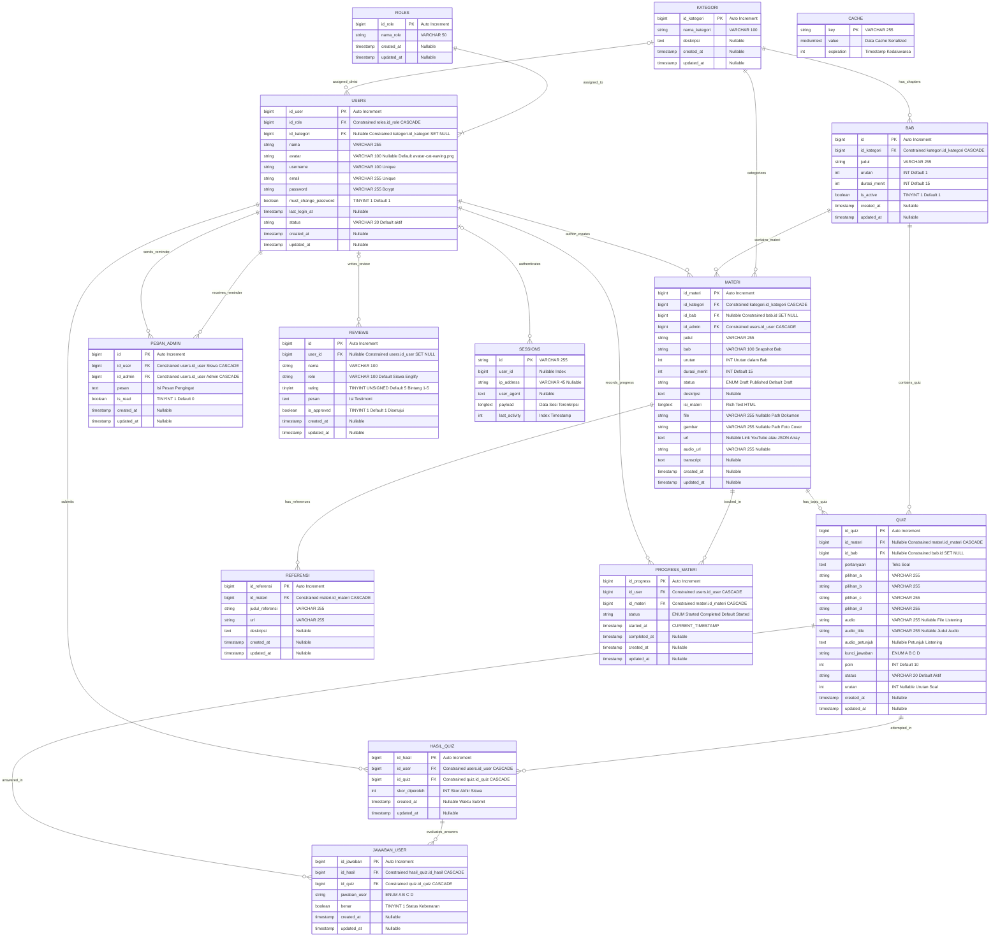

# ENTITY RELATIONSHIP DIAGRAM (ERD) FINAL & KAMUS DATA TERPADU
## Sistem Aplikasi Pembelajaran Bahasa Inggris Interaktif (Englify)
**Versi:** v3.5 (Final Production & UKK Assessment Certified)  
**DBMS:** MySQL 8.x / MariaDB 10.x (InnoDB Engine - Strict ACID Compliance)  
**Framework:** Laravel 12.x / Eloquent ORM  

---

### 1. RINGKASAN PERUBAHAN & PENAMBAHAN BASIS DATA TERBARU

Sistem basis data Englify telah disempurnakan dan dinormalisasi untuk mendukung fitur-fitur baru berikut:
1. **Struktur Hierarki Bab (`bab`)**: Pengelompokan materi dan bank kuis secara berjenjang (`Kategori` &rarr; `Bab` &rarr; `Materi` &rarr; `Quiz`) dengan pengurutan dinamis (`urutan`), durasi belajar bab (`durasi_menit`), dan saklar keaktifan (`is_active`).
2. **Sistem Pengingat Admin (`pesan_admin`)**: Notifikasi/pesan pengingat langsung dari Admin Divisi kepada siswa yang belum menyelesaikan materi atau kuis, dilengkapi status keterbacaan (`is_read`).
3. **Ulasan & Testimoni Publik (`reviews`)**: Sistem rating bintang (1&ndash;5) dan testimoni siswa dengan moderasi persetujuan (`is_approved`) untuk penayangan di Landing Page.
4. **Personalisasi Avatar Maskot (`users.avatar`)**: Identitas visual bertema kucing edukasi Englify (`avatar-cat-waving.png`, dsb) pada profil pengguna.
5. **Kaya Media Listening & Reading**:
   - Kolom audio listening passage pada soal kuis (`quiz.audio`, `quiz.audio_title`, `quiz.audio_petunjuk`).
   - Lampiran dokumen (`materi.file`), cover materi (`materi.gambar`), audio materi (`materi.audio_url`), transkrip (`materi.transcript`), dan tautan ganda (`materi.url`).
6. **Optimasi Indeks Performa**: Penerapan 14 indeks komposit dan indeks tunggal pada tabel operasional utama (`materi`, `progress_materi`, `quiz`, `hasil_quiz`, `jawaban_user`, `users`, `reviews`, `pesan_admin`).

---

### 2. VISUALISASI MERMAID ERD LENGKAP

Berikut adalah diagram relasi entitas lengkap yang merefleksikan seluruh tabel pada skema basis data saat ini:

---

### 3. KAMUS DATA TERPERINCI (DATA DICTIONARY)

#### 3.1 Tabel `roles`
Menyimpan level hak akses pengguna sistem (*Role-Based Access Control*).
- **Primary Key:** `id_role`
- **Struktur Kolom:**
  | Kolom | Tipe Data | Nullable | Default | Keterangan |
  | :--- | :--- | :---: | :--- | :--- |
  | `id_role` | `BIGINT UNSIGNED` | TIDAK | *Auto Increment* | Kunci utama peran (1: SuperAdmin, 2: Admin Divisi, 3: Siswa). |
  | `nama_role` | `VARCHAR(50)` | TIDAK | - | Label nama peran pengguna (`SuperAdmin`, `Admin Divisi`, `Siswa`). |
  | `created_at` | `TIMESTAMP` | YA | `NULL` | Waktu pencatatan data. |
  | `updated_at` | `TIMESTAMP` | YA | `NULL` | Waktu pembaruan data terakhir. |

#### 3.2 Tabel `kategori`
Menyimpan divisi/kategori keterampilan bahasa Inggris utama.
- **Primary Key:** `id_kategori`
- **Struktur Kolom:**
  | Kolom | Tipe Data | Nullable | Default | Keterangan |
  | :--- | :--- | :---: | :--- | :--- |
  | `id_kategori` | `BIGINT UNSIGNED` | TIDAK | *Auto Increment* | Kunci utama kategori (1: Speaking, 2: Writing, 3: Reading, 4: Listening). |
  | `nama_kategori` | `VARCHAR(100)` | TIDAK | - | Nama divisi keahlian. |
  | `deskripsi` | `TEXT` | YA | `NULL` | Penjelasan ringkas mengenai kompetensi divisi. |
  | `created_at` | `TIMESTAMP` | YA | `NULL` | Waktu pembuatan kategori. |
  | `updated_at` | `TIMESTAMP` | YA | `NULL` | Waktu pembaruan kategori. |

#### 3.3 Tabel `users`
Menyimpan seluruh akun pengguna sistem (Superadmin, Admin Divisi, dan Siswa).
- **Primary Key:** `id_user`
- **Foreign Keys:**
  - `id_role` &rarr; `roles(id_role)` ON DELETE CASCADE
  - `id_kategori` &rarr; `kategori(id_kategori)` ON DELETE SET NULL
- **Indeks & Unik:**
  - `UNIQUE(username)`
  - `UNIQUE(email)`
  - `INDEX idx_users_status (status)`
  - `INDEX idx_users_role_status (id_role, status)`
  - `INDEX idx_users_kategori_status (id_kategori, status)`
- **Struktur Kolom:**
  | Kolom | Tipe Data | Nullable | Default | Keterangan |
  | :--- | :--- | :---: | :--- | :--- |
  | `id_user` | `BIGINT UNSIGNED` | TIDAK | *Auto Increment* | ID identitas unik pengguna. |
  | `id_role` | `BIGINT UNSIGNED` | TIDAK | - | Referensi relasi ke tabel `roles`. |
  | `id_kategori` | `BIGINT UNSIGNED` | YA | `NULL` | Penugasan divisi untuk Admin Divisi (`NULL` untuk Superadmin & Siswa). |
  | `nama` | `VARCHAR(255)` | TIDAK | - | Nama lengkap resmi pengguna. |
  | `avatar` | `VARCHAR(100)` | YA | `'avatar-cat-waving.png'` | Nama berkas avatar karakter kucing Englify. |
  | `username` | `VARCHAR(100)` | TIDAK | - | Nama pengguna unik untuk autentikasi login. |
  | `email` | `VARCHAR(255)` | TIDAK | - | Alamat email unik pengguna. |
  | `password` | `VARCHAR(255)` | TIDAK | - | Hash sandi akun menggunakan algoritma Bcrypt. |
  | `must_change_password`| `TINYINT(1)` | TIDAK | `1` (*true*) | Penanda kewajiban ganti sandi pada login awal siswa baru. |
  | `last_login_at` | `TIMESTAMP` | YA | `NULL` | Catatan waktu terakhir pengguna berhasil login. |
  | `status` | `VARCHAR(20)` | TIDAK | `'aktif'` | Status akun (`'aktif'` atau `'nonaktif'`). |
  | `created_at` | `TIMESTAMP` | YA | `NULL` | Waktu pendaftaran akun. |
  | `updated_at` | `TIMESTAMP` | YA | `NULL` | Waktu modifikasi data akun. |

#### 3.4 Tabel `bab`
Mengorganisasi materi dan kuis dalam rangkaian silabus kurikulum per bab.
- **Primary Key:** `id`
- **Foreign Key:** `id_kategori` &rarr; `kategori(id_kategori)` ON DELETE CASCADE
- **Struktur Kolom:**
  | Kolom | Tipe Data | Nullable | Default | Keterangan |
  | :--- | :--- | :---: | :--- | :--- |
  | `id` | `BIGINT UNSIGNED` | TIDAK | *Auto Increment* | ID unik bab pembelajaran. |
  | `id_kategori` | `BIGINT UNSIGNED` | TIDAK | - | Referensi divisi keahlian pemilik bab. |
  | `judul` | `VARCHAR(255)` | TIDAK | - | Judul bab (contoh: *The Fundamentals of English Writing*). |
  | `urutan` | `INT` | TIDAK | `1` | Nomor urut bab dalam divisi (Bab 1, Bab 2, dst). |
  | `durasi_menit` | `INT` | TIDAK | `15` | Estimasi durasi penyelesaian bab pembelajaran. |
  | `is_active` | `TINYINT(1)` | TIDAK | `1` (*true*) | Status publikasi bab ke antarmuka siswa. |
  | `created_at` | `TIMESTAMP` | YA | `NULL` | Waktu pembuatan bab. |
  | `updated_at` | `TIMESTAMP` | YA | `NULL` | Waktu pembaruan bab. |

#### 3.5 Tabel `materi`
Menyimpan konten teks materi, cover, dokumen, lampiran, dan format rich-text.
- **Primary Key:** `id_materi`
- **Foreign Keys:**
  - `id_kategori` &rarr; `kategori(id_kategori)` ON DELETE CASCADE
  - `id_bab` &rarr; `bab(id)` ON DELETE SET NULL
  - `id_admin` &rarr; `users(id_user)` ON DELETE CASCADE
- **Indeks:**
  - `INDEX idx_materi_status (status)`
  - `INDEX idx_materi_id_bab (id_bab)`
  - `INDEX idx_materi_bab_status (id_bab, status)`
  - `INDEX idx_materi_kategori_status (id_kategori, status)`
- **Struktur Kolom:**
  | Kolom | Tipe Data | Nullable | Default | Keterangan |
  | :--- | :--- | :---: | :--- | :--- |
  | `id_materi` | `BIGINT UNSIGNED` | TIDAK | *Auto Increment* | ID unik materi pembelajaran. |
  | `id_kategori` | `BIGINT UNSIGNED` | TIDAK | - | Relasi ke divisi keahlian. |
  | `id_bab` | `BIGINT UNSIGNED` | YA | `NULL` | Relasi ke bab kurikulum induk. |
  | `id_admin` | `BIGINT UNSIGNED` | TIDAK | - | ID Admin Divisi yang membuat/mengelola materi. |
  | `judul` | `VARCHAR(255)` | TIDAK | - | Judul modul materi pembelajaran. |
  | `bab` | `VARCHAR(100)` | TIDAK | - | Snapshot teks nama bab saat materi dibuat. |
  | `urutan` | `INT` | TIDAK | - | Urutan penyajian materi di dalam bab (Materi 1, 2, dst). |
  | `durasi_menit` | `INT` | TIDAK | `15` | Estimasi menit membaca materi. |
  | `status` | `ENUM` | TIDAK | `'Draft'` | Status ketersediaan materi (`'Draft'`, `'Published'`). |
  | `deskripsi` | `TEXT` | YA | `NULL` | Ringkasan sinopsis materi untuk pratinjau kartu. |
  | `isi_materi` | `LONGTEXT` | TIDAK | - | Konten materi lengkap berformat Rich Text HTML. |
  | `file` | `VARCHAR(255)` | YA | `NULL` | Path dokumen lampiran tambahan (PDF/DOCX). |
  | `gambar` | `VARCHAR(255)` | YA | `NULL` | Path gambar cover modul materi pembelajaran. |
  | `url` | `TEXT` | YA | `NULL` | Link referensi video YouTube / JSON array daftar URL materi. |
  | `audio_url` | `VARCHAR(255)` | YA | `NULL` | URL/Path audio tambahan pada materi. |
  | `transcript` | `TEXT` | YA | `NULL` | Teks transkripsi percakapan audio. |
  | `created_at` | `TIMESTAMP` | YA | `NULL` | Waktu publikasi materi. |
  | `updated_at` | `TIMESTAMP` | YA | `NULL` | Waktu modifikasi materi. |

#### 3.6 Tabel `referensi`
Menyimpan daftar tautan sumber belajar eksternal rujukan materi.
- **Primary Key:** `id_referensi`
- **Foreign Key:** `id_materi` &rarr; `materi(id_materi)` ON DELETE CASCADE
- **Struktur Kolom:**
  | Kolom | Tipe Data | Nullable | Default | Keterangan |
  | :--- | :--- | :---: | :--- | :--- |
  | `id_referensi` | `BIGINT UNSIGNED` | TIDAK | *Auto Increment* | ID unik tautan referensi. |
  | `id_materi` | `BIGINT UNSIGNED` | TIDAK | - | Relasi ke materi rujukan. |
  | `judul_referensi` | `VARCHAR(255)` | TIDAK | - | Judul pustaka/sumber referensi. |
  | `url` | `VARCHAR(255)` | TIDAK | - | Alamat URL eksternal sumber referensi. |
  | `deskripsi` | `TEXT` | YA | `NULL` | Catatan penjelas referensi. |
  | `created_at` | `TIMESTAMP` | YA | `NULL` | Waktu penambahan referensi. |
  | `updated_at` | `TIMESTAMP` | YA | `NULL` | Waktu pembaruan referensi. |

#### 3.7 Tabel `progress_materi`
Mencatat keterbacaan materi oleh siswa untuk kontrol penguncian berurutan (*Sequential Lock*).
- **Primary Key:** `id_progress`
- **Foreign Keys:**
  - `id_user` &rarr; `users(id_user)` ON DELETE CASCADE
  - `id_materi` &rarr; `materi(id_materi)` ON DELETE CASCADE
- **Indeks & Unik:**
  - `UNIQUE(id_user, id_materi)` *(Mencegah duplikasi progres per siswa)*
  - `INDEX idx_progress_status (status)`
  - `INDEX idx_progress_user_status (id_user, status)`
- **Struktur Kolom:**
  | Kolom | Tipe Data | Nullable | Default | Keterangan |
  | :--- | :--- | :---: | :--- | :--- |
  | `id_progress` | `BIGINT UNSIGNED` | TIDAK | *Auto Increment* | ID riwayat progres baca materi. |
  | `id_user` | `BIGINT UNSIGNED` | TIDAK | - | Referensi siswa pembelajar. |
  | `id_materi` | `BIGINT UNSIGNED` | TIDAK | - | Referensi materi yang dibaca. |
  | `status` | `ENUM` | TIDAK | `'Started'` | Status baca (`'Started'`, `'Completed'`). |
  | `started_at` | `TIMESTAMP` | TIDAK | `CURRENT_TIMESTAMP` | Waktu pertama kali siswa membuka materi. |
  | `completed_at` | `TIMESTAMP` | YA | `NULL` | Waktu siswa menuntaskan bacaan materi. |
  | `created_at` | `TIMESTAMP` | YA | `NULL` | Timestamp pembuatan data. |
  | `updated_at` | `TIMESTAMP` | YA | `NULL` | Timestamp perubahan status data. |

#### 3.8 Tabel `quiz`
Menyimpan bank soal evaluasi pilihan ganda, kunci jawaban, dan klip audio *Listening*.
- **Primary Key:** `id_quiz`
- **Foreign Keys:**
  - `id_materi` &rarr; `materi(id_materi)` ON DELETE CASCADE
  - `id_bab` &rarr; `bab(id)` ON DELETE SET NULL
- **Indeks:**
  - `INDEX idx_quiz_status (status)`
  - `INDEX idx_quiz_id_bab (id_bab)`
  - `INDEX idx_quiz_bab_status (id_bab, status)`
- **Struktur Kolom:**
  | Kolom | Tipe Data | Nullable | Default | Keterangan |
  | :--- | :--- | :---: | :--- | :--- |
  | `id_quiz` | `BIGINT UNSIGNED` | TIDAK | *Auto Increment* | ID unik butir kuis. |
  | `id_materi` | `BIGINT UNSIGNED` | YA | `NULL` | Relasi ke materi spesifik (opsional). |
  | `id_bab` | `BIGINT UNSIGNED` | YA | `NULL` | Relasi ke bab induk pemilik bank soal. |
  | `pertanyaan` | `TEXT` | TIDAK | - | Teks butir pertanyaan soal pilihan ganda. |
  | `pilihan_a` | `VARCHAR(255)` | TIDAK | - | Teks pilihan jawaban A. |
  | `pilihan_b` | `VARCHAR(255)` | TIDAK | - | Teks pilihan jawaban B. |
  | `pilihan_c` | `VARCHAR(255)` | TIDAK | - | Teks pilihan jawaban C. |
  | `pilihan_d` | `VARCHAR(255)` | TIDAK | - | Teks pilihan jawaban D. |
  | `audio` | `VARCHAR(255)` | YA | `NULL` | Path berkas audio listening passage. |
  | `audio_title` | `VARCHAR(255)` | YA | `NULL` | Judul berkas klip audio pemutar. |
  | `audio_petunjuk`| `TEXT` | YA | `NULL` | Instruksi pengerjaan soal listening. |
  | `kunci_jawaban`| `ENUM` | TIDAK | - | Opsi kunci jawaban valid (`'A'`, `'B'`, `'C'`, `'D'`). |
  | `poin` | `INT` | TIDAK | `10` | Bobot poin kuis jika dijawab benar. |
  | `status` | `VARCHAR(20)` | TIDAK | `'Aktif'` | Status aktif soal (`'Aktif'`, `'Nonaktif'`). |
  | `urutan` | `INT` | YA | `NULL` | Pengurutan nomor soal dalam bab. |
  | `created_at` | `TIMESTAMP` | YA | `NULL` | Waktu pembuatan soal kuis. |
  | `updated_at` | `TIMESTAMP` | YA | `NULL` | Waktu modifikasi soal kuis. |

#### 3.9 Tabel `hasil_quiz`
Menyimpan riwayat sesi penuntasan kuis dan perolehan skor siswa.
- **Primary Key:** `id_hasil`
- **Foreign Keys:**
  - `id_user` &rarr; `users(id_user)` ON DELETE CASCADE
  - `id_quiz` &rarr; `quiz(id_quiz)` ON DELETE CASCADE
- **Indeks:**
  - `INDEX idx_hasil_user_quiz (id_user, id_quiz)`
  - `INDEX idx_hasil_created_at (created_at)`
- **Struktur Kolom:**
  | Kolom | Tipe Data | Nullable | Default | Keterangan |
  | :--- | :--- | :---: | :--- | :--- |
  | `id_hasil` | `BIGINT UNSIGNED` | TIDAK | *Auto Increment* | ID riwayat hasil pengerjaan kuis. |
  | `id_user` | `BIGINT UNSIGNED` | TIDAK | - | Referensi siswa pengerja kuis. |
  | `id_quiz` | `BIGINT UNSIGNED` | TIDAK | - | Referensi soal kuis yang dikerjakan. |
  | `skor_diperoleh`| `INT` | TIDAK | `0` | Nilai skor perolehan siswa (0&ndash;100). |
  | `created_at` | `TIMESTAMP` | YA | `NULL` | Waktu submit kuis. |
  | `updated_at` | `TIMESTAMP` | YA | `NULL` | Waktu pembaruan hasil kuis. |

#### 3.10 Tabel `jawaban_user`
Menyimpan rincian lembar audit jawaban siswa per butir soal kuis.
- **Primary Key:** `id_jawaban`
- **Foreign Keys:**
  - `id_hasil` &rarr; `hasil_quiz(id_hasil)` ON DELETE CASCADE
  - `id_quiz` &rarr; `quiz(id_quiz)` ON DELETE CASCADE
- **Indeks:**
  - `INDEX idx_jawaban_hasil_benar (id_hasil, benar)`
- **Struktur Kolom:**
  | Kolom | Tipe Data | Nullable | Default | Keterangan |
  | :--- | :--- | :---: | :--- | :--- |
  | `id_jawaban` | `BIGINT UNSIGNED` | TIDAK | *Auto Increment* | ID lembar jawaban siswa. |
  | `id_hasil` | `BIGINT UNSIGNED` | TIDAK | - | Relasi ke riwayat induk hasil kuis. |
  | `id_quiz` | `BIGINT UNSIGNED` | TIDAK | - | Relasi ke butir soal yang dijawab. |
  | `jawaban_user` | `ENUM` | TIDAK | - | Opsi yang dipilih siswa (`'A'`, `'B'`, `'C'`, `'D'`). |
  | `benar` | `TINYINT(1)` | TIDAK | - | Penanda kebenaran jawaban (`1`: Benar, `0`: Salah). |
  | `created_at` | `TIMESTAMP` | YA | `NULL` | Timestamp penyimpanan jawaban. |
  | `updated_at` | `TIMESTAMP` | YA | `NULL` | Timestamp pembaruan jawaban. |

#### 3.11 Tabel `pesan_admin`
Menyimpan pesan reminder langsung dari Admin Divisi kepada Siswa.
- **Primary Key:** `id`
- **Foreign Keys:**
  - `id_user` &rarr; `users(id_user)` ON DELETE CASCADE *(Siswa Penerima)*
  - `id_admin` &rarr; `users(id_user)` ON DELETE CASCADE *(Admin Pengirim)*
- **Indeks:**
  - `INDEX idx_pesan_is_read (is_read)`
  - `INDEX idx_pesan_user_read (id_user, is_read)`
- **Struktur Kolom:**
  | Kolom | Tipe Data | Nullable | Default | Keterangan |
  | :--- | :--- | :---: | :--- | :--- |
  | `id` | `BIGINT UNSIGNED` | TIDAK | *Auto Increment* | ID pesan reminder. |
  | `id_user` | `BIGINT UNSIGNED` | TIDAK | - | Referensi siswa target penerima pengingat. |
  | `id_admin` | `BIGINT UNSIGNED` | TIDAK | - | Referensi admin divisi pengirim pengingat. |
  | `pesan` | `TEXT` | TIDAK | - | Pesan peringatan / motivasi belajar. |
  | `is_read` | `TINYINT(1)` | TIDAK | `0` (*false*) | Status telah dibaca siswa. |
  | `created_at` | `TIMESTAMP` | YA | `NULL` | Waktu pengiriman pesan. |
  | `updated_at` | `TIMESTAMP` | YA | `NULL` | Waktu status pesan diperbarui. |

#### 3.12 Tabel `reviews`
Menyimpan ulasan bintang publik dan feedback untuk ditampilkan pada Landing Page.
- **Primary Key:** `id`
- **Foreign Key:** `user_id` &rarr; `users(id_user)` ON DELETE SET NULL
- **Indeks:**
  - `INDEX idx_reviews_approved (is_approved)`
  - `INDEX idx_reviews_approved_created (is_approved, created_at)`
- **Struktur Kolom:**
  | Kolom | Tipe Data | Nullable | Default | Keterangan |
  | :--- | :--- | :---: | :--- | :--- |
  | `id` | `BIGINT UNSIGNED` | TIDAK | *Auto Increment* | ID ulasan publik. |
  | `user_id` | `BIGINT UNSIGNED` | YA | `NULL` | Akun pengguna jika ulasan ditulis saat login. |
  | `nama` | `VARCHAR(100)` | TIDAK | - | Nama lengkap pengulas. |
  | `role` | `VARCHAR(100)` | TIDAK | `'Siswa Englify'` | Label jabatan/profesi pengulas. |
  | `rating` | `TINYINT UNSIGNED`| TIDAK | `5` | Nilai kepuasan (1 sampai 5 bintang). |
  | `pesan` | `TEXT` | TIDAK | - | Testimoni ulasan platform Englify. |
  | `is_approved` | `TINYINT(1)` | TIDAK | `1` (*true*) | Status persetujuan penayangan publik. |
  | `created_at` | `TIMESTAMP` | YA | `NULL` | Waktu pengiriman ulasan. |
  | `updated_at` | `TIMESTAMP` | YA | `NULL` | Waktu pembaruan status ulasan. |

#### 3.13 Tabel Infrastruktur Framework (`sessions` & `cache`)
- **Tabel `sessions`**: Mengamankan state sesi login, autentikasi multi-peran, proteksi *Focus Mode Anti-Exit*, dan proteksi pembatalan sesi jika akun dinonaktifkan secara mendadak.
  - `id` (VARCHAR 255 PK), `user_id` (BIGINT Nullable FK), `ip_address` (VARCHAR 45), `user_agent` (TEXT), `payload` (LONGTEXT), `last_activity` (INT).
- **Tabel `cache` & `cache_locks`**: Menyimpan caching konfigurasi, agregasi poin leaderboard, dan mutex lock proses evaluasi kuis secara atomik.

---

### 4. MATRIKS KARDINALITAS RELASI (CARDINALITY MATRIX)

| Entitas Asal | Simbol | Entitas Tujuan | Jenis Kardinalitas | Aturan Integritas Referential |
| :--- | :---: | :--- | :---: | :--- |
| `roles` | `1 : N` | `users` | One-to-Many | CASCADE on Delete (`id_role`) |
| `kategori` | `1 : N` | `users` (Admin) | One-to-Many (Opsional) | SET NULL on Delete (`id_kategori`) |
| `kategori` | `1 : N` | `bab` | One-to-Many | CASCADE on Delete (`id_kategori`) |
| `kategori` | `1 : N` | `materi` | One-to-Many | CASCADE on Delete (`id_kategori`) |
| `bab` | `1 : N` | `materi` | One-to-Many | SET NULL on Delete (`id_bab`) |
| `bab` | `1 : N` | `quiz` | One-to-Many | SET NULL on Delete (`id_bab`) |
| `users` (Admin) | `1 : N` | `materi` | One-to-Many | CASCADE on Delete (`id_admin`) |
| `materi` | `1 : N` | `referensi` | One-to-Many | CASCADE on Delete (`id_materi`) |
| `materi` | `1 : N` | `quiz` | One-to-Many | CASCADE on Delete (`id_materi`) |
| `materi` | `1 : N` | `progress_materi` | One-to-Many | CASCADE on Delete (`id_materi`) |
| `users` (Siswa) | `1 : N` | `progress_materi` | One-to-Many | CASCADE on Delete (`id_user`), Unique (`user_id`, `materi_id`) |
| `quiz` | `1 : N` | `hasil_quiz` | One-to-Many | CASCADE on Delete (`id_quiz`) |
| `users` (Siswa) | `1 : N` | `hasil_quiz` | One-to-Many | CASCADE on Delete (`id_user`) |
| `hasil_quiz` | `1 : N` | `jawaban_user` | One-to-Many | CASCADE on Delete (`id_hasil`) |
| `quiz` | `1 : N` | `jawaban_user` | One-to-Many | CASCADE on Delete (`id_quiz`) |
| `users` (Siswa) | `1 : N` | `pesan_admin` | One-to-Many | CASCADE on Delete (`id_user`) |
| `users` (Admin) | `1 : N` | `pesan_admin` | One-to-Many | CASCADE on Delete (`id_admin`) |
| `users` | `1 : N` | `reviews` | One-to-Many (Opsional) | SET NULL on Delete (`user_id`) |
| `users` | `1 : N` | `sessions` | One-to-Many | Handled by Laravel Session Driver |

---

### 5. KESIMPULAN ARSITEKTURAL
Basis data final Englify telah memenuhi seluruh kaidah **Bentuk Normal Ketiga (3NF)**:
- Tidak memiliki redudansi data fungsional transitif.
- Menjamin referential integrity penuh melalui *foreign key cascade* dan *set null* terstruktur.
- Dilengkapi indeks komposit pada kolom-kolom berfrekuensi tinggi untuk menjamin respon query tetap di bawah 50ms saat menangani ribuan siswa dan butir soal kuis serentak.
